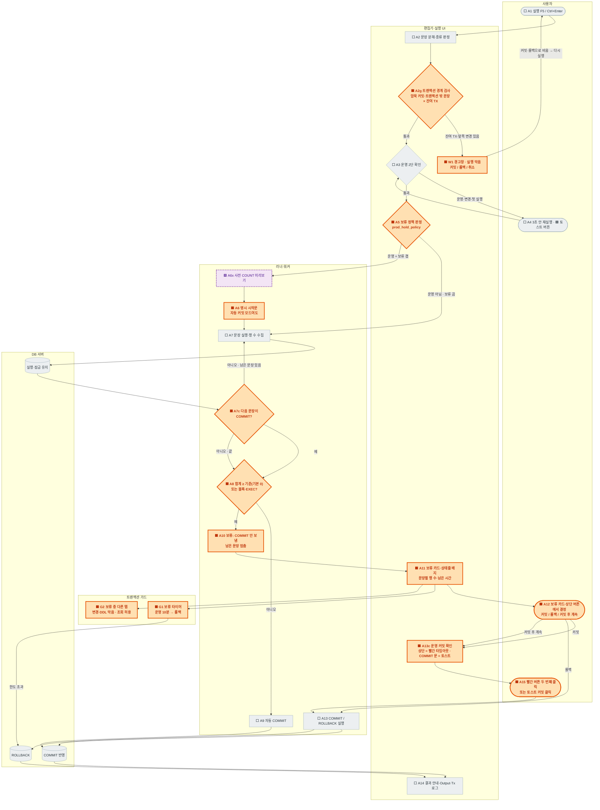
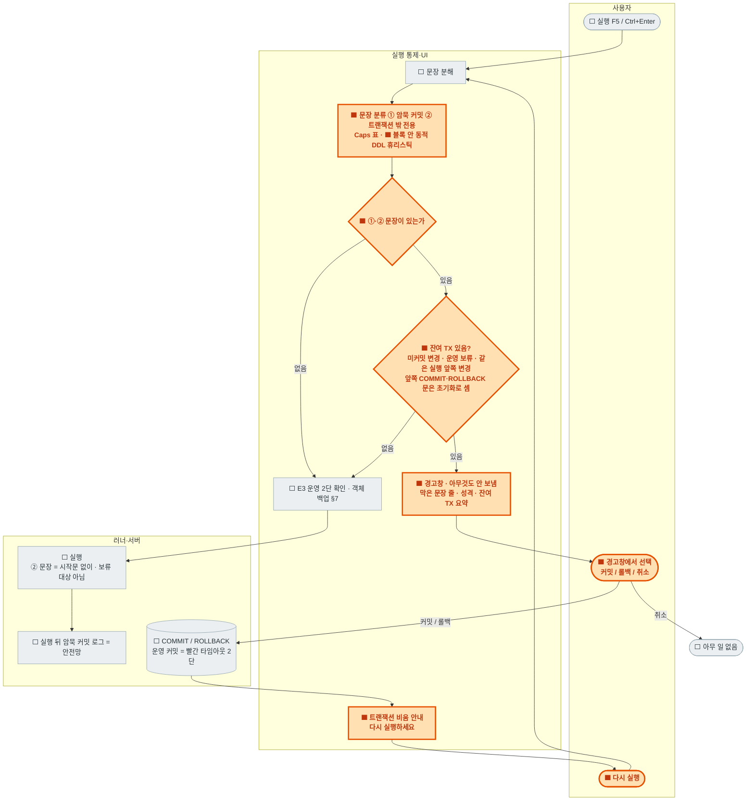
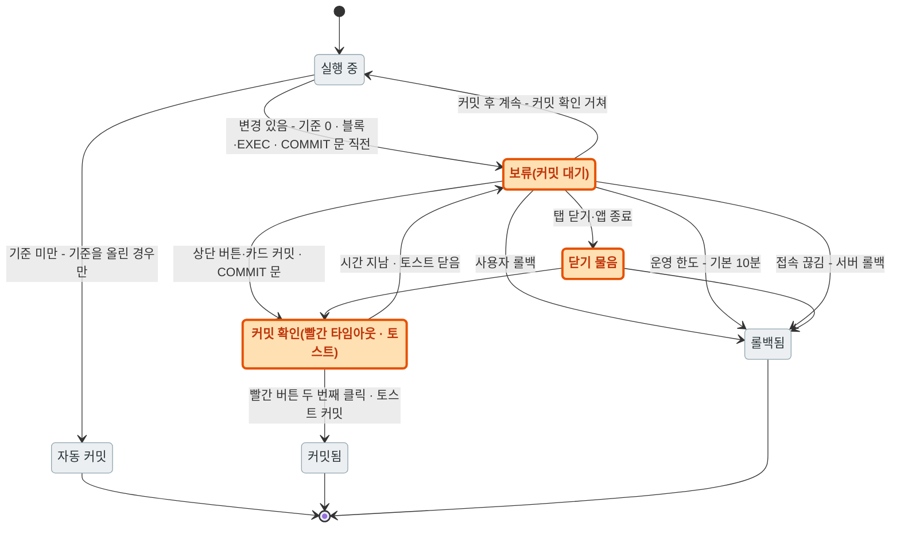
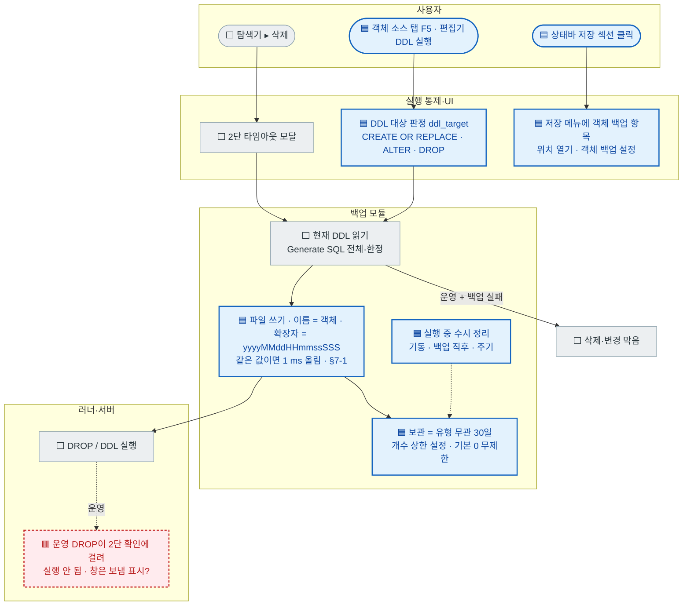

# 114 · 운영기(PRD) 변경 "보류 커밋" — 방어 장치 전수 · 기술 검토 · Activity 설계

> **요구 원문(사용자 10-15 · 1차)**: "서버타입이 운영기인 경우 데이터가 대량 수정/삭제되는 대상에 대해서 자동 Commit 모드인 경우라 하더라도 자동 Commit을 하지 않고 사용자가 다시 Commit 버튼을 눌러야 운영기에 반영이 되도록 하고 싶어 · 각 actor 기준으로 어떤 순서로 동작이 되면 좋을지 Activity를 설계하고 각 Activity에서 어떤 기능이 동작하는지 설명 · 현재 방어 로직 정리(객체 변경 백업이 정상인지 · 운영/개발 모두 동작하는지 · 백업 기간) · 그 외 예방 기법 · 추가되는 기능이 어느 시점에 적용되면 좋을지 별도 폰트/색으로 표시"
> **사용자 결정(10-15 · 2차)** = §9 표 전부 반영(D-295~D-303) — 운영 기본 보류 기준 **0 = 모든 변경 보류** · 행 수 = 실행 전체 합계 · 블록·EXEC = 행 수 무관 보류 · 보류 중 다른 탭 = 변경·DDL 막고 조회 허용 · 스크립트 안 COMMIT = 직전 판정 · **운영 COMMIT 직접 실행 = 토스트 확인 클릭 · 상단 Commit 버튼 = 빨간 타임아웃 버튼 2단** · 운영 한도 지나면 롤백 · **객체 백업 = 유형 무관 30일 · 실행 중 수시 정리 · 개수 상한 설정(기본 0 = 무제한)** · **상태바 저장 섹션 메뉴에 객체 백업 바로가기**
> **사용자 지시(10-15 · 3차)** = "특정 DBMS의 경우 DDL이 Commit 처리를 동반하는 등의 특징이 있다면 해당 동작 전에 이 상황을 경고창으로 알려주고 Transaction에 대한 처리를 통해서 잔여 TX가 없는 상태로 먼저 변경하도록 실행을 막는 방식을 도입" → **§5-2 트랜잭션 경계 가드**(D-304 · 운영·개발 모두)
> **사용자 지시(10-15 · 4차)** = "파일이름은 객체 확장자를 년월일시분초MS로 · nexa-dir3에서 이름 1차 · 확장자 2차 역순 정렬해 이름 기준 상위 5개만 남기면 최신 5개만 남길 수 있을 것" → **§7-1 백업 파일 이름·보관 운영 기준**(D-305 · 검토 결과 = 이름 규칙 채택 · dir3 정렬은 "이름 내림차순 한 키"로 보정)
> **상태** = 📐 **설계 확정 · 개발 대기**(사용자 지시) · 남은 결정 = §9-2 둘
> **조사 기준** = main `6f278b9`(10-15) 코드 정적 조사 + 실제 설정 폴더 조회(읽기만) · 실행 확인 안 한 것은 "추론"으로 표기
> **짝 문서** = [56 수동 커밋 잠금 방지](56-manual-commit-lock-prevention.md) · [34 트랜잭션 UX](34-transaction-ux.md) · [87 §14 데이터 보호 불변식](87-grid-data-editing.md) · [28 §9 객체 삭제](28-object-explorer.md) · [70 자동 저장](70-autosave-and-restore.md) · [100 §5 보수적 생성](100-object-source-run-and-output-tab.md) · [52 세션 모드·실행 통제](52-session-modes.md) · [61 §1-12 실행 통제 순서](61-core-design-and-working-rules.md)

### 표기(이 문서 전체)

| 표시 | 뜻 | 다이어그램 색 |
|---|---|---|
| ⬜ **기존** | 지금 코드에 있고 동작하는 장치 | 회색 상자 |
| 🟧 **신규 · 1단계** | 보류 커밋 본체 + 운영 커밋 확인 — 먼저 넣을 것 | **주황 · 굵은 테두리** |
| 🟦 **신규 · 2단계** | 객체 백업 확대·보관·바로가기 등 보강 | **파랑 테두리** |
| 🟪 **신규 · 3단계** | 있으면 좋은 것(선택) | **보라 점선** |
| 🟥 **결함·확인 필요** | 조사 중 발견한 빈틈·결함 후보 | **빨강 점선** |

> 다이어그램은 Mermaid(GitHub·VS Code Mermaid 확장에서 색까지 보임). 렌더러가 없으면 상자 글머리의 단계 표시(⬜ 🟧 🟦 🟪 🟥)로 같은 구분을 읽는다.

---

## 0. 결론

1. **지금 운영(PRD) 접속도 기본은 자동 커밋이다.** 운영 전용으로 커밋을 미루는 장치는 없다. 있는 것은 ① 그리드 편집 금지 ② 데이터를 바꾸는 문장의 "3초 안 재실행" 2단 확인 ③ 미커밋 트랜잭션 경고·자동 롤백 한도의 운영 강화값 ④ 탐색기 **DROP**의 사전 DDL 백업(운영에서 백업 실패 = 삭제 안 함)이다.
2. **설계(확정)**: 운영 접속에서 데이터를 바꾸는 실행은 자동 커밋 모드여도 **명시 트랜잭션 안에서 실행**하고, **기본으로 모두 보류**한다(기준 행 수 0 · D-295). 보류된 변경은 **사용자가 Commit을 눌러야** 반영되며, 운영 Commit은 **상단 버튼 = 빨간 타임아웃 버튼 2단 · 편집기의 COMMIT 문 = 토스트 확인 클릭**을 거친다(D-300). 운영 한도(기본 10분)가 지나면 **롤백**한다(D-301).
3. **객체 변경 백업은 지금 요구와 다르다.** 백업이 생기는 것은 **탐색기 ▸ 삭제(DROP)뿐**이고 이름 시각은 **초까지**, 보관은 파일 스냅숏과 같은 `project.backup_days` **7일**이다. 설계 = F5 재생성·ALTER·편집기 DDL까지 백업 · 이름에 밀리초 · **유형 무관 30일 보관 + 실행 중 수시 정리 + 개수 상한(기본 0 = 무제한)**(D-302) · **상태바 저장 메뉴에 객체 백업 바로가기**(D-303).
4. **결함 후보 3**(🟥 · §2): 운영 탐색기 DROP이 2단 확인에 걸려 첫 호출에서 **실행 안 되고 "보냄"으로 표시**될 수 있음(추론) · 백업 파일 이름 충돌(같은 초) · 2단 확인 토스트에 버튼이 없음.
5. **트랜잭션 경계 가드(D-304 · 3차 지시)**: 실행 **전에** 문장을 분류해 ① 암묵 커밋 문장(Oracle·MySQL의 DDL 등 — 앞 미커밋분까지 커밋) ② 트랜잭션 안에서 실행할 수 없는 문장(PG `VACUUM`·`CREATE DATABASE` 등)이 **잔여 트랜잭션(미커밋 변경 · 운영 보류)이나 같은 실행 안 앞쪽 변경**과 만나면 **경고창으로 알리고 실행을 막는다** · 사용자가 경고창에서 커밋(운영 = 빨간 타임아웃 2단)·롤백으로 **트랜잭션을 비운 뒤 다시 실행**한다 · 운영·개발 모두 적용. 지금 코드는 같은 판정(`Dialect::implicit_commit`)을 **실행 뒤 로그**로만 쓴다.

---

## 1. 현재 방어 장치 전수(⬜ 기존)

| # | 장치 | 언제(시점) | 대상 | 운영 전용? | 설정 · 기본 | 코드 위치 |
|---|---|---|---|---|---|---|
| E1 | **그리드 편집 금지** | 결과 도착·유형 변경 때 판정 | 결과 그리드 셀 편집·행 추가/삭제 | ✅ 운영만 | 없음(우회 불가) · 문구 "읽기 전용: 운영(PRD) 접속입니다" | `grid.rs:1114-1139` `edit_prepare` · `set_prod` 1214 |
| E2 | **유형 변경 즉시 재판정** | 유형을 바꾼 순간(재실행 없이) | 열린 결과 그리드 | ✅ | — | `app/grid_results.rs:1261` `announce_env_change` · 진입점 5 |
| E3 | **운영 2단 실행** | 실행 직후 · 서버로 보내기 전 | 조회가 아닌 모든 문장(DML · DDL · PL/SQL 블록 · EXEC · `CONNTYPE`) — `SELECT/WITH/EXPLAIN/SHOW/DESC/VALUES/PRAGMA/USE`와 클라이언트 명령만 제외 | ✅ | `run.prod_confirm` 켬 · 재실행 창 **3초 하드코딩** | `sessions.rs:1174` `prod_confirm_needed` · `app/run.rs:284-298` |
| E4 | **운영 해제 2단 확인** | 유형을 PRD → 다른 값으로 바꿀 때 | 세션 메뉴 · 팔레트 · `CONNTYPE` | ✅ | `run.prod_confirm` 공유 · 빨간 [실행] 버튼 토스트 | `sessions.rs:1151` · `app/drop.rs:382-421` |
| E5 | **유형 표시** | 늘 | 상태줄 칩(PRD = 빨강) · 로그인 목록 `· PRD` · 임시 변경 = 외곽선 칩 | ✅ | `statusbar.env_badge` 켬 | `app/paint.rs:365-389` · `conn_win.rs:2894` |
| E6 | **미커밋 경고·자동 처리(L2)** | 미커밋 트랜잭션이 남아 있는 동안 주기 | 수동 커밋 모드의 열린 트랜잭션 | 운영 = 더 엄격 | `tx.prod_stale_min` 5 · `tx.prod_idle_limit_min` 10 · `tx.idle_action` rollback · 카운트다운 60 s | `sessions.rs:987` `tx_limits_for` · `app/tx.rs:258` |
| E7 | **조회만 한 트랜잭션 종료(L1)** · 막힘 감지(L3) · 서버 안전망(L4) | 결과 수신 뒤 · 30 s 주기 · 접속 직후 | 수동 커밋 모드 | 공통 | `tx.read_end` auto · `tx.block_poll_secs` 30 · `tx.server_idle_timeout_secs`/`lock_wait_timeout_secs` 0 | [56](56-manual-commit-lock-prevention.md) |
| E8 | **그리드 편집 데이터 보호 불변식** | 그리드 변경 적용 때 | 자동 생성 UPDATE/DELETE | 공통(운영은 E1로 진입 불가) | 끌 수 없음 | `nsql-run/src/lib.rs:1196-1391` `apply_changes` |
| E9 | **객체 삭제 모달 + 2단 타임아웃 버튼** | 탐색기 ▸ 삭제… | DROP | 공통 | `login.delete_confirm_ms` 5000 | `drop_win.rs:199-216` · `app/drop.rs` |
| E10 | **DROP 전 DDL 백업** | E9 확인 직후 · DROP 전 | 탐색기에서 지우는 객체 | 공통(실패 처리만 다름) | `explorer.drop_backup` 켬 · 보관 `project.backup_days` 7 | `backups.rs:68-162` · `app/drop.rs:180-274` |
| E11 | **DROP 보수형 문장** | DROP 문 생성 | CASCADE/PURGE 없음 | 공통 | — | D-241 · `app/drop.rs:7` |
| E12 | **문지기 `gate_open`** | 모든 실행 진입점 | 세션 하나 = 한 번에 한 작업 | 공통 | — | `app/run.rs:244` · [52](52-session-modes.md) |
| E13 | **서버 상태 판정** | 실행 직전 | 끊긴 끝점에 보내지 않음 · Import 시작 막기 | 공통 | — | `app/run.rs:307` · `app/events.rs:776` |
| E14 | **활성 탭 바뀜 검사** | 파일 실행 직전 | 다른 접속으로 실행되는 것 방지 | 공통 | — | `app/files.rs:774` |
| E15 | **미커밋 탭 닫기 물음** | 탭·창 닫을 때 | 열린 트랜잭션 | 공통 | `tx.close_action` ask | `app/files.rs:149` |
| E16 | **버튼 연타 차단** | 버튼·툴바 클릭 | 같은 대상 빠른 두 번째 클릭 | 공통 | `ui.click_guard_ms` 350 | nexa-ctl `Button` |
| E17 | **상태바 저장 섹션 메뉴** | 상태줄 자동 저장 항목 클릭 | 프로젝트 폴더 열기 · 일반 파일 자동 저장 위치 열기 · 자동 저장 설정 · 프로젝트 저장 | 공통 | — | `app/menus.rs:70` `open_autosave_menu` |

### 1-1. 질문 확인 — "객체 변경 백업이 정상 반영되는가"

| 질문 | 확인 결과 | 근거 |
|---|---|---|
| 어떤 변경에 백업이 생기나 | **탐색기 ▸ 삭제(DROP)만**. 객체 소스 탭 F5(CREATE OR REPLACE) · ALTER · 편집기에서 직접 친 DDL은 백업 **없음** | `backups::write_drop` 호출처 = `app/drop.rs` 하나 |
| 시각 형식 | 파일 이름 = `<프로필>_<스키마>.<이름>_<종류>_<yyyymmdd>-<HHMMSS>.sql` = **초까지**(밀리초 없음) · 파일 머리 주석에만 `YYYY-MM-DD HH:MM:SS.mmm` | `backups.rs:95-120` |
| 같은 초 두 번 | 이름이 같아 **덮어씀**(tmp → rename) | `backups.rs:126-133` |
| 위치 | `<설정 폴더>/backups/drop/` | `backups.rs:68` |
| 운영·개발 모두? | **백업 생성은 모든 유형**(`explorer.drop_backup` 켬) · 다른 것은 실패 처리 = 운영 → 삭제 막음 · 그 밖 → "백업 없이 삭제" 재확인 | `app/drop.rs:252-274` |
| 보관 기간 | `project.backup_days`(기본 **7일** · 1~365) = 파일 탭 미저장 스냅숏과 **같은 키** · **기동 때와 백업 직후에만** 정리 · 개수 상한 없음 | `nsql-settings lib.rs:3617` · `backups.rs:138` · `app/event_loop.rs:151` |
| 실제 동작 기록 | 10-01 격리 홈 실기 ✓(개발 접속 백업 생성 · 백업 끔 · 운영 + 백업 실패 = 삭제 막음) · **운영 + 백업 성공 + 2단 실행 켬 조합은 시험한 적 없음** · 이 PC 실제 설정 폴더에는 `backups/drop/` 폴더가 아직 없음(실제 삭제를 한 적 없음) | [journal 09-30 §9](journal/2026-09-30.md) · 폴더 조회 |
| 자동 시험 | `write_drop` 단위 시험·E2E **없음**(DROP 문 생성 시험만) | `backups.rs` 시험 1개 = 파일 스냅숏 |

---

## 2. 빈틈·결함 후보(🟥)

| # | 내용 | 영향 | 설계 조치 |
|---|---|---|---|
| G1 | **운영 접속도 자동 커밋** · 변경 문장이 2단 확인(E3) 한 번만 지나면 즉시 영구 반영 | 이번 요구의 본체 | 🟧 보류 커밋(§5) |
| G2 | **영향 행 수 기준·WHERE 없는 UPDATE/DELETE 감지 없음** | 실수 1회 = 전체 행 변경 | 🟧 운영 기본 = 모두 보류(D-295)로 해소 · 기준을 올린 경우를 위해 WHERE 없음 판정은 유지 |
| G3 | **객체 변경 백업 = DROP만**(F5 재생성·ALTER 없음) | 운영 프로시저를 덮어쓰면 원본 소실 | 🟦 §7 |
| G4 | 백업 파일 이름 **밀리초 없음 · 같은 초 덮어씀** | 연속 작업 시 앞 백업 소실 | 🟦 §7 |
| G5 | 객체 백업 보관이 파일 스냅숏과 **같은 키 7일** · 실행 중 정리 없음 · 개수 상한 없음 | 운영 백업이 1주 뒤 사라짐 | 🟦 D-302 |
| G6 | **운영 탐색기 DROP**이 `run_text_in`을 지나 E3에 걸림 → 첫 호출은 무장만 하고 반환하는데 삭제 창은 "보냄"(`DropSent`) 표시 · 백업 파일은 이미 생김 | 사용자는 지워졌다고 오인 | 🟥 1단계와 함께 재현 E2E → 수정(`app/drop.rs:314-322` · **추론**) |
| G7 | E3 재실행 창 3초 **하드코딩** · 토스트에 버튼 없음 | 마우스 사용자에게 어려움 | 🟦 버튼 + 설정 |
| G8 | 프로필 영속 유형 변경(`set_profile_env`)에는 2단 확인 없음 | 저장된 운영 프로필을 한 번에 개발로 | 🟦 E4와 같은 길 |
| G9 | `tx.smart_commit`은 **첫 DML이 이미 커밋된 뒤** 전환 · 유형 무관 | 운영 보호에는 못 씀 | 운영은 보류 커밋이 대신 · smart_commit은 그대로 |
| G10 | 대량 적재(Import) · CLI `nsql run`의 운영 보호 = 끊긴 끝점 검사뿐 | 운영에 대량 INSERT가 바로 반영 | 🟪 Import 운영 확인 · CLI는 별도 설계 |

---

## 3. 기술 검토 — "커밋 전에 행 수를 알 수 있는가"

### 3-1. DBMS별 지금 동작

| DBMS | 서버 자동 커밋 | 자동 커밋 모드에서 행 수 도착 시점 | 수동 모드 시작문 | DDL 성질 |
|---|---|---|---|---|
| Oracle | **없음**(러너가 COMMIT을 보냄) | **커밋 전**(러너가 결과 받은 뒤 COMMIT) | 없음(첫 DML이 시작) | **DDL = 암묵 커밋**(앞 미커밋분도 커밋) |
| PostgreSQL | 있음 | **커밋 뒤**(서버가 문장마다 커밋) | `BEGIN` | DDL 트랜잭션 가능 |
| SQL Server | 있음 | 커밋 뒤 | `BEGIN TRANSACTION` | 대부분 트랜잭션 가능 |
| MySQL | 있음 | 커밋 뒤 | `START TRANSACTION` | **DDL = 암묵 커밋** |
| SQLite | 있음 | 커밋 뒤 | `BEGIN` | 트랜잭션 가능 |

근거 = `nsql-core/src/caps.rs:108-181`(`server_autocommit`·`tx_begin`) · `nsql-run/src/lib.rs:2644-2662`(`autocommit_needs_commit`).

### 3-2. 방식 비교

| 방식 | 내용 | 판정 |
|---|---|---|
| **A. 운영 = 명시 트랜잭션 + 사후 판정** | 운영 접속의 변경 실행 앞에 시작문을 보내고, 실행 합계 행 수로 **기준 미만 = 자동 COMMIT · 기준 이상 = 보류** · 기준 0 = 늘 보류 | 🟧 **채택**(D-295 기준 0 = 방식 D와 같은 결과 · 기준을 올리면 "대량만 보류"로 바뀜) |
| B. 사전 COUNT(*) | 같은 WHERE로 `SELECT COUNT(*)`를 먼저 | 🟪 3단계 미리보기 보조로만(WHERE 추출 한계) |
| C. 실행 계획 추정 | EXPLAIN 예상 행 수 | 채택 안 함(부정확) |
| D. 운영 = 늘 수동 커밋 | 자동 커밋 끄기 | A의 기준 0으로 흡수 |

### 3-3. 방식 A의 기술 쟁점과 처리(확정)

| 쟁점 | 처리 | 결정 |
|---|---|---|
| 행 수 단위 | **실행 한 번(스크립트 전체) 합계** · 카드에 문장별 목록 | D-296 |
| 여러 문장 스크립트 | 합계가 기준을 넘는 문장에서 **멈추고 보류**(기준 0 = 첫 변경 문장 뒤가 아니라 **실행 끝 또는 COMMIT 직전**에 멈춤 · 아래 행) | D-296 |
| 스크립트 안 사용자 `COMMIT` | **그 COMMIT 직전에 판정** · 기준 이상(기준 0 = 변경이 있었으면 늘)이면 **COMMIT을 보내지 않고 멈춤** → 토스트 확인(D-300) | D-299 |
| PL/SQL 블록·EXEC·CALL | 행 수가 정확히 오지 않으므로 **행 수와 무관하게 보류** | D-297 |
| DDL(Oracle·MySQL 암묵 커밋) · 트랜잭션 밖 전용 문장 | **§5-2 트랜잭션 경계 가드** = 잔여 TX(보류 포함)나 같은 실행 앞쪽 변경이 있으면 **경고창 + 실행 막음** → 커밋/롤백으로 비운 뒤 다시 실행 · 잔여가 없으면 지금처럼 E3 2단 확인 + 객체 백업(§7) · ② 문장은 보류 대상이 아님(시작문 없이 실행) | D-298 · **D-304** |
| 잠금 | 보류 = 행 잠금 유지 → L2 타이머 운영 한도(`tx.prod_idle_limit_min` 10) · **한도 지나면 롤백**(커밋 자동 처리 금지) · L3 막힘 표시 | D-301 |
| 같은 연결의 다른 탭 | 보류 중 **변경·DDL 실행 막음 · 조회 허용** · 커밋/롤백은 어느 탭에서나 | D-298 |
| 운영 COMMIT 확인 | 상단(툴바) Commit 버튼 = **빨간 타임아웃 버튼**(첫 클릭 = 무장 · 빨강 + 남은 시간 · 시간 안 두 번째 클릭 = 커밋 · 지나면 원래대로) · 편집기 `COMMIT` 문 = 실행 멈추고 **토스트의 빨간 [커밋] 버튼 클릭** 필요 · 보류 카드 [커밋] = 상단 버튼과 같은 타임아웃 2단 · ROLLBACK = 확인 없음 | D-300 |
| 접속 끊김 | 서버가 롤백 → 카드·로그에 "끊김 = 서버 롤백됨" | 설계 |
| 탭 닫기·앱 종료 | 기존 `tx.close_action` 물음 · 운영 보류는 늘 물음 | 설계 |
| 그리드 편집 | 운영은 E1로 막힘 그대로 | 🟪 3단계 선택 = 운영 그리드 편집 허용 + 늘 보류 |

---

## 4. Actor

| Actor | 실체 | 책임 |
|---|---|---|
| **사용자** | 사람 | 실행 · 확인 · 커밋/롤백 결정 |
| **편집기·실행 UI** | `App`(`app/run.rs` · 툴바 · 상태줄 · 토스트 · 카드) | 진입 · 안내 · 버튼 |
| **실행 통제(문지기)** | `gate_open` · `prod_confirm_needed` · 🟧 `prod_hold_policy` · 🟧 `prod_commit_guard` | 보낼지 · 2단 확인 · 보류 정책 · 커밋 확인 |
| **러너·워커** | `nsql-run` `Runner` · `worker.rs` | 문장 분해 · 시작문 · 실행 · 행 수 수집 · COMMIT/보류 |
| **DB 서버** | Oracle · PG · SQL Server · MySQL | 실행 · 잠금 · 커밋/롤백 |
| **트랜잭션 가드** | L1~L4 · `tx_guard_tick` | 보류 시간 감시 · 자동 롤백 |
| **백업 모듈** | `backups.rs` · Generate SQL DDL | 객체 변경 전 원본 저장 · 보관 정리 |

---

## 5. Activity — 운영 접속 "데이터를 바꾸는 실행" 전체 흐름



### 5-1. Activity별 기능 설명

| Activity | 표시 | Actor | 하는 일 | 쓰는 부품·설정 |
|---|---|---|---|---|
| A1 실행 | ⬜ 기존 | 사용자 | F5 / Ctrl+Enter / 툴바 실행 | `run_text_in` |
| A2 문장 분해·판정 | ⬜ 기존 | UI | 문장으로 나누고 변경 없는 `CONNTYPE`을 거름 | `run_needed_items` |
| **A2g 트랜잭션 경계 검사** | 🟧 1단계 | 문지기 | 실행할 문장 중 ① 암묵 커밋 ② 트랜잭션 밖 전용 문장이 있고, 세션에 잔여 TX(미커밋 변경 · 운영 보류)가 있거나 같은 실행 안에서 그 앞에 변경 문장이 있으면 → **아무것도 보내지 않고 W1** · 운영·개발 모두 | 순수 함수 `tx_boundary_guard` · `Dialect::implicit_commit` 확장 · §5-2 · D-304 |
| **W1 경고창** | 🟧 1단계 | UI·사용자 | 모달 경고창 = 막은 문장(줄 번호) · 성격(①/②) · 잔여 TX 요약 · [커밋](운영 = 빨간 타임아웃 2단) [롤백] [취소] · 처리 뒤 자동 실행하지 않고 "다시 실행하세요" | §5-2 |
| A3 운영 2단 확인 | ⬜ 기존 | 문지기 | 운영 + 조회 아닌 문장 → 첫 실행은 무장만 | `run.prod_confirm` · `prod_armed` |
| A3b 토스트 버튼·창 설정 | 🟦 2단계 | UI | 토스트에 빨간 [실행] 버튼 · 3초 → 설정 `run.prod_confirm_ms` | `Toasts::push_button` |
| **A5 보류 정책 판정** | 🟧 1단계 | 문지기 | 운영 + `tx.prod_hold` 켬 + 변경 문장 → 보류 경로 | 순수 함수 `prod_hold_policy`(MC/DC 시험) |
| A6x 사전 COUNT | 🟪 3단계 | 러너 | 단순 UPDATE/DELETE의 예상 행 수를 2단 확인 문구에 | 87 §14 guard 재사용 |
| **A6 명시 시작문** | 🟧 1단계 | 러너 | 이 실행 한 번을 트랜잭션으로(PG `BEGIN` · MSSQL `BEGIN TRANSACTION` · MySQL `START TRANSACTION` · Oracle = 러너 COMMIT 보류만) | `caps.tx_begin` · `manual_begin_sql` 재사용 |
| A7 실행·행 수 | ⬜ 기존 | 러너·서버 | 문장 실행 · `rows_affected` 합산 | `RunEvent::Done` |
| **A7c COMMIT 직전 판정** | 🟧 1단계 | 러너 | 스크립트 안 `COMMIT` 문을 만나면 보내기 전에 A8로 | nsql-script 문장 종류 · D-299 |
| **A8 기준 판정** | 🟧 1단계 | 러너 | 합계 행 수 ≥ `tx.prod_hold_rows`(기본 **0**) **또는** 블록·EXEC·CALL → 보류 | D-295 · D-296 · D-297 |
| A9 자동 COMMIT | ⬜ 기존(경로만 이동) | 러너 | 기준 미만(기준을 올린 경우만) = 바로 COMMIT | `autocommit_needs_commit` |
| **A10 보류** | 🟧 1단계 | 러너 | COMMIT 안 보냄 · 남은 문장 멈춤 · 세션 `tx_open` + 보류 표식 `Sess.prod_held` | `tx_left_open` 확장 |
| **A11 보류 카드** | 🟧 1단계 | UI | 주황 카드 "운영 · 커밋 대기 · N행(문장별) · 남은 시간" + [커밋] [롤백] [커밋 후 계속] · 상태줄 PRD 칩 옆 "보류 N행" · 상단 Commit 강조 | 실행 카드 스택 · `tx.badge` |
| **G1 보류 타이머** | 🟧 1단계 | 가드 | 운영 한도 `tx.prod_idle_limit_min` 지나면 **롤백**(카운트다운 카드 · 커밋 자동 처리 금지) | `tx_guard_tick` · D-301 |
| **G2 보류 중 다른 탭** | 🟧 1단계 | 문지기 | 같은 연결의 다른 탭 = 변경·DDL 막음 · 조회 허용 · 같은 탭 DDL = A2g 경고창(§5-2) | `gate_open` 확장 · D-298 |
| **A12 사용자 결정** | 🟧 1단계 | 사용자 | 커밋 · 롤백 · 커밋 후 계속(남은 문장 이어 실행 = 다시 판정) | 카드 · 툴바 · 상태줄 팝업 |
| **A13c 운영 커밋 확인** | 🟧 1단계 | UI | **상단 Commit 버튼 = 빨간 타임아웃 버튼**(첫 클릭 = 무장 + 남은 시간 · 두 번째 클릭 = 커밋 · 시간 지나면 원래대로) · 보류 카드 [커밋]도 같은 2단 · **편집기 `COMMIT` 문 = 토스트의 빨간 [커밋] 버튼 클릭** | `TimeoutButton`(삭제 모달 부품) · `Toasts::push_button` · 새 `tx.prod_commit_confirm_ms` · D-300 |
| A15 확인 클릭 | 🟧 1단계 | 사용자 | 빨간 버튼 두 번째 클릭 또는 토스트 [커밋] 클릭 | — |
| A13 결정 실행 | ⬜ 기존 | 러너·서버 | COMMIT / ROLLBACK | `run.commit`/`run.rollback` |
| A14 안내·기록 | ⬜ 기존(+문구) | UI | 상태줄 · Output · 트랜잭션 로그에 "운영 보류 → 사용자 커밋/롤백/한도 롤백" | [44](44-transaction-log.md) |

---

## 5-2. Activity — 트랜잭션 경계 가드(암묵 커밋 · 트랜잭션 밖 전용 문장 · D-304)

> 사용자 3차 지시. **서버 유형 무관**(운영·개발 모두) · 운영은 경고창의 [커밋]이 D-300 빨간 타임아웃 2단 · 운영 보류(§5)와 함께 쓰면 "보류 중 DDL"이 이 가드로 막힌다.

### 5-2-1. DBMS별 문장 분류

| DBMS | ① 암묵 커밋 문장(실행 순간 **앞 미커밋분까지 커밋**) | ② 트랜잭션 안에서 실행 불가(시작문 뒤면 **오류**) | 지금 코드 |
|---|---|---|---|
| Oracle | `CREATE` · `ALTER` · `DROP` · `TRUNCATE` · `GRANT` · `REVOKE` · `RENAME` · `COMMENT` (+ 확인 필요 = `ANALYZE` · `AUDIT`/`NOAUDIT` · `FLASHBACK` · `PURGE`) | 거의 없음 | `Dialect::implicit_commit` = 키워드 8 · **실행 뒤** 로그 `StTxImplicit` + `TxOutcome::ImplicitCommit`(`app/tx.rs:26`) |
| MySQL·MariaDB | 위 8 + 확인 필요 = `LOCK`/`UNLOCK TABLES` · `START TRANSACTION`/`BEGIN`(진행 중 트랜잭션 커밋) · `SET autocommit = 1` · `ANALYZE`/`OPTIMIZE`/`REPAIR`/`CHECK TABLE` · `FLUSH` · `INSTALL PLUGIN` | 거의 없음 | 키워드 8만 |
| PostgreSQL | 없음(DDL 트랜잭션) | `VACUUM` · `CREATE`/`DROP DATABASE` · `CREATE`/`DROP TABLESPACE` · `CREATE`/`DROP INDEX CONCURRENTLY` · `REINDEX … CONCURRENTLY` · `ALTER SYSTEM` | 없음 |
| SQL Server | 없음(대부분 트랜잭션) | `CREATE`/`ALTER`/`DROP DATABASE` · `BACKUP` · `RESTORE` · `RECONFIGURE` · 전체 텍스트 카탈로그 일부(확인 필요) | 없음 |
| SQLite | 없음 | `VACUUM` | 없음 |
| ODBC | 모름 → **보수적으로 ① 취급**(DDL 키워드면 경고) | 모름 | 지금 `ddl_transactional()` = 참이라 ① 아님 → 가드에서는 바꿈 |

- 정적 판정의 한계: PL/SQL 블록 안 `EXECUTE IMMEDIATE 'ALTER …'`(동적 DDL)·프로시저 안 DDL은 실행 전에 알 수 없다 → 🟪 3단계 = 블록 본문에 `EXECUTE IMMEDIATE` + DDL 낱말이 보이면 ①로 취급(휴리스틱) · 그 밖은 지금처럼 **실행 뒤 로그**가 안전망.
- 분류 표는 Caps 포트로(엔진·러너는 방언이 아니라 능력표를 묻는다 · 61 §1-6): `Caps.implicit_commit_kw` · `Caps.no_tx_kw`.

### 5-2-2. 흐름



### 5-2-3. 경고창(W1) 내용

| 자리 | 내용 |
|---|---|
| 제목 | ① "이 문장은 진행 중인 트랜잭션을 자동으로 커밋합니다" / ② "이 문장은 트랜잭션 안에서 실행할 수 없습니다" |
| 본문 | DBMS · 서버 유형 칩(PRD = 빨강) · 막은 문장(편집기 줄 번호 + 첫 줄) · 잔여 TX 요약 = 미커밋 문장 수 · 합계 영향 행 · 가장 오래된 시각 · 운영 보류 여부(트랜잭션 로그 대기 목록 `tx_pending`) · 같은 실행 안 앞쪽 변경이면 그 줄 번호 |
| 안내 | "먼저 아래에서 커밋 또는 롤백해 트랜잭션을 비운 뒤 다시 실행하세요 · 또는 스크립트를 나눠 실행하세요" |
| 버튼 | **[커밋]**(운영 = 빨간 타임아웃 2단 · D-300) · **[롤백]** · **[취소]** · 기본 포커스 = 취소 · Esc = 취소 · Enter = 아무것도 확정하지 않음 |
| 형태 | 모달(창 입력 잠금 · 삭제 모달 `drop_win`과 같은 틀) · 팝업 배치·포커스 규칙(61 §2-2) |
| 처리 뒤 | **자동 실행하지 않음** · 상태줄 "트랜잭션을 비웠습니다 - 다시 실행하세요" · Output·트랜잭션 로그에 "경계 가드: 커밋/롤백(사용자)" |
| 같은 실행 안 앞쪽 변경만 있는 경우(세션 잔여 TX 0) | [커밋]/[롤백]은 흐림(아직 보낸 것 없음) · 안내 = "스크립트를 나누거나 앞에 COMMIT/ROLLBACK을 넣으세요" · [취소]만 |

### 5-2-4. 기존 장치와의 관계

| 기존 | 관계 |
|---|---|
| 실행 뒤 암묵 커밋 로그(`StTxImplicit`) | 그대로 둠 = 정적 판정이 놓친 동적 DDL의 **안전망** |
| E3 운영 2단 확인 | 가드를 통과한 뒤에 E3 · 가드에 막히면 E3 무장도 하지 않음 |
| 운영 보류(§5) | 보류 = 잔여 TX → 보류 중 DDL은 이 가드로 막힘(D-298의 "같은 탭 DDL") |
| `tx.smart_commit` | 자동 → 수동 전환 뒤의 DDL도 이 가드를 지남 |
| 그리드 편집 적용(E8) | 자체 커밋/세이브포인트라 대상 아님 |

## 6. Activity — 보류 상태의 수명



---

## 7. Activity — 객체 변경 전 백업 · 보관 · 바로가기



| Activity | 표시 | 하는 일 |
|---|---|---|
| 탐색기 삭제 → 모달 → DDL 읽기 → 파일 → DROP | ⬜ 기존 | E9 · E10 그대로 |
| **운영 DROP 2단 확인 충돌** | 🟥 1단계와 함께 | 삭제 창 확인을 이미 거쳤으므로 E3를 건너뛰는 표식으로 보내거나, 창이 무장 상태를 알아 "한 번 더"를 안내 · 실서버 E2E로 재현부터 |
| **F5 재생성·ALTER·편집기 DDL 백업** | 🟦 2단계 | 실행 직전 `ddl_target`(nsql-core `ddl.rs`)으로 대상 객체를 알아 같은 백업 모듈 호출 · 새 객체(아직 없음)는 생략 · 운영 + 백업 실패 = 실행 막음 · 운영·개발 모두 백업 |
| **이름 규칙 = 객체.시각 확장자** | 🟦 2단계(D-305) | `<프로필>_<스키마>.<객체>_<종류>.<yyyyMMddHHmmssSSS>` · 같은 값이 있으면 1 ms 올림(17자리 고정 유지) · §7-1 |
| **보관 30일 · 유형 무관** | 🟦 2단계(D-302) | 새 키 `backup.object_days` **30**(1~3650) · 파일 스냅숏 `project.backup_days`와 분리 · 운영·개발 같은 값 |
| **개수 상한(객체별)** | 🟦 2단계(D-302 · D-305) | 새 키 `backup.object_keep` = **객체마다 최신 N개** · **0 = 무제한**(일수 정리는 늘 적용) · 운영 기준 예 = 5 · 값을 주면 오래된 것부터 |
| **실행 중 수시 정리** | 🟦 2단계(D-302) | 지금 = 기동·백업 직후만 → **주기 정리 추가**(HIDDEN `backup.prune_interval_min` 60 · 유휴 때 · 파일 열거만이라 가벼움 · 39 §3 등재) |
| **상태바 저장 섹션 바로가기** | 🟦 2단계(D-303) | `open_autosave_menu`(E17)에 구분선 + **"객체 백업 위치 열기"**(`<설정>/backups/objects/` · 없으면 만들고 열기) + **"객체 백업 설정"**(설정 창을 `backup.object_*`로) · 프로젝트 자동 저장 항목과 같은 모양 |

> 폴더: 새 백업은 `<설정>/backups/objects/`(DROP·DDL 공용) · 기존 `backups/drop/`의 파일도 같은 보관 규칙으로 정리(이주 없이 두 폴더 모두 훑음).

---

### 7-1. 백업 파일 이름·보관 운영 기준(D-305 · 사용자 4차 지시 검토)

**① 이름 규칙(채택)**

```
<프로필>_<스키마>.<객체>_<종류>.<yyyyMMddHHmmssSSS>
예) BISCM_BISCM_SB.PKG_STAT_GATHER_BSY_PACKAGE_BODY.20261015173012345
    M4PLAN_dbo.usp_plan_load_PROCEDURE.20261015173012346
```

| 검토 항목 | 판정 | 근거·처리 |
|---|---|---|
| 확장자 = 17자리 고정 시각 | ✅ 적합 | 자릿수가 같아 **글자 순 = 시간 순**(자연 정렬을 켜도 같은 결과 · 17자리는 u64 안) |
| 객체별 묶음 | ✅ 적합 | 확장자를 뺀 앞부분이 객체마다 같아 이름 정렬에서 한데 모임 |
| 객체 이름 안의 `.` | ✅ 문제 없음 | dir3·OS의 확장자 = **마지막 `.` 뒤**(`ndir-tree` `ext_of`) · 시각이 늘 마지막 |
| 같은 ms 두 번 | 🟦 처리 필요 | 이미 있으면 **1 ms 올린 값**으로(자릿수·순서 유지) · `_2` 꼬리는 확장자를 깨므로 안 씀 |
| 시각 기준 | 🟦 처리 | **로컬 시각**(사람이 읽음 · 한국 = 일광 절약 없음) · 일광 절약 지역의 1시간 역행은 감수(파일 머리 주석에 UTC 오프셋도 적음) |
| `.sql` 확장자를 잃음 | ⚠ 감수 + 보완 | OS 더블클릭 연결 없음 · nexa-sql은 모르는 확장자 = Plain Text(128차) → **백업 폴더 아래 파일은 SQL로 연다**(경로 규칙) · 파일 머리 주석 `-- nexa-sql object backup · …`로 내용 판정도 가능 · 상태바 바로가기(D-303)로 열면 SQL |
| Windows 경로 길이 | ✅ | 확장자 17자 + 객체 이름 · 기존 `safe_name` 그대로 · 260자 넘으면 객체 부분 가운데 축약(+해시 6자) |

**② nexa-dir3 정렬 검토 — 제안한 2키 정렬은 그대로는 효과가 없다**

- dir3의 **이름 열 정렬은 확장자까지 포함한 전체 파일 이름**을 비교한다(`ndir-tree/src/lib.rs` `SortKey::Name` → `cmp_name(&na.name, …)`). 백업 파일은 이름이 모두 달라 1차 키(이름)에서 **동률이 생기지 않으므로 2차 키(확장자 역순)는 쓰이지 않는다** → 결과 = 객체별로 **오래된 것이 위**.
- **같은 목적을 이루는 정렬 = "이름 내림차순" 한 키**: 앞부분(객체)이 같으면 확장자(시각)가 큰 것이 먼저 → **객체마다 최신이 위**에 모인다(객체 묶음 순서만 Z→A).
- 확장자 열 정렬(시각만)로 보면 객체를 섞은 **전체 최신순**이 된다(최근 작업 확인용).

**③ 운영 기준**

| 항목 | 기준 |
|---|---|
| 자동 보관(프로그램) | 서버 유형 무관 **30일**(`backup.object_days` · D-302) + **객체별 최신 N개**(`backup.object_keep` · 기본 0 = 무제한 · D-305) · 둘 다 적용(먼저 걸리는 쪽) · 실행 중 수시 정리 |
| 권장 운영값 | `backup.object_keep = 5`(객체마다 최신 5개) — 사용자 4차 지시의 "최신 5개" |
| 수동 정리(dir3) | 상태바 ▸ 저장 ▸ "객체 백업 위치 열기"(D-303) → dir3에서 **이름 내림차순** → 객체 묶음마다 위 5개를 남기고 아래를 선택해 삭제 · 프로그램 자동 규칙과 결과가 같다 |
| 복원 | 파일을 열어(SQL로 열림) 내용 확인 → 그 접속에서 실행 · 운영은 E3 2단 확인 + 객체 백업이 다시 생긴다(덮어쓰기 전 원본 보존) |

## 8. 적용 시점 · 설정 키

### 8-1. 단계

| 단계 | 넣을 것 | 왜 그 시점 |
|---|---|---|
| 🟧 **1단계(핵심)** | **A2g·W1 트랜잭션 경계 가드(§5-2 · 운영·개발 모두 · 보류의 전제)** · A5 · A6 · A7c · A8 · A10 · A11 · A12 · **A13c 운영 커밋 확인(빨간 타임아웃 · 토스트)** · G1 · G2 · 운영 DROP 충돌(G6) | 요구 본체 · 이것만으로 "운영 변경 = 버튼 커밋"이 성립 |
| 🟦 **2단계(보강)** | 객체 변경 백업 확대(F5·ALTER·편집기 DDL) · 이름 밀리초 · **보관 30일·개수 상한·수시 정리** · **상태바 객체 백업 바로가기** · A3b 토스트 버튼·창 설정 · 프로필 영속 유형 변경 2단(G8) | 1단계가 실서버에서 안정된 뒤 · 서로 독립 |
| 🟪 **3단계(선택)** | 사전 COUNT 미리보기(A6x) · 운영 그리드 편집 = 늘 보류 · Import 운영 확인 · CLI 보류 옵션 | 사용성 개선 · 범위가 큼 |

### 8-2. 새 설정 키

| 키 | 기본 | 뜻 | 단계 · 결정 |
|---|---|---|---|
| `tx.prod_hold` | on | 운영 접속의 변경을 커밋 보류 | 🟧 |
| `tx.prod_hold_rows` | **0** | 실행 합계 영향 행 수 기준 · **0 = 운영의 모든 변경 보류** | 🟧 D-295 · D-296 |
| `tx.prod_hold_blocks` | on | PL/SQL 블록·EXEC·CALL = 행 수 무관 보류 | 🟧 D-297 |
| `tx.prod_hold_no_where` | on | WHERE 없는 UPDATE/DELETE = 행 수 무관 보류(기준을 올렸을 때 의미) | 🟧 |
| `tx.prod_commit_confirm_ms` | 5000 | 운영 Commit 빨간 타임아웃 버튼의 두 번째 클릭 시간 | 🟧 D-300 |
| `tx.ddl_commit_guard` | on | 트랜잭션 경계 가드(§5-2) · 운영·개발 모두 · 끄면 실행 뒤 로그만(운영은 끌 수 없음) | 🟧 D-304 |
| `tx.ddl_commit_guard_blocks` | off | 블록 안 `EXECUTE IMMEDIATE` + DDL 낱말 휴리스틱 | 🟪 |
| `run.prod_confirm_ms` | 3000 | 운영 2단 재실행 창(시간 단위 규칙 = ms) | 🟦 |
| `backup.object_ddl` | on | F5·ALTER·편집기 DDL 전에도 객체 백업 | 🟦 |
| `backup.object_days` | **30** | 객체 백업 보관 일수(유형 무관) | 🟦 D-302 |
| `backup.object_keep` | **0** | 객체마다 최신 N개만 보관 · 0 = 무제한(일수는 늘 적용) · 운영 권장 5 | 🟦 D-302 · D-305 |
| `backup.prune_interval_min`(HIDDEN) | 60 | 실행 중 정리 주기 | 🟦 D-302 |

운영 한도 = 기존 `tx.prod_idle_limit_min` 10분 그대로 · 운영 보류의 자동 처리는 `tx.idle_action` 값과 무관하게 **롤백 고정**(D-301). 부하원 규칙(39 §3): 새 키 전부 끌 수 있음 · 주기 정리는 유휴 틱에서.

---

## 9. 결정

### 9-1. 사용자 결정(10-15 · 반영 완료)

| # | 질문 | 결정 | 번호 |
|---|---|---|---|
| ① | 운영 보류 기준 행 수 | **0 = 운영의 모든 변경 보류**(기본) | D-295 |
| ② | 행 수 단위 | **실행 전체 합계** | D-296 |
| ③ | PL/SQL 블록·EXEC·CALL | **행 수와 무관하게 보류** | D-297 |
| ④ | 보류 중 같은 연결의 다른 탭 | **변경·DDL 막음 · 조회 허용** | D-298 |
| ⑤ | 스크립트 안 사용자 `COMMIT` | **그 COMMIT 직전 판정 · 기준 이상이면 멈춤** | D-299 |
| ⑥ | 운영 COMMIT 직접 실행 | **편집기 COMMIT = 토스트 확인 클릭 · 상단 버튼 = 빨간 타임아웃 버튼 2단** | D-300 |
| ⑦ | 운영 한도 지남 | **롤백** | D-301 |
| ⑧ | 객체 백업 보관 | **유형 무관 30일 · 실행 중 수시 정리 · 개수 상한 설정(기본 0 = 무제한 · 일수는 적용)** | D-302 |
| ⑨ | 객체 백업 옵션 바로가기 | **상태바 저장 섹션 메뉴에 추가**(프로젝트 자동 저장 바로가기와 같은 모양) | D-303 |
| ⑩ | 암묵 커밋 DDL 등 트랜잭션 경계 문장 | **실행 전 경고창으로 알리고 실행을 막음 · 커밋/롤백으로 잔여 TX를 비운 뒤 다시 실행**(운영·개발 모두) | D-304 |
| ⑪ | 백업 파일 이름·개수 기준 | **이름 = 객체 · 확장자 = yyyyMMddHHmmssSSS** · 개수 상한 = **객체별 최신 N개**(기본 0 · 운영 권장 5) · dir3 수동 정리 = 이름 내림차순(§7-1 검토) | D-305 |

### 9-2. 남은 결정(개발 착수 전)

| # | 질문 | 권장 |
|---|---|---|
| A | 기준 0(모두 보류)에서 E3 "3초 재실행"을 DML에도 남길지 — 남기면 실행 2단 + 커밋 2단 = 네 번 누름 | **DML은 E3 생략(보류가 대신) · DDL·블록은 E3 유지**(Oracle·MySQL DDL은 되돌릴 수 없음) |
| B | 영향 행 0인 변경(예 `UPDATE … WHERE` 일치 0) | **보류 없이 종료**(바뀐 것 없음 · 잠금 없음 · 안내 한 줄) |
| C | 경고창에서 커밋/롤백한 뒤 막았던 실행을 자동으로 이어 갈지 | **자동 실행 안 함**(사용자가 다시 실행 = 의도 재확인) |

---

## 10. 검증 계획(1단계 개발 때)

- 순수 함수 `prod_hold_policy`(운영 여부 × 설정 × 문장 종류 × 합계 행 수 × WHERE 유무 × 블록) · `prod_commit_guard`(버튼 무장 · 시간 · COMMIT 문) = **MC/DC 시험**(61 §1-12 · 52 §12).
- 실서버 E2E(임시 객체 `NSQLT_*`만): 4 DBMS × {변경 1행 = 보류 → 상단 버튼 2단 커밋 · 보류 → 롤백 · 보류 → 한도 롤백(시험용 짧은 한도) · 스크립트 `UPDATE …; COMMIT;` = COMMIT 직전 멈춤 → 토스트 [커밋] · 보류 중 다른 탭 DDL·변경 막힘 · 조회 허용 · 블록 = 보류} · 다른 세션에서 보류분이 **안 보이는지** 확인.
- 운영 DROP 충돌(G6) 재현 E2E: 운영 + `run.prod_confirm` 켬 + 백업 성공 → 서버 잔존 여부.
- 경계 가드: `tx_boundary_guard`(방언 × 문장 분류 × 잔여 TX × 같은 실행 앞쪽 변경 × 앞쪽 COMMIT/ROLLBACK) MC/DC · 실서버 = Oracle·MySQL `UPDATE`(수동) 뒤 `ALTER` = 경고창·서버 미전송 확인 · PG `BEGIN` 뒤 `VACUUM` = 경고창 · 커밋/롤백 뒤 재실행 통과 · 스크립트 `UPDATE …; COMMIT; ALTER …` = 통과.
- 백업(2단계): F5 재생성 전 파일 생성 · 같은 ms 두 번 = 1 ms 올린 두 파일 · 객체별 최신 N개 정리 · 백업 폴더 파일이 SQL로 열림 · 30일 지난 파일이 실행 중 정리되는지(파일 시각 조작) · `backup.object_keep` 객체별 상한 · 상태바 메뉴 두 항목 캡처.
- 기존 E2E 회귀: `conn-cmd-e2e.sh`(운영 2단) · `mac-grid-edit-e2e.sh`(E8) · 트랜잭션 로그.
