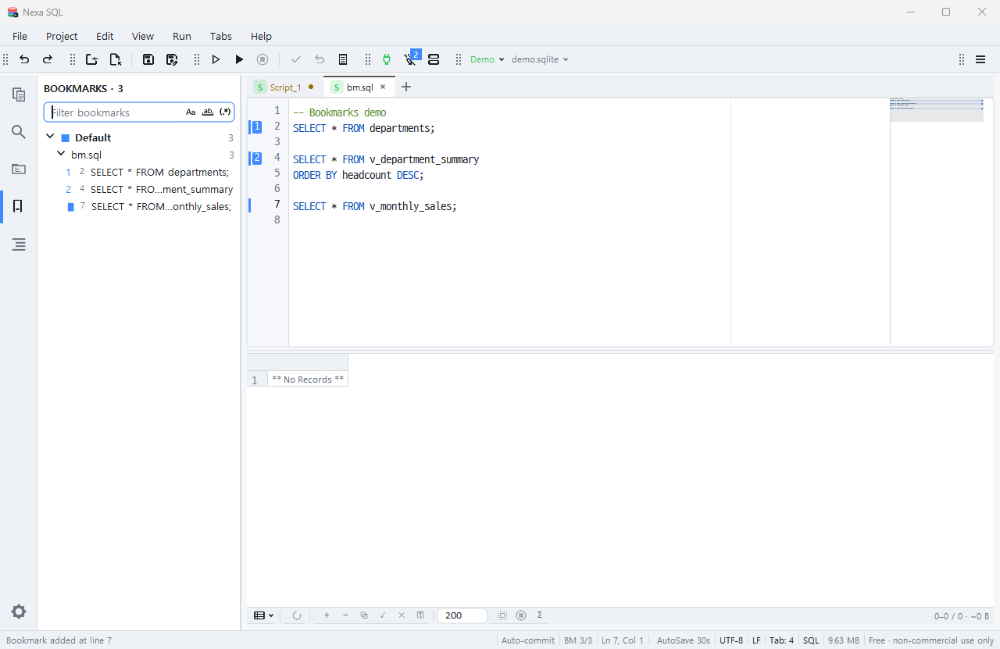

# Bookmarks

**English** | [한국어](Bookmarks-ko)

Leave a mark on a line and come back to it. After edits and external changes, the position is found again from **the line text and the lines around it** (if it cannot be found, the bookmark stays as "invalid" and is cleaned up after 30 days).

## Keys

| Action | Windows/Linux | macOS |
|---|---|---|
| Toggle | Ctrl+F2 · **Ctrl+K, Ctrl+K** | ⌘F2 · **⌘K, ⌘K** |
| Next / previous | F2 / Shift+F2 · **Ctrl+K, Ctrl+N / Ctrl+K, Ctrl+P** | F2 / ⇧F2 · **⌘K, ⌘N / ⌘K, ⌘P** |
| Clear all bookmarks in this document | Ctrl+Shift+F2 · **Ctrl+K, Ctrl+X** | ⌘⇧F2 · **⌘K, ⌘X** |
| Select all bookmarked lines with multiple carets | Alt+F2 | ⌥F2 |
| **Set mnemonic** 0–9 | Ctrl+Shift+digit | ⌘⇧digit |
| Go to mnemonic | Ctrl+digit | ⌘digit |
| Bookmarks panel | Ctrl+Shift+B | ⌘⇧B |

When you set a mnemonic on a line without a bookmark, one is created and the mnemonic is set. In the menu, **numbers already in use** carry ✓ and the line number of that bookmark (e.g. `✓ 3  line 12`). Choosing a number used by another bookmark (from the menu or with Ctrl+Shift+digit) takes it over right away, and the notice toast shows **[Restore]** — pressing it cancels the assignment you just made and gives the number back to the original bookmark (turn off Preferences ▸ Bookmarks ▸ Behavior & storage `bookmark.mnemonic_notice` to take numbers over without a notice). Setting the same number on the same line again clears only the mnemonic; the bookmark stays. The bold keys are Visual Studio-style **two-step chords** (press Ctrl+K, then the next key) — a second binding for keyboards such as the HHKB, whose firmware intercepts Ctrl+F1–F4 (both work · you can change them in Preferences ▸ Keys).

The left side of the editor is laid out as **bookmark area (color bar · mnemonic box) → line numbers → text → minimap**. Turning line numbers off (`editor.line_numbers` off) keeps the bookmark area, and the line change marks (green/yellow bars) sit separately to the right of the line numbers, so they do not overlap bookmarks. If you want no gutter at all, check positions with the minimap dots and the line-end labels (`bookmark.inline_label`) instead.

## Using the mouse in the gutter

Right-click the **bookmark area (color bar · mnemonic box) or the line numbers** on the left of the editor to open a small menu — **Bookmarks** at the top (opens the bookmarks panel on the left) is always there; over a line, **Toggle Bookmark** (✓ when present · add/remove with one item) and **Mnemonic ▸ 1–9** (creates the bookmark if needed and sets it · the current one has ✓ · the same number again = clear) are added, with **Clear mnemonic** right below (only when there is a mnemonic). In the empty area below the last line, only the Bookmarks item appears. Right-clicking the text still opens the edit menu as before.

## Display

- Gutter color bar (invalid = dimmed) · mnemonic number box · **dots on the right edge of the minimap** · **line-end labels** (`◆ label` · dimmed text) — each can be turned off in Preferences ▸ Bookmarks ▸ Display, and the label length limit is `bookmark.inline_label_chars` (40).
- Status bar `BM 3/12` = this document / total.

## Panel (activity bar ▸ Bookmarks)



*Bookmarks panel · mnemonics (1 · 2) and marks in the gutter*

Tree of group → document → item · filter (Aa · ab · (.*) toggles · Hangul matches right away by jamo while still being composed ("ㄱ" · "기")) · **a named bookmark shows its name in the accent color and bold**, followed by the dimmed line text (unnamed ones show only the text) · renaming (menu ▸ Rename Bookmark · command `bookmark.label`) opens an input box **only in the name slot**, after the mnemonic and line number · **single click = open in a preview tab** at that line (becomes a regular tab when you edit) · **double-click · Enter · menu Open = regular tab** (same rules as the Project Explorer · promoted if already open as a preview) · right-click: Open · Mnemonic · Move to group · Remove (click the toast within 5 seconds = undo) · document/group menus (select all · rename · default group · enable/disable · delete) · Remove invalid bookmarks · **type-ahead** (letters with the list focused = jump to a group/document/bookmark name · Hangul · [Explorers and filters](Explorers-and-Filters.md#type-ahead--type-letters-to-jump-to-a-name)).

## Where they are stored

There are three cases depending on the work mode (the same layering as settings):

| Mode | How to enter it | Where bookmarks go |
|---|---|---|
| **File mode** | Just start it (or with only files as arguments) | Global — `workspaces/default.nsql-workspace` in the user settings folder (`%APPDATA%\nexa-sql`) |
| **Folder mode** | `nexa-sql .` · `nexa-sql c:\users\user\project` | **`.nsql/workspaces/default.nsql-workspace`** in that folder (`.nsql/` is created on the first save · moves with the folder) |
| **Project mode** | Open a `.nsql-project` or pass it as an argument | Inside the **project file** (`bookmarks`) — moves and is shared with the project |

When you do "Save New Project" in file mode, the bookmarks at that time are **moved** into the project and the local file is emptied (after you close the project, the local one is empty). Opening an existing project does not touch local bookmarks.

**Bookmarks of untitled tabs (Script_N)**: in project mode they are stored in the project file together with the tab text and attach to the same line when reopened; in file and folder modes those tabs are temporary, so the bookmarks are kept **in memory only** and not written to a file (they are gone after a restart). Such bookmarks are tied only to the tab's **id**, so even if you rename the tab (right-click ▸ Rename tab), the document row of the bookmarks panel always shows **the current tab name** — the name at creation time is not kept. When the tab is closed and its name is unknown, it shows as `(closed tab #id)`.

**When they are saved**: automatically within 1 second of a change (up to 5 seconds when changes keep coming) — the app wakes up on its own at that time to save even when it is idle. Closing the window or quitting with File ▸ Exit writes them immediately without waiting for the debounce.

## CLI

```
nsql bookmark list [--project <file>] [--doc <path>] [--md]
nsql bookmark add <file> <line> [--label <text>] [--project <file>]
nsql bookmark rm <id> [--project <file>]
nsql bookmark prune [--days N] [--project <file>]
```

With `--project x.nsql-project`, the bookmarks inside that project file are read and written (the rest of its content is left as is).
