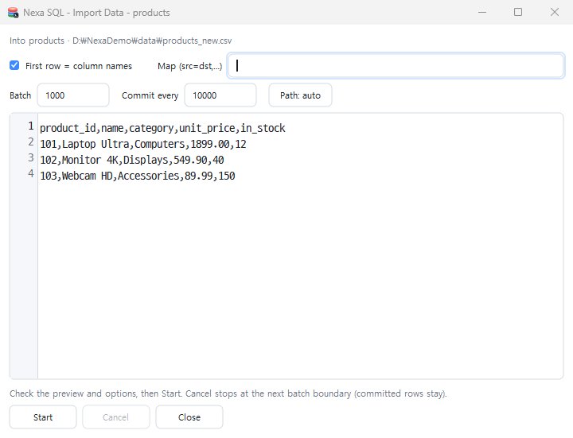

# 파일로 넣기 · 내보내기 (대량 적재)

[English](Bulk-Import-Export) | **한국어**

CSV · TSV · JSON · JSON Lines · Excel(xlsx) · Parquet 파일을 표에 **넣고**(import), 조회 결과를 파일로 **내보냅니다**(export). GUI와 CLI가 같은 코드를 쓰므로 결과와 안내 문구가 같습니다.

> 넣기는 **INSERT만** 합니다(새 표로 넣을 때는 `CREATE TABLE`도). 기존 행을 고치거나 지우지 않습니다(UPDATE·DELETE는 [결과 그리드에서 데이터 편집](Data-Editing-ko.md)의 안전 규칙을 따릅니다).

## 1. 화면에서 넣기 (Import 창)



*Import 창 — 대상 표 · 첫 줄 = 열 이름 · 열 매핑 · 배치/커밋 간격 · 파일 미리보기*

1. 탐색기에서 **표**를 우클릭 ▸ **데이터 가져오기**(그 표에) 또는 **스키마**를 우클릭 ▸ **데이터 가져오기(새 표)…**. 메뉴로는 **실행 ▸ 파일에서 데이터 가져오기…**(현재 세션 · 기본 = 새 표).
2. 파일을 고릅니다(csv · tsv · json · jsonl · ndjson · xlsx · parquet).
3. Import 창에서 미리보기와 옵션을 확인하고 **시작**.

창은 위에서 아래로 세 구역입니다.

| 구역 | 담긴 것 |
|---|---|
| 원료 | **파일** 경로 · **형식**(**자동(확장자)** 또는 직접 지정) · **시트**(xlsx) · **첫 줄 = 열 이름** · **구분자** · **인코딩** · **공백 다듬기** · **NULL 글** — 형식에 맞는 칸만 보입니다. 바꾸면 파일을 다시 살펴 미리보기와 매핑을 새로 채웁니다 |
| 미리보기 | 파일 앞부분을 읽기 전용 그리드로(`import.preview_rows` · 기본 100행) · 머리글 = 이름 · 추론 형 |
| 대상 | **기존 표** / **새 표** · **표**(기존 = 목록에서 고름 · 새 표 = 이름 입력) · **DDL 보기**(새 표: 실행할 `CREATE TABLE`) · 열 매핑 표(✓ = 가져옴 · **원료 열** · **추론 형** · **대상 열** 또는 새 표의 **열 형** · **판정 · 표본** / **표본**) · **순서대로 연결** |
| 적재 옵션 | **배치**(한 번에 보내는 행 수) · **커밋 간격**(0 = 끝에 한 번) · **경로**(`auto → driver → multirow → single` · 아래 §3) · **빈 값 = NULL** · **오류 시**: **멈춤** / **행 건너뛰고 보고** |
| 아랫줄 | 진행 중에는 커밋된 행 수와 경과, 끝나면 결과(성공 = 초록 · 실패·취소 = 빨강) · **시작** · **취소** · **닫기** |

- 기존 표: 이름이 같은 열은 자동으로 연결됩니다(대소문자 · `_` · 공백 무시). 나머지는 직접 고르거나 ✓를 꺼서 건너뜁니다. ✓인 열에 대상이 없거나, 기본값 없는 NOT NULL 열에 연결된 원료가 없거나, 한 대상 열에 둘 이상 연결되면 시작이 비활성입니다. 표본 기반 경고(글 값이 숫자 열로 · 길이 초과 · 표본에 중복 키 값 …)는 판정 열에 보이고 시작을 막지 않습니다.
- 새 표: 열 형은 파일 표본(`import.sample_rows` · 기본 1000행)으로 추론하고, 필요하면 매핑 표에서 바꿉니다. 표를 먼저 만들고, 만들기가 실패하면 아무것도 넣지 않습니다.
- 적재는 **지금 탭의 연결**로 실행됩니다. 탐색기에서 고른 표가 다른 서버라면 그 탭을 먼저 그 서버에 접속하라고 안내합니다.
- 적재 중에는 그 연결이 바쁜 상태가 되고(다른 실행은 기다립니다), **취소**는 다음 배치 경계에서 멈춥니다. 이미 커밋된 행은 그대로 남고 커밋되지 않은 마지막 배치만 되돌립니다.
- 창을 닫아도(Esc · 닫기) 진행 중이면 먼저 취소가 됩니다.

## 2. 명령으로 넣기 (`nsql import`)

```
nsql import -c <대상> -t <표> [옵션] <파일|->
```

```
nsql import -c prod -t EMP emp.csv
nsql import -c prod -t EMP -f tsv --map emp_no=EMPNO,name=ENAME --commit-every 5000 emp.tsv
cat rows.jsonl | nsql import -c prod -t EMP -
```

| 옵션 | 뜻 |
|---|---|
| `-f csv\|tsv\|json\|jsonl\|xlsx\|parquet` | 형식을 직접 지정(생략하면 확장자로 판단: `.tsv`·`.tab` = 탭, `.json` = JSON 배열, `.jsonl`·`.ndjson` = JSON Lines, `.xlsx`·`.xlsm`·`.xls`·`.xlsb`·`.ods` = 스프레드시트, `.parquet`·`.pq` = Parquet, 그 밖 = 쉼표) |
| `--no-header` | 첫 줄도 데이터(열은 표의 순서대로) |
| `--cols a,b,…` | 파일의 열 이름을 순서대로 지정(헤더가 없을 때) |
| `--map src=dst,…` | 파일 열 → 표 열 이름 바꾸기 |
| `--sheet 이름\|N` | 읽을 시트(xlsx) |
| `--delim ';'` · `--encoding auto\|utf-8\|euc-kr\|utf-16le` | 구분자 · 글 인코딩(기본 = 설정 `import.encoding` · `auto`) |
| `--trim` · `--null-text 글` | 공백 다듬기 · NULL로 볼 글 |
| `--create` · `--types a:number(10),…` · `--skip a,b` · `--sample N` | 추론 형으로 표를 만듦 · 일부 형 덮기 · 뺄 열 · 형 추론 표본 행 수 |
| `--on-error stop\|skip` | 실패한 행에서 멈춤 / 건너뛰고 보고 |
| `--dry-run` | 추론한 열·형, DDL, 앞 10행만 찍고 끝 |
| `--batch N` | 한 번에 보낼 행 수 |
| `--commit-every N` | N행마다 커밋(0 = 끝에 한 번) |
| `--mode auto\|driver\|multirow\|single` | 적재 경로(§3) |
| `--empty-null on\|off` | 빈 칸을 NULL로 볼지, 빈 문자열로 둘지 |
| `--timing` | 단계별 시간을 stderr로 |

- 파일 이름 자리에 `-`를 주면 표준 입력에서 읽습니다.
- 값이 큰따옴표로 감싸여 있으면 그 안의 쉼표·줄바꿈을 그대로 읽습니다. 파일 앞의 BOM은 무시합니다.
- **JSON Lines**는 한 줄에 객체 하나입니다. 첫 객체의 키가 열 이름이 되고, 어떤 줄에 없는 키나 `null`은 NULL로 들어갑니다. **JSON**(배열 하나) 파일은 통째로 읽습니다(`import.json_max_mb` 256 MB까지 · 더 크면 JSON Lines로).
- 날짜·숫자는 표의 열 타입에 맞춰 보냅니다. 형식이 맞지 않으면 그 행에서 서버 오류로 멈추고 어느 행인지 알려 줍니다.

## 3. 적재 경로와 속도

`auto`(기본)는 DBMS가 제공하는 빠른 길이 있으면 그것을 쓰고, 없으면 여러 행을 한 문장에 담아 보냅니다.

| DBMS | 자동으로 고르는 길 |
|---|---|
| Oracle | 배열 DML(한 번에 배치 크기만큼 바인드) |
| PostgreSQL | `COPY … FROM STDIN` |
| SQL Server | TDS 벌크 적재 |
| MySQL / MariaDB | `LOAD DATA LOCAL INFILE`(서버의 `local_infile`이 켜져 있을 때만 · 아니면 다중 행 `INSERT`) |
| SQLite · 그 밖 | 다중 행 `INSERT` |

측정값(5,000행 · 4열 · 원격 서버 · 디버그 빌드) — 환경에 따라 달라집니다.

| DBMS | 초당 행 |
|---|---|
| SQLite | 약 57,000 |
| PostgreSQL | 15,000 ~ 20,000 |
| Oracle | 13,000 ~ 14,000 |
| SQL Server | 5,200(배치 1,000) → 13,900(배치 5,000) |

- SQL Server는 배치마다 준비 왕복이 있어 `--batch`를 키울수록 빨라집니다.
- `driver`는 빠른 길이 없으면 오류로 알려 주고, `multirow`는 항상 다중 행 INSERT, `single`은 한 행씩 보냅니다(문제를 찾을 때).

## 4. 실패했을 때

- 배치가 실패하면 그 배치를 **한 행씩 다시 넣어** 문제 행을 지목합니다: `row 500 (line 501)` 처럼 **파일의 몇 번째 행 · 몇 번째 줄**인지와 서버 오류 메시지를 보여 줍니다.
- 그 앞까지 성공한 행은 커밋되고 몇 행이 들어갔는지 함께 알려 줍니다(`499 rows committed`).
- **오류 시 = 행 건너뛰고 보고**(`--on-error skip` · 설정 `import.on_error`)이면 멈추지 않고 실패한 행만 건너뛰어 끝에 목록으로 알려 줍니다.
- 전부-아니면-무로 하고 싶으면 **커밋 간격을 0**으로 두세요(`--commit-every 0` · 창의 커밋 간격 = 0). 대신 큰 파일에서는 서버의 트랜잭션이 길어집니다.

## 5. 내보내기 (`nsql export`)

```
nsql export -c <대상> (-q <SQL> | -t <표>) [-f csv|tsv|json|jsonl|xlsx|parquet|insert[:표]] [-o 파일] [--fast]
```

`--fast`는 **서버가 직접 csv/tsv를 만들어** 보내게 합니다(PostgreSQL `COPY TO`). 지원하지 않는 DBMS·형식이면 한 줄 안내 뒤 평소 경로로 내보냅니다.

## 6. 설정 (`bulk.*` · `import.*`)

창과 명령의 기본값입니다(설정 ▸ 검색창에 `bulk` 또는 `import` · 분류 **CLI**).

| 키 | 기본 | 뜻 |
|---|---|---|
| `bulk.batch_rows` | 1000 | 한 번에 보낼 행 수 |
| `bulk.commit_every` | 10000 | 커밋 간격(0 = 끝에 한 번) |
| `bulk.mode` | auto | 적재 경로 |
| `bulk.empty_null` | on | 빈 칸 = NULL |
| `bulk.check_constraints` | on | SQL Server 벌크 적재 중 CHECK·FK 검사 유지 |
| `bulk.fire_triggers` | off | SQL Server 벌크 적재 중 INSERT 트리거 실행 |
| `bulk.append_hint` | off | Oracle 직접 경로 삽입(`/*+ APPEND */`) — 빠르지만 표를 잠그고 되돌리기 특성이 달라집니다 |
| `import.sample_rows` | 1000 | 형 추론 표본 행 |
| `import.preview_rows` | 100 | Import 창 미리보기 행 |
| `import.encoding` | auto | 글 파일 인코딩(auto = BOM → UTF-8 → cp949) |
| `import.on_error` | stop | 실패한 행 처리: 멈춤 / 건너뛰고 보고 |
| `import.text_margin_pct` | 50 | 새 표 문자열 열 길이 여유(%) |
| `import.json_max_mb` | 256 | JSON 배열 파일 상한(MB) |
