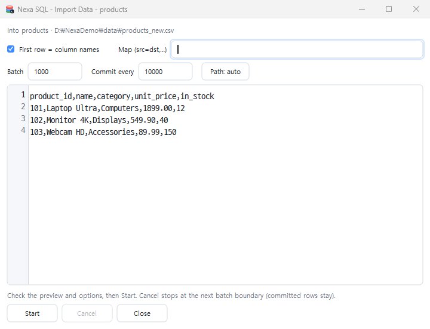

# Import and export files (bulk load)

**English** | [한국어](Bulk-Import-Export-ko)

You can **import** CSV, TSV, JSON, JSON Lines, Excel (xlsx) and Parquet files into a table, and **export** query results to a file. The GUI and the CLI use the same code, so the results and messages are the same.

> Import only runs **INSERT** (plus `CREATE TABLE` when you import into a new table). It never changes or deletes existing rows (UPDATE and DELETE follow the safety rules in [Editing data in the result grid](Data-Editing.md)).

## 1. Import from the GUI (Import Data window)



*Import window — target table · First row = column names · column mapping · batch/commit interval · file preview*

1. In the Object Explorer, right-click a **table** ▸ **Import Data** (into that table), or right-click a **schema** ▸ **Import Data (new table)…**. From the menu: **Run ▸ Import Data from File…** (current session · new table by default).
2. Pick the file (csv · tsv · json · jsonl · ndjson · xlsx · parquet).
3. In the Import Data window, check the preview and the options, then press **Start**.

The window has three areas, top to bottom.

| Area | What it holds |
|---|---|
| Source | **File** path · **Format** (**Auto (by extension)** or a fixed format) · **Sheet** (xlsx) · **First row = column names** · **Delimiter** · **Encoding** · **Trim spaces** · **NULL text** — only the fields that apply to the format are shown. Changing one re-reads the file and refreshes the preview and the mapping |
| Preview | The first rows of the file in a read-only grid (`import.preview_rows`, default 100); each header shows the name and the inferred type |
| Target | **Existing table** / **New table** · **Table** (existing = pick from the list · new = type a name) · **View DDL** (new table: the `CREATE TABLE` to be run) · column mapping table (✓ = import · **Source column** · **Inferred** · **Target column** or **Column type** for a new table · **Check · sample** / **Sample**) · **Map by position** |
| Load options | **Batch** (rows per round trip) · **Commit every** (0 = once at the end) · **Path** (`auto → driver → multirow → single`, §3) · **Empty = NULL** · **On error**: **Stop** / **Skip row & report** |
| Bottom line | While running, rows committed and elapsed time; when done, the result (success = green · failure or cancel = red) · **Start** · **Cancel** · **Close** |

- Existing table: columns with the same name are linked automatically (case, `_` and spaces ignored). Others you choose yourself, or untick ✓ to skip them. Start stays disabled while a ticked column has no target, a NOT NULL column (without a default) has no source, or two source columns map to the same target. Sample-based warnings (text into a number column, too long, duplicate key values in the sample, …) are shown in the Check column and do not block Start.
- New table: the column types come from a sample of the file (`import.sample_rows`, default 1000); change them in the mapping table if needed. The table is created first; if that fails nothing is inserted.
- The import runs on the **current tab's connection**. If the table you picked in the explorer is on another server, you are asked to connect that tab to that server first.
- During the import that connection is busy (other runs wait). **Cancel** stops at the next batch boundary: rows already committed stay, and only the last uncommitted batch is rolled back.
- Closing the window (Esc · Close) while it is running cancels first.

## 2. Import from the command line (`nsql import`)

```
nsql import -c <target> -t <table> [options] <file|->
```

```
nsql import -c prod -t EMP emp.csv
nsql import -c prod -t EMP -f tsv --map emp_no=EMPNO,name=ENAME --commit-every 5000 emp.tsv
cat rows.jsonl | nsql import -c prod -t EMP -
```

| Option | Meaning |
|---|---|
| `-f csv\|tsv\|json\|jsonl\|xlsx\|parquet` | Set the format (otherwise taken from the extension: `.tsv`·`.tab` = tab, `.json` = JSON array, `.jsonl`·`.ndjson` = JSON Lines, `.xlsx`·`.xlsm`·`.xls`·`.xlsb`·`.ods` = spreadsheet, `.parquet`·`.pq` = Parquet, anything else = comma) |
| `--no-header` | The first line is data too (columns follow the table order) |
| `--cols a,b,…` | Name the file's columns in order (when there is no header) |
| `--map src=dst,…` | Rename file columns → table columns |
| `--sheet NAME\|N` | Sheet to read (xlsx) |
| `--delim ';'` · `--encoding auto\|utf-8\|euc-kr\|utf-16le` | Delimiter · text encoding (default = setting `import.encoding`, `auto`) |
| `--trim` · `--null-text TEXT` | Trim spaces · text that means NULL |
| `--create` · `--types a:number(10),…` · `--skip a,b` · `--sample N` | Create the table from the inferred types · override some types · leave columns out · rows sampled for type detection |
| `--on-error stop\|skip` | Stop at a failing row, or skip it and report |
| `--dry-run` | Only print the inferred columns and types, the DDL and the first 10 rows, then exit |
| `--batch N` | Rows sent at once |
| `--commit-every N` | Commit every N rows (0 = once at the end) |
| `--mode auto\|driver\|multirow\|single` | Load path (§3) |
| `--empty-null on\|off` | Treat empty fields as NULL, or keep them as empty strings |
| `--timing` | Per-stage timings to stderr |

- Give `-` as the file name to read from standard input.
- A value wrapped in double quotes keeps its commas and line breaks. A BOM at the start of the file is ignored.
- **JSON Lines** is one object per line. The keys of the first object become the column names; a key missing from a line, or `null`, is inserted as NULL. A **JSON** file (one array) is read whole (up to `import.json_max_mb`, 256 MB — use JSON Lines for bigger files).
- Dates and numbers are sent to match the table's column types. If a value does not fit, the import stops at that row with the server error and tells you which row it was.

## 3. Load paths and speed

`auto` (default) uses the fast path the DBMS offers when there is one, and otherwise sends several rows in one statement.

| DBMS | Path chosen automatically |
|---|---|
| Oracle | Array DML (binds one batch at a time) |
| PostgreSQL | `COPY … FROM STDIN` |
| SQL Server | TDS bulk load |
| MySQL / MariaDB | `LOAD DATA LOCAL INFILE` (only when the server has `local_infile` on, otherwise multi-row `INSERT`) |
| SQLite · others | Multi-row `INSERT` |

Measurements (5,000 rows · 4 columns · remote server · debug build) — they vary with your environment.

| DBMS | Rows per second |
|---|---|
| SQLite | about 57,000 |
| PostgreSQL | 15,000 ~ 20,000 |
| Oracle | 13,000 ~ 14,000 |
| SQL Server | 5,200 (batch 1,000) → 13,900 (batch 5,000) |

- SQL Server has a prepare round trip per batch, so a larger `--batch` is faster.
- `driver` reports an error when there is no fast path, `multirow` always uses multi-row INSERT, and `single` sends one row at a time (for tracking down problems).

## 4. When it fails

- When a batch fails, that batch is **re-inserted one row at a time** to pin down the bad row: you see **which row and which line of the file** it was, like `row 500 (line 501)`, together with the server error message.
- The rows that succeeded before it are committed, and you are told how many went in (`499 rows committed`).
- With **On error = Skip row & report** (`--on-error skip` · setting `import.on_error`), failing rows are skipped and listed at the end instead of stopping the import.
- If you want all-or-nothing, set the **commit interval to 0** (`--commit-every 0` · Commit every = 0 in the window). On a large file this keeps one server transaction open for longer.

## 5. Export (`nsql export`)

```
nsql export -c <target> (-q <SQL> | -t <table>) [-f csv|tsv|json|jsonl|xlsx|parquet|insert[:table]] [-o file] [--fast]
```

`--fast` makes **the server build the csv/tsv itself** and stream it (PostgreSQL `COPY TO`). If the DBMS or format does not support it, a one-line notice is printed and the normal path is used.

## 6. Settings (`bulk.*` · `import.*`)

Defaults for the window and the command (Settings ▸ type `bulk` or `import` in the search box · category **CLI**).

| Key | Default | Meaning |
|---|---|---|
| `bulk.batch_rows` | 1000 | Rows sent at once |
| `bulk.commit_every` | 10000 | Commit interval (0 = once at the end) |
| `bulk.mode` | auto | Load path |
| `bulk.empty_null` | on | Empty field = NULL |
| `bulk.check_constraints` | on | Keep CHECK and FK checks during SQL Server bulk load |
| `bulk.fire_triggers` | off | Fire INSERT triggers during SQL Server bulk load |
| `bulk.append_hint` | off | Oracle direct-path insert (`/*+ APPEND */`) — fast, but it locks the table and changes how rollback behaves |
| `import.sample_rows` | 1000 | Rows sampled for type detection |
| `import.preview_rows` | 100 | Rows in the Import window preview |
| `import.encoding` | auto | Text file encoding (auto = BOM → UTF-8 → cp949) |
| `import.on_error` | stop | On a failed row: stop / skip and report |
| `import.text_margin_pct` | 50 | Extra length added to text columns of a new table (%) |
| `import.json_max_mb` | 256 | Size limit for a JSON array file (MB) |
