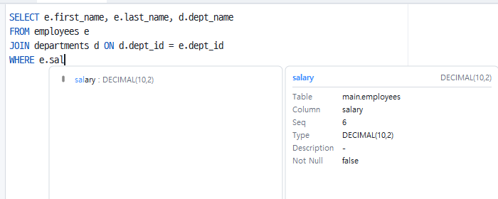
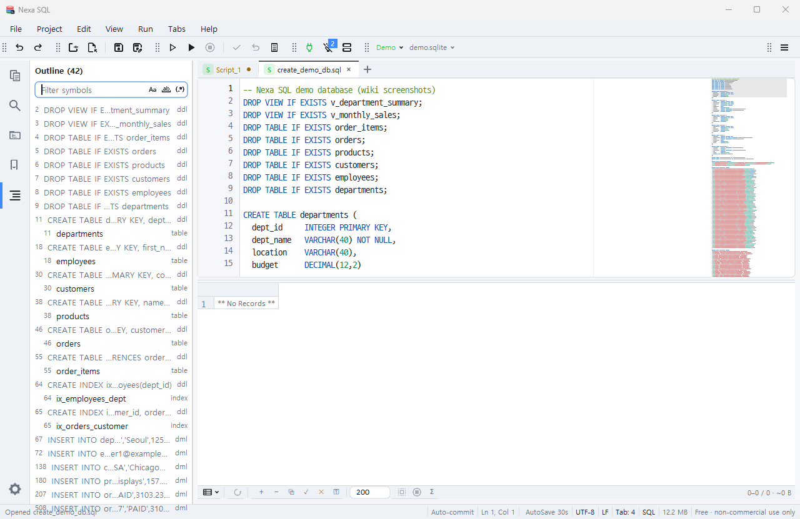

# Code completion and outline

**English** | [한국어](Code-Completion-and-Outline-ko)

This page covers the candidate popup that appears while you type in the editor (IntelliSense) and the list of symbols in the current document (the outline).

## Three-minute tour (summary for testing)

1. After connecting, type `SELECT * FROM ` in a new tab and wait a moment, or press **Ctrl+Space** (Mac **⌃Space** · Control). The tables and views of the current schema, schema names and dictionary views (`ALL_TABLES` · `sys.tables` · `pg_catalog.pg_class` …) appear. An abbreviation such as `sc` also finds `SALES_CUSTOMER` (fuzzy).
2. Pick a table, add ` e` (an alias), then type `SELECT e.`: **as soon as you type `.`** the columns of that table appear (right-hand column = `PK NUMBER(4)` · `FK … NOT NULL`). If the explorer has not read that table yet, "Loading columns…" shows briefly and the list fills in shortly.
3. Type `SELECT nv` and the **built-in function** `NVL` appears with its signature (`NVL(expr1, expr2)`). Enter inserts `NVL()` with the caret inside the parentheses, and the status bar shows `ƒ NVL(expr1, expr2)` (signature help). Functions without arguments, such as `SYSDATE`, are inserted without parentheses.
4. Oracle: type `DBMS_OUTPUT.` and package members such as `PUT_LINE` appear. SQL Server: catalog views after `sys.` · `INFORMATION_SCHEMA.` · PostgreSQL: after `pg_catalog.` · `information_schema.`.
5. Type `INSERT INTO emp (` and the first candidate is **all columns** (`EMPNO, ENAME, …`): one Enter completes the column list.
6. When there are many candidates, the popup **scrolls** (visible rows = setting `intel.popup_rows` 10 · wheel · PgUp/PgDn/Home/End).
7. Turn on `Insert table alias` in Preferences ▸ Editors ▸ **Code completion**, and picking a table after FROM inserts the alias too, as in `SALES_CUSTOMER sc` (`sc2` if it clashes with an alias already in the statement).
8. **Ctrl+R** = Goto Symbol (palette of document symbols) · the outline icon in the activity bar = the symbol panel.

## Code completion

*Completion popup and detail card: column candidates after the alias `e.` · type · NOT NULL*

| When | What |
|---|---|
| Immediately when you type `.` | `alias.` · `table.` = the columns of that table (type · PK/FK/UQ · NOT NULL) · `schema.` = the objects of that schema · system packages such as `DBMS_OUTPUT.` = members · `sys.`/`INFORMATION_SCHEMA.`/`pg_catalog.` = catalog views |
| 2 identifier characters + a short pause (250 ms) | Candidates that fit the context (table below) |
| **Ctrl+Space** (Mac ⌃Space) | Manually, at any time (regardless of settings) · on a Mac, if "Select the previous input source" under System Settings ▸ Keyboard Shortcuts ▸ Input Sources is ⌃Space, the OS takes it first, so turn that item off or change `key.edit.complete` |
| When you type `(` | The **signature in the status bar** for built-in functions and package members (`ƒ NVL(expr1, expr2)`) |

Candidates by context:

| Position | Candidates |
|---|---|
| After `FROM` · `JOIN` · `UPDATE` · `INSERT INTO` (including comma lists) | Tables, views and synonyms of the current schema · schema names · CTEs of this statement · **dictionary views** (`ALL_TABLES` · `USER_OBJECTS` · `V$SESSION` · `sys.tables` · `pg_catalog.pg_stat_activity` · `sqlite_master` …) |
| After `alias.` | The columns of that table. If the explorer has not read the table yet, "Loading columns…" is shown, and reopening shortly afterwards shows them filled in |
| SELECT list · WHERE · ON … | **Columns of all aliased tables** (alias on the right · ordered by FROM order → column position · tables not read yet appear once filled) — confirming inserts `A.column`, and **confirming while holding Alt inserts the column name only** (reversed when `intel.qualify_columns` is off) · **built-in functions** (per dialect · with signatures) · **system package names** · document symbols (DEFINE · VARIABLE · declared variables · procedures) · keywords · words in this document |
| Right after `INSERT INTO table (` | First candidate = **all columns of that table** (one snippet) |
| Start of a statement | Keywords · document symbols |

- Keys: ↑/↓ to choose · PgUp/PgDn/Home/End · wheel (only while the cursor is over the popup · scrolling outside closes the popup and scrolls the editor) · **Enter or Tab** to confirm · Esc to close · keep typing to filter further · the popup closes when Backspace removes the prefix.
- Large documents: above 1 MB (`intel.max_doc_kb`), only 256 KB before and after the caret are read to determine the context, and document words are not offered. At large-file level 1 (5 MB) the automatic popup is off but **⌃Space still works** · at level 2 (20 MB) completion is off. A tab whose requests are slow (over 30 ms twice in a row) turns document words off by itself. **Speed boost** mode turns off icons, detail cards, document words and the preload right after connecting (⌃Space completion still works).
- If objects changed elsewhere (a table created with another tool, etc.) do not appear, press **Ctrl+Shift+R** (Mac ⌘⇧R) = Refresh Metadata Cache (Current Schema) (table/column comments are re-read too · the menu name has said "Metadata Cache" since 10-21). The Edit menu and the palette also offer "(This Server)" and "(All Servers)" scopes, and right-clicking a server or schema in the explorer ▸ "Refresh Metadata Cache" does the same. An explorer "Refresh" also marks the completion cache for that scope as stale, so it is re-read on the next request.
- After confirming: functions become `NAME()` with the caret inside (`intel.insert_parens`) · a space after keywords (`intel.insert_space` · off by default) · an alias for tables after FROM (`intel.insert_alias` · off by default).
- Matching rule (setting `intel.match`): fuzzy (default · `sc` → `SALES_CUSTOMER`) · contains · prefix. Hangul also matches by jamo while it is being composed.
- When the list is long, only the first 200 (`intel.max_items`) are shown, with a "N more" line at the end. **Scroll to the end or press End** to append the next 200 (End = all).
- FROM position: tables, views, materialized views and synonyms compete by name and match in **one tier**; functions and packages are in the tier below (table functions first · setting `intel.from_routines`) · procedures and SQL Server scalar functions cannot appear in FROM, so they are not shown. Picking a function puts the caret inside `NAME()`. Once you have typed `schema.table.`, no popup appears in the FROM position (completion goes down to table level only). The icon to the left of each item = the same kind shape as in the explorer (`intel.icons`).
- Invoking completion right after `*` or `A.*` shows a single item, **All columns (N)**. Picking it replaces the star with the column list (`A.*` = the columns of alias A · `*` = all columns of every table in FROM, with aliases · separation = setting `intel.star_layout` (**One line** `A, B, C` by default / Multiple lines = one per line, comma at the start of the line, no indentation) · after the comma `intel.star_comma_space` = Active tab setting (default · that tab's indent unit) / Space / Tab). The card on the right shows the list.
- Invoking completion right after `JOIN table ON` (in an empty position) shows a **join condition built from the foreign key** on the first line (e.g. `e.dept_id = d.id` · composite keys joined with `AND` · whichever side holds the foreign key). Constraint information is read only at that moment, so the first time you may briefly see "loading". Turn it off with `intel.join_fk`.
- Highlighting: an item that **matches what you typed exactly is bold blue**; for a partial match **only the matched characters are in the accent color** (`DMS_` = 4 prefix characters · `MI40` = 4 abbreviation characters).
- Order (when you have typed a prefix): exact > prefix > word boundary (after `_`) > contains > abbreviation > subsequence (more consecutive matches and word starts rank higher). Within the same grade: **recently confirmed** → source → the browsing order below → shorter names. **When opened without a prefix** (browsing), items within the same tier are in **name order** (tables and views mixed alphabetically · dictionary views and functions in the tier below). Column-list snippets are always at the top.
- Browsing order (no prefix): alias columns in **their order in the table**, objects as **tables → views → materialized views → synonyms** then by name, keywords by frequency of use.
- Items look like `column_name : type`, with PK/FK/UQ/NN markers on the right. **Click = select** (details in the side card), **double-click or Enter = confirm**. The **detail card** next to the popup (`intel.detail_card`) shows, for a column, the table, position, type, Not Null and the keys/indexes/constraints it belongs to (its place as `#i/n`); for a table, the column count, PK and indexes; for a function, its signature. Background/text transparency: `intel.detail_bg_alpha`/`intel.detail_text_alpha`.
- The popup does not appear inside strings or comments. It is off for large files (L1 and above), tabs that are not SQL syntax, and binary content.

### Settings (Preferences ▸ Editors ▸ Code completion)

| Key | Default | Meaning |
|---|---|---|
| `intel.enabled` | on | IntelliSense as a whole (off also disables the outline and Goto Symbol) |
| `intel.auto_activation` | on | Open automatically while typing (Ctrl+Space · Mac ⌃Space always works) |
| `intel.delay_ms` | 250 | Delay from typing an identifier to the popup |
| `intel.trigger_chars` | `.` | Characters that open the popup immediately |
| `intel.min_chars` | 2 | Identifier length at which automatic completion starts |
| `intel.match` | fuzzy | prefix · contains · fuzzy |
| `intel.recent_boost` | on | Prefer recently confirmed items |
| `intel.max_items` | 200 | Number of candidates kept after ranking |
| `intel.popup_rows` | 10 | Visible rows (scrolls when there are more) |
| `intel.keywords` | on | Keyword candidates |
| `intel.document_words` | on | Document word candidates |
| `intel.insert_case` | default | Case of inserted text (default · upper · lower · match) |
| `intel.show_types` | on | Right-hand column (type · kind · signature) |
| `intel.functions` | on | Built-in functions · system packages · dictionary views (static tables · no server access — after connecting, the dictionary read from the server with your privileges takes precedence) |
| `intel.preload` | on | Right after connecting, preload the tables, views and synonyms of the current schema + privilege-aware dictionary views (metadata session · once) |
| `intel.insert_parens` | on | Confirming a function = `NAME()` + caret inside |
| `intel.insert_alias` | off | Confirming a table after FROM = alias too |
| `intel.insert_space` | off | Confirming a keyword = one space |
| `intel.insert_columns` | on | All-columns snippet after `INSERT INTO t (` |
| `intel.join_fk` | on | First candidate after `JOIN table ON` = join condition built from the foreign key |
| `intel.signature_help` | on | Signature in the status bar after `(` |
| `intel.signature_card` | on | While the caret is inside the parentheses of a known function, a signature card right above the caret (off = status bar only) |
| `intel.budget_ms` | 30 | If assembling candidates takes longer than this, one line goes to the log window |

> Metadata (tables, columns) lives in **the same store** that the object explorer on the left reads into. **Right after connecting, the tables, views and synonyms of the current schema and the dictionary views this account can see (Oracle `ALL_`/`DBA_`/`V$` · SQL Server `sys.`/`INFORMATION_SCHEMA.` · PG `pg_catalog.`/`information_schema.`) are read once** (`intel.preload` · when off, on the first completion request), so tables of the current schema appear right after FROM. **Other schemas are read the moment you type `schema.`** ("Loading objects…" → filled in), and they are dropped from memory as soon as no open document uses that name any more. What you expand in the explorer goes into the same store, and the store is emptied when you disconnect. Completion never opens its own connection to the server (it uses the explorer's metadata session). The built-in function and dictionary view tables are static tables built into the app, so they appear even without a connection (missing functions are covered by document words).

## Outline

*Outline panel: the statements and objects of the script as a list; click to go to that line*

**Outline = a map of declared names (10-25).** By default the panel shows only *symbols*: objects created by `CREATE`, routines (procedures, functions, packages, bodies, triggers, types), CTEs, `DEFINE`/`VARIABLE`, cursors, labels and declared variables — as a tree (a package body contains its subprograms; a procedure contains its local declarations). Plain statements are hidden; turn them on with the four toggles to the right of the filter box: **Select · DML · DDL · Other** (Other = client commands such as `EXEC`/`PRINT`/`SET`, anonymous blocks and other SQL). The header shows *visible/total*, the chevrons expand or collapse everything, ←/→ fold a row, and the selection follows the caret. Goto Symbol (Ctrl+R) uses the same toggles. Settings: **Preferences ▸ Editors ▸ Outline** — `outline.show_select` · `outline.show_dml` · `outline.show_ddl` · `outline.show_other` (off) · `outline.show_declared` (on) · `outline.expand_depth` (1 = routines visible, their inner declarations folded) · `outline.follow_caret` (on) · `outline.sort` (order of sibling symbols: file order by default · name · kind) · `outline.grid_columns` (on · while the result grid has focus, the outline lists its columns: check to show/hide, click a name to jump to that column).

Turn on the **Outline** icon in the activity bar (or View ▸ Outline) to list the symbols of the current tab with line numbers: statement heads (dimmed) · `DEFINE`/`VARIABLE` · CTEs · `CREATE …` targets · PL/SQL `PROCEDURE`/`FUNCTION` (bold · indented when inside a package)/`PACKAGE [BODY]`/`TRIGGER`/`TYPE`/`CURSOR`/`<<label>>` · variables in declaration sections · T-SQL `DECLARE @v`. Click or Enter = go there · the filter box works like in the other panels (Hangul jamo) · **type-ahead** (with the list focused, typing a character = jump to that symbol · ↑/↓ = move among the matches · Hangul). After an edit the list updates a moment later (when idle), and switching tabs switches to that tab's symbols.

**Comments: Ctrl+/ (Mac ⌘/) = toggle line comment `--` · Ctrl+Shift+? (Mac **⌘⌥/**) = toggle block comment `/* … */`** (on the selection, or the current line when there is none · press again to undo). On a Mac, ⌘⇧? is taken first by macOS "Search the Help menu"; turn that item off under System Settings ▸ Keyboard Shortcuts ▸ App Shortcuts to use it.

**Goto Symbol: Ctrl+R (Mac ⌘R)** shows the same list in a palette; type a name and press Enter to go there (the same key as Sublime).

## Not there yet (planned · T-178 follow-up)

A worker for computing candidates (if the time budget is measured to be exceeded · no overruns so far). Postfix completion (`.count`), running statements from the popup and ML ranking have been decided against. FK join-condition completion, hover cards, Ctrl+click navigation and the signature card next to the caret are already in (T-178 closed 11-04).

## Completion by object kind (10-01)

In the following positions you get **only objects of that kind** instead of keywords.

| Input | What appears |
|---|---|
| `USE ` (SQL Server) | The server's databases · for MySQL, schemas (= databases) |
| `ALTER SESSION SET CURRENT_SCHEMA = ` (Oracle) · `SET search_path TO ` (PostgreSQL) | Schemas |
| `EXEC ` · `EXECUTE ` · `CALL ` | Procedures and functions of the current schema (packages too for Oracle) + schemas · for SQL Server, system procedures such as `sp_help` |
| `DROP VIEW ` · `DROP PROCEDURE IF EXISTS ` · `ALTER SEQUENCE ` etc. | Objects of that kind (`DROP TABLE` gives tables as before) |

- After `JOIN t ON ` you now get **columns**, not tables (only `GRANT … ON` · `CREATE INDEX … ON` · `COMMENT ON` give objects).
- After `ALTER TABLE t `, after `MERGE … USING src s ON ` and inside `CREATE INDEX ix ON t(`, the columns of that table appear.
- After `OUTPUT INSERTED.` · `DELETED.` in SQL Server data-changing statements, the columns of the target table appear.
- MySQL now has a grammar file, so keywords such as `USE` · `SHOW TABLES` · `LIMIT` · `ON DUPLICATE KEY UPDATE` appear in the right places.

> **`ALTER TABLE` clauses (10-08)**: after `ALTER TABLE t `, the next words such as `ADD` · `MODIFY` (Oracle) · `ALTER COLUMN` (SQL Server · PostgreSQL) · `DROP CONSTRAINT` appear in the completion list. After `DROP FUNCTION`, functions appear.

### System procedure parameters (SQL Server · 10-08)

After a system procedure name, as in `EXEC sys.sp_updateextendedproperty `, press **Ctrl+Space** (or start typing `@`) to get that procedure's `@parameters` with their types: `@name` · `@value` · `@level0type` …. Typing `@l` leaves only `@level…`, and parameters you have already written are left out. They also appear after `, `, but not in a value position (after `= `). While the caret is after the name, the full signature is shown in the status bar (or the signature card).

- Covered = the 30 procedures in the built-in table (adding/updating/dropping extended properties · `sp_rename` · the `sp_help` family · `sp_columns` · `sp_tables` · `sp_executesql` · linked servers · `xp_cmdshell`, etc.). Parameters of user procedures are not covered by this table (see below).

### Data types · user-defined functions (10-09)

Where a data type is expected, the DBMS's **built-in data types** appear with their forms (e.g. `NUMBER(p, s)` · `VARCHAR2(n [CHAR|BYTE])` · `decimal(p, s)`). If the server has user-defined types (TYPE · domains · table types), they appear too.

| Position | Example |
|---|---|
| Type conversion | `CAST(a AS ` · `CONVERT(` · PostgreSQL `a::` |
| Variable declaration | Oracle `v_x ` under `DECLARE` · after a procedure's `IS`/`AS` · SQL Server `DECLARE @x ` · `VAR x ` |
| Routine header | Parameter `p IN ` · SQL Server `@a ` · `RETURN ` · `RETURNS ` |
| Table | `CREATE TABLE t (id ` · `ALTER TABLE t ADD c ` · `MODIFY` · `ALTER COLUMN` |

- Data types do not intrude on aliases (`SELECT a AS `) or expression positions in the body.
- In expression positions such as `SELECT ` · `WHERE x = `, the **user-defined functions and packages of the current schema** appear along with built-in functions, without a schema prefix (the first time, "loading" may show briefly).
- To leave out built-in data types, turn off the setting `intel.types` (user-defined types still appear).
- Not supported yet: inside PostgreSQL `$$ … $$` bodies · Oracle `%TYPE`/`%ROWTYPE`.

### User procedure arguments (10-08)

- **SQL Server**: press Ctrl+Space after `EXEC PROC_TEST ` (or after `, `) to get that procedure's `@arguments` with types (e.g. `@VS_CODE VARCHAR(100)`). The first time, "loading" shows briefly while the argument list is read from the server, then the list fills in. `@arguments` you have already written are left out. In T-SQL the standard form is `EXEC proc @a = 1, @b = 2` without parentheses (parentheses are an error).
- **Named arguments (Oracle · PostgreSQL)**: press Ctrl+Space at the start of an argument (after `(` or `,`) in `EXEC APPDB.SP_TEST1(` or `SELECT fn(` to get **named-argument snippets** such as `p_pjt_code => `. Arguments already written as `name =>` are left out.
- No argument list appears in value positions (after `= ` · after `=> `).

### SQL Server three-part names (10-01)

- A name without a schema is resolved in **the current schema of the current database** (usually `dbo`). Running `USE OtherDB` changes that base.
- After `OtherDB.` you get that database's schemas, after `OtherDB.dbo.` the tables and views of that database and schema, and after `t.` in `FROM OtherDB.dbo.T t` the columns of that table. These are treated as different objects from same-named objects in the current database. The first time they are read from the server, so "loading" may show briefly.
