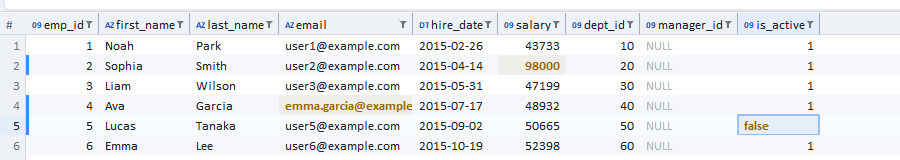
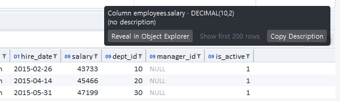
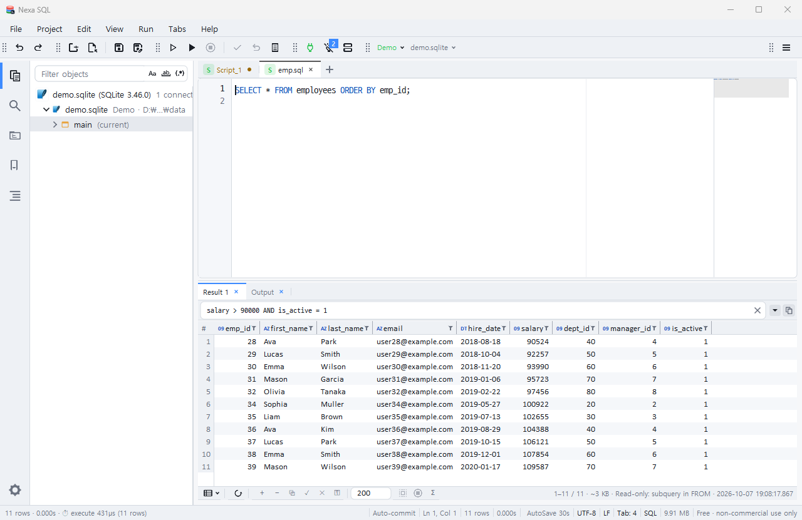
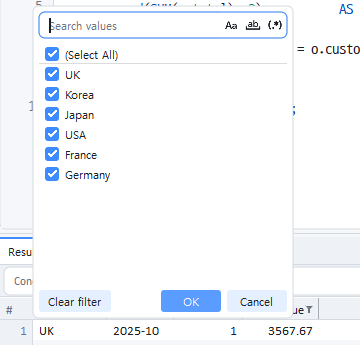
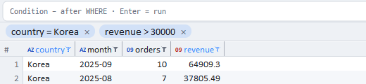

# Editing data in the result grid

**English** | [한국어](Data-Editing-ko)

You can edit the result of a single-table query directly in the grid. Your edits are not sent to the server until you press **Apply (✓)**, and an apply runs as **one transaction**: if any part fails, everything is rolled back.

## When can you edit

| Result | Editing |
|---|---|
| `SELECT a, b FROM t` · `SELECT * FROM t WHERE …` · `SELECT t.a FROM t t` | Allowed |
| JOIN · GROUP BY · DISTINCT · UNION · subquery in FROM · expression/alias columns (`a+1`, `a AS x`) | Read-only (the status bar says why) |
| Views · procedure results · cursors · production (PROD) connections · setting `grid.edit` off | Read-only |

Nexa SQL must be able to find **exactly one** row on the server for each edited row. It picks the method in this order:

| Grade | Condition | How the row is found |
|---|---|---|
| Grade 1 | All PK or UNIQUE columns are in the result | Those key columns (original values) |
| Grade 1 (supplemented) | There is a key, but it is missing from the result (`SELECT name FROM emp`) | The key columns are appended as **hidden columns** and the query is re-run once (not shown on screen · `grid.edit_hidden_keys` · off by default) |
| Grade 2 | No key | The DBMS row identifier is appended as a hidden column and the query is re-run once: Oracle `ROWID` · SQLite `rowid` · PostgreSQL `ctid`+`xmin` (`grid.edit_rowid` · off by default) · SQL Server/MySQL have none |
| Grade 3 | Neither a key nor a row identifier | The original values of **all comparable columns** (LOB, floating-point, long text, xml/json and spatial columns excluded · `grid.edit_all_cols`) |
| Read-only | None of the above works | — |

Hidden columns never appear in copy, text view or ⌘A/Ctrl+A; they are used only in the WHERE clause. If the re-run fails (for example a SQLite `WITHOUT ROWID` table), Nexa SQL goes back to the original statement and treats the result as Grade 3.

*Edited cells in the grid (highlighted) · stripe on the left of edited rows · type badges in column headers (AZ text · 09 number · DT date)*

## How to edit

| Action | Key / mouse |
|---|---|
| Start editing | Enter · **F2** · double-click · just start typing (the first character starts the edit) |
| Confirm | Enter (moves to the cell below) · Tab / Shift+Tab (moves right/left) · click another cell |
| Cancel | Esc |
| Clear a cell / NULL | Delete · Backspace (whether empty means NULL is set by `grid.edit_empty`) · right-click ▸ Set NULL |
| Move between cells (outside the cell editor) | Arrow keys · Tab / Shift+Tab |
| Insert · duplicate · delete a row | Toolbar `+ ⧉ −` · right-click menu (delete only marks the row · DELETE is sent on apply). Duplicate and delete are enabled **after you select a cell** (insert is always available) |
| Duplicate row (key) | **Ctrl+D** (Mac ⌘D) |
| Paste | ⌘V/Ctrl+V: a tab/newline-separated block fills the grid starting at the selected cell (rows are added automatically if needed · limit `grid.paste_max_rows`) |
| Undo / redo | ⌘Z/Ctrl+Z · ⌘⇧Z/Ctrl+Y (a history for grid edits only) |
| List of changes · SQL preview | Right-click ▸ Show changes / Preview SQL (the statements to be sent, with literals) |
| Apply · revert all | Toolbar ✓ / ✕ |
| View a value (without editing) | **Shift+Enter** · **Shift+double-click**: the value window opens directly, even for read-only results (2026-10-12) |
| Insert now (date columns) | **Ctrl+;** = now, according to the column type (date · time · date and time + fractional seconds at the column precision) · **Ctrl+Shift+;** = current time (a date-time cell keeps its date) · right-click ▸ **Set to now ▸** Date (today) / Time / Date and time / Timestamp (fractional seconds) / Server time (NOW) · the same keys and menu work in the value window (2026-10-13) |

> **F2 and Ctrl+D (⌘D) do the above only while the result grid has focus.** Outside the grid (in the editor, for example) they keep their usual meaning: F2 = next bookmark · Ctrl+D = select the next occurrence of the word. When another modifier is held (Ctrl+F2, Shift+F2), the grid uses the usual meaning too.

The edit box for a cell opens exactly where the cell text is drawn, and long text is shown from the beginning. Inside the box, double-click selects a word and triple-click selects everything (`editor.dblclick` · `editor.triple_click` · `editor.dblclick_underscore`).

## Unapplied edits when you close (2026-11-22)

Edits you have not applied yet are never thrown away silently:

| You close | What happens |
|---|---|
| A result tab with unapplied edits | A small popup asks: **Close and discard edits** / **Cancel** |
| An editor tab whose result tabs have unapplied edits | The first close is held and the status bar says how many result tabs have edits — close the tab **again** to discard them |
| The app · the project · or you open another project | A popup asks: **Discard Edits and Continue** / **Cancel** |

Without unapplied edits everything closes at once, as before.

## Display

*Hover over a column header and a card appears: source table · column · type · comment · view in the explorer / copy comment (single-table results)

- **Changed cells** = orange bold text (with only a faint background). If you change a value and then change it back, it no longer counts as changed (A → B → A = no change).
- **Row stripes**: inserted rows green · changed rows in the accent color · deleted rows red with strikethrough · rows that failed to apply get a red background.
- The footer shows `Edits n · added m · deleted k`: this is the scope of the transaction when you apply.

## Apply and safety rules

Apply (✓) builds **bound statements** in the order DELETE → UPDATEs that change key columns → other UPDATEs → INSERT and sends them in one transaction. To protect your data, the following cannot be turned off by any setting.

1. **Pre-check**: before every UPDATE/DELETE, `SELECT COUNT(*)` runs with the same WHERE clause. If the target is not exactly 1 row, **nothing is written** (for example a Grade 3 table with two identical rows).
2. **Rows affected = 1**: if an executed statement affects anything other than 1 row, the apply stops immediately.
3. **Rollback**: in auto-commit mode the whole apply is rolled back; in manual-commit mode it is rolled back to a savepoint, and if needed you are told that a ROLLBACK is required.
4. **Duplicate key pre-check**: if the pending changes would make the same key appear twice, the apply is refused before anything is sent.

In addition, `grid.edit_key_check` (on by default) checks the server once before applying whether a key value you changed or inserted already exists in the table (results with a primary/unique key only). A key swap (A↔B) is refused too; apply it in two steps.

When something fails, the status bar, the log and a toast say exactly which statement (`UPDATE #3 (ID=5)`) failed, at which step and why.

## Refreshing the screen after apply (`grid.edit_refresh`)

| Value | Behavior |
|---|---|
| `rows` (default) | Re-reads only the changed rows by key and replaces them **in place** · inserted rows become real rows where they are · deleted rows are removed · scroll position, sort and selection are kept. If a row cannot be identified (sequence keys · PostgreSQL ctid, etc.), the whole query is re-run |
| `requery` | Always re-runs the whole query |
| `local` | Does not re-read; the edited values stay as they are (server defaults and trigger results are not shown) |

## Concurrency (`grid.edit_concurrency`)

| Value | Extra columns compared in the WHERE clause |
|---|---|
| `key` (default) | Key only |
| `key_old` | Key + the old values of the columns you edited |
| `all_old` | Key + the old values of all comparable columns |

If another session changed the row first, the pre-check finds 0 rows and nothing is written.

## Large values (LOB): the value window

> **Open it directly**: **Shift+Enter** or **Shift+double-click** on a cell (2026-10-12). A plain double-click, Enter or F2 starts editing.

**NULL and empty strings** (2026-10-13): for an editable text cell, the value window has **[NULL] [Empty string] [Value]** buttons at the top. Pick one of the three and **Apply to cell**. In the grid, NULL is shown as a dimmed `NULL` and an empty string as a dimmed `''` (`grid.null_text` · `grid.empty_text`). Right-click a cell ▸ **Set empty string** puts `''` in right away. Oracle stores an empty string as NULL, so [Empty string] and "Set empty string" are not offered there.

Select a cell and choose right-click ▸ **View value** (or open the value window with Enter instead of editing) to look at the value separately.

| Value | Window | What you can do |
|---|---|---|
| Text (CLOB · TEXT · long strings) | Text (editable in place if the cell is editable) | **Apply to cell** (saving is ✓ Apply) · load from a file · save to a file · copy |
| Binary (BLOB · BYTEA · varbinary) | Hex (hex dump) / Image (PNG · BMP · GIF preview) | Load from a file (the file goes into the cell as is · label `<file · n bytes>`) · save to a file (the bytes as they are) |
| JPEG (baseline) | Preview (grayscale · YCbCr · subsampling · restart intervals) | Progressive JPEG shows a notice only |
| Progressive JPEG/WebP | The format is recognized but there is no preview | Save to a file and view it there |

Values above the limit `grid.lob_view_max_mb` (16) are not decoded; only the first part is shown in hex. With `grid.lob_image_preview` off, binary values are always shown in hex. Text longer than 4,000 characters and binary values are bound as CLOB/BLOB types when saved (to avoid the Oracle VARCHAR2 4000 and SQL Server NVARCHAR(4000) limits).

To load many rows from a file at once, see [Importing and exporting files](Bulk-Import-Export.md) (grid editing changes rows safely one at a time; bulk loading is INSERT only).

## Related settings

`grid.edit` · `grid.edit_empty` · `grid.edit_refresh` · `grid.edit_hidden_keys` · `grid.edit_rowid` · `grid.edit_all_cols` · `grid.edit_concurrency` · `grid.edit_key_check` · `grid.paste_max_rows` · `grid.lob_view_max_mb` · `grid.lob_image_preview` · `tx.prod_*` (production connections cannot be edited).

> Technical document: `docs/87-grid-data-editing.md` in the repository (design · row identification grades · data protection invariants).

## No row-identification re-query by default (2026-09-27)

When you queried a table without a key, Nexa SQL used to re-run the query once automatically to prepare for editing (injecting ROWID or the missing key columns). Now the **default is no re-query**: if the result has PK/UNIQUE columns, it is edited with them; if not, rows are matched by *the values of all columns* (with the exactly-1-row pre-check for every statement).

If you need more precise row identification (ROWID · key columns), choose **⚿ Fetch row identity (requery)** on the edit toolbar of the result grid. It applies to that result only. To always do it, turn the settings `grid.edit_rowid` / `grid.edit_hidden_keys` on.

## Result filter (view-only projection) (2026-10-05)

*Condition bar: type the condition that follows WHERE and press Enter = re-run the query in the same tab*

*Column header funnel → value list (like Excel AutoFilter)*

*Active filters = chip strip (remove one at a time with ×) · hatched funnel*

A filter **only hides rows** of a result that has already been fetched: it does not ask the server again and does not change the data. (Exception: when the result still has more rows on the server, the default `grid.filter_server` = auto re-runs the query on the server with the filter; see "Rows not fetched yet" below.)

- **Adding a filter**: right-click a column header or a cell and choose a filter item (text, number, date or boolean conditions depending on the column type · regular expressions · NULL or not). One condition per column; by default only rows that match the conditions of all columns (AND) remain. Check **Match any filter (OR)** in the filter menu to keep rows that match any one of them; "OR" then appears between the chips (the filtered query SQL and the server re-query use OR too).
- **Picking values**: Filter ▸ **Pick values ▸** lists the values of that column as check items (from fetched rows · NULL excluded · up to 30 = setting `grid.filter_pick_max`). Pick one to show only that value, pick more to show any of several values (a value list); picking a checked value again removes it.
- **Funnel · value list** (2026-10-06 · works like Excel AutoFilter): click the dimmed **funnel** at the right end of a column header to open a value list below that column. **(Select All)** at the top has three states (all/some/none), and when there is no filter yet, every value starts checked. Check only the values to keep and press **OK** to see only those; pressing OK with everything checked removes the filter. **[Clear filter]** = clear this column's filter · **[Cancel]**/Esc = close without changes · Enter = OK · clicking outside the popup closes it and the click goes through as usual. Typing in the search box at the top (case-insensitive · Hangul also matches by jamo, e.g. `ㄱ`) narrows the list and checks all matching values, and **(Select All Search Results)** and **Add current selection to filter** appear above the list. With "add" unchecked, OK **replaces** the filter with the search results; with it checked, OK **adds them to the values already picked**. Clearing the search text brings back the checks from before the search (the search text is not saved). The list holds up to 500 values from fetched rows (`grid.filter_values_max`) · you can also open it with the right-click menu item **Value list popup**. The list height is fixed at 12 rows (`grid.filter_popup_rows`) regardless of how many values there are, so the buttons do not move while you search. When nothing matches, "No matching values" is shown.
- **Inline condition box** (2026-10-06 · revised 10-07 · DBeaver's condition bar): type the expression that comes after `WHERE` in the box right above the result grid and press **Enter** (or Ctrl+Enter). The statement that produced the current result is wrapped as `SELECT * FROM ( … ) q WHERE 1=1 AND (expression)` and **re-run on the server in the same result tab** (unlike the filter above, which only filters fetched rows, this targets everything). Press **Shift+Enter** for a new line; from the second line the box expands by itself (up to 3 lines · `grid.cond_max_lines`). Buttons at the top right of the box: **×** = clear all text · **▾/▴** = expand to the maximum lines / collapse to one line (the text stays · when collapsed only the caret line is visible and keys or the wheel move between lines) · **Copy** = copy the wrapped SQL. Emptying the text collapses the box. As you type, column names and function candidates appear below the box (Tab/Enter inserts). If the expression is invalid (unknown column · brackets · quotes · `;` etc.), it is **not run**: the border turns red and the status bar gives the reason; if the server returns an error, the border also turns red and the result grid stays as it was. **Drag a column header and drop it on the box** to insert that column name; by default a condition template comes with it (text columns `col = ''` · numeric columns `col = 0` · joined with ` AND ` when there is already an expression · turn off with `grid.cond_drop_template`). Inside the box, Ctrl+C/X/V/A · Ctrl+Z/Y and the right-click menu (copy · cut · paste · select all) act only on the box text. Esc = leave the box · turn the box off with the setting `grid.condition_bar`. The value-filter chip strip is hidden by default; to see it, turn on `grid.filter_strip` (a second line below the condition bar · only when filters exist). The box text uses the same monospace font size as the result grid. Completion candidates follow the same rules as the editor: from two characters (`intel.min_chars`) · not for words starting with a digit (`1=1`) · the list opens with nothing selected, so press ↓ to pick; with nothing selected, Enter simply **runs** and Tab passes through.
- **Dragging column names** (2026-10-12): press and drag a column header. Inside the header row you get a preview of reordering columns; **once you move over the condition bar or out of the grid, the column order is left alone and a chip with the column name follows the cursor**. **Drop it on the editor to insert the column name there** (quoted if needed · `editor.quote_idents`) · **dropping it on a filter box (object, project, bookmark, outline and extension panels) or the Find/Replace box** also inserts it at that box's caret (boxes that accept a drop get a highlighted border · 2026-10-13) · dropping on the condition bar adds a condition template · moving back to the header switches back to reordering columns.
- **Font size** (2026-10-07): **Ctrl+=** (larger) · **Ctrl+-** (smaller) · **Ctrl+wheel**. When the editor has focus (for the wheel: the cursor is over it), the editor font (`editor.font_size`) changes; for the result grid, the result font (`grid.font_size`) changes, and the status bar briefly shows "… font size: N px". The value is saved in the settings · to reset, use the Command Palette **View: Reset font size (editor / result grid by focus)** (`view.zoom_reset`). The editor line spacing follows the font size (`editor.line_height_mode` · `editor.line_height` · "editor line spacing" in the [Preferences window](Settings.md)).
  - **How the funnel is shown** (`grid.filter_funnel`): **Always** (default · dimmed on every column) · **On header hover** · **None (right-click menu)** (only the hatched funnel on filtered columns · open the list with right-click ▸ Value list popup). When the funnel or sort marker would cover a column name, the column becomes wider by that much.
  - **Turning filters off** (`grid.filter_enabled` off): the funnel, the filter menu and the value list all disappear, and any active filters are cleared.
  - **Value list scope** (`grid.filter_values_scope`): by default the list shows **only values from rows that pass the other columns' filters** (for example, after filtering by department, the name list shows only people in that department). To always see all values, use `all`.
  - A value that contains commas (`A,B C,D`) is still filtered as one value.
  - The settings are grouped under Preferences ▸ Data Editor ▸ **Result Filter**.
- **Filter strip**: while filters are active, a line appears above the grid with one **chip** per condition (`column condition ×`). A chip's **×** = clear only that column's filter · the **×** at the right end of the line = clear all · when chips overflow they are shortened to `+N`. With no filters, the line disappears. Turn it on with the setting `grid.filter_strip` (off by default).
- **How many rows are visible**: the status bar shows `n / N rows` (visible rows / fetched rows). A filtered column gets a hatched marker in place of the funnel in its header (click it to reopen the value list with the current checks · hover for a tooltip with the condition).
- **To run the same condition on the server**: right-click ▸ **Copy filtered query** copies a query with the current conditions moved into WHERE. Conditions that are hard to express in DBMS syntax, such as regular expressions, become a list of the matching values from fetched rows, and the list stops at `grid.filter_list_max` entries.
- **Rows not fetched yet**: with all rows fetched, a filter works only on those rows. When the result still has more rows on the server, the setting `grid.filter_server` decides: **auto (re-query on server)** (default) re-runs the query on the server with the filter in the same tab (the condition bar and filters combined · if it fails, the current result stays) · **local (fetched rows only)** filters fetched rows only and fetches at most `grid.filter_fill_pages` (3) more pages automatically · **ask** shows a hint once and then behaves like local. To target everything yourself, choose **Run filtered query on server** at the bottom of the filter menu: the result of re-running the same condition on the server opens in a **new result tab** (running the copied query SQL above yourself gives the same result).

## Show referenced row (following foreign keys) (2026-10-05)

In the result of a plain single-table query, **right-click a cell in a foreign key column ▸ Show referenced row** to query the parent table row that the value points to in a **new result tab** (`SELECT *` by the parent's primary key · composite keys work too).

- If the column is not a foreign key or the value is NULL, the item is dimmed; for results with joins, GROUP BY and the like, the item is not shown.
- Table constraints are read once when the result arrives. If "reading table constraints, try again in a moment" appears the first time, choose the item again a moment later.
- Turn it off with the setting `grid.fk_follow` (when off, constraints are not read either).
