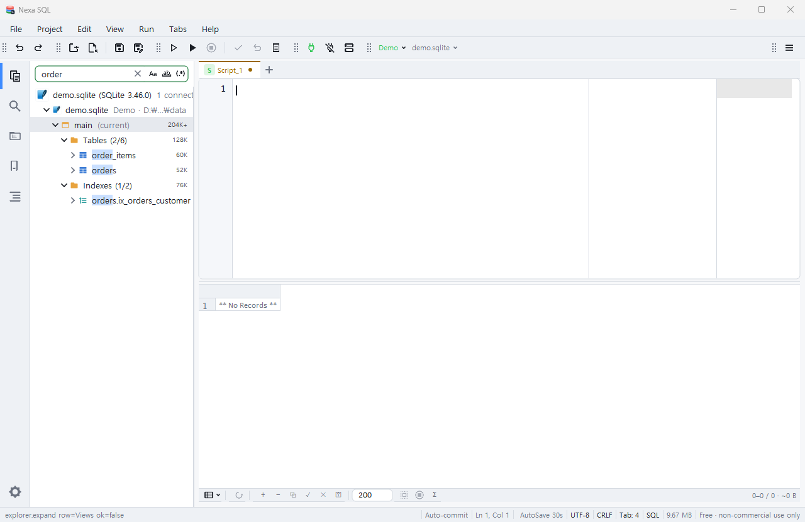
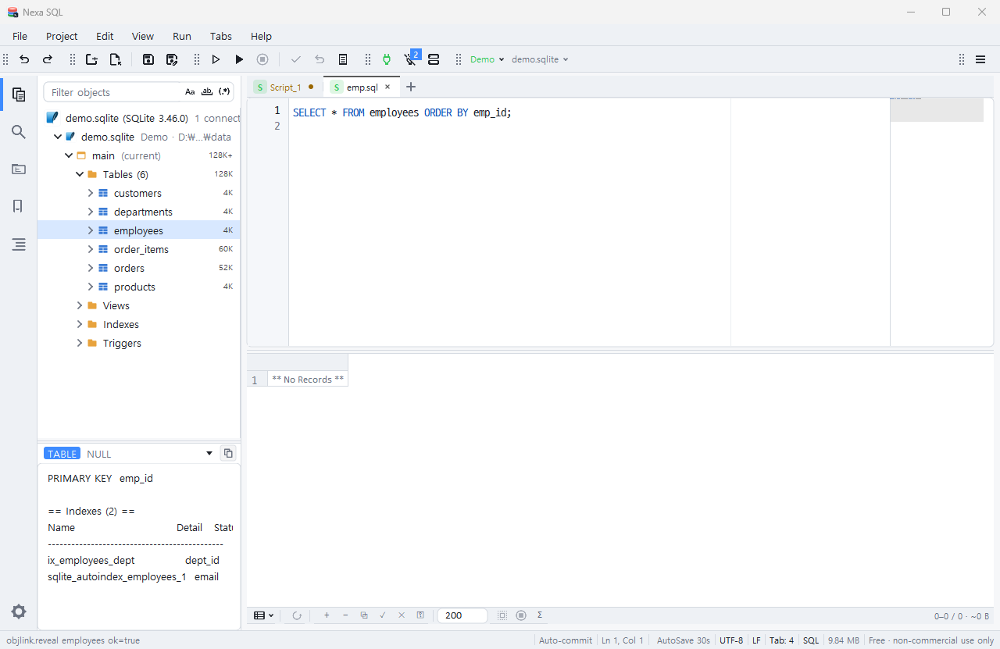
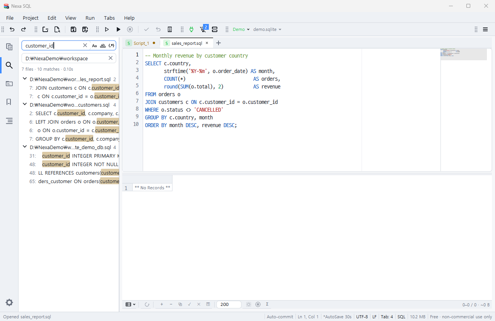

# Explorers and filters

**English** | [한국어](Explorers-and-Filters-ko)

The panels of the left activity bar (Object Explorer · Find in Files · Project · Bookmarks · Extensions) follow the same rules.

> **Using the Object Explorer from the keyboard** (2026-10-05): select an item and press **Shift+F10** to open the right-click menu next to that row (same items as a mouse right-click). The **Object Explorer** group of the Command Palette (Select rows · Open source · Copy name · Refresh · Refresh Metadata Cache · Load sizes) also acts on the selected item. Actions that ask for confirmation, such as delete, can be chosen only from the menu.

## Filter box

> **Object Explorer search does not expand folders automatically** (10-08) — folder labels show `matches/total` and schemas show `N matches`, so expand only the places you need. To auto-expand matching places as before, turn on the setting `explorer.filter_expand`.

> **Object Explorer search range** (10-15) — the default is the **whole DBMS** (Oracle · PostgreSQL = every schema on the server · SQL Server = every database · read one after another when a search starts). To search only the current schema/database, set `explorer.search_scope` to **current schema/database**.

*Object Explorer filter — as you type, only matching objects and the folders above them remain, and the matching part is highlighted*

| Toggle | Meaning |
|---|---|
| `Aa` | Match case |
| `ab` | Whole word |
| `(.*)` | Regular expression (an invalid expression turns the box red and matches nothing) |
| Folder check (Project only) | Match the path too — matches against the `folder/name` path (searches like `crates/x`) |
| Include description (Object Explorer only) | **Include Description** — matches table and view **descriptions (comments)** as well as names (off by default · same value as the setting `explorer.search_desc`). When you turn it on and type a search term, descriptions are read in the background for each schema, so the first time takes a moment. SQLite has no descriptions |
| Eye · dot (right of the Project box) | Show hidden files · dot files (Windows) — the same setting as the file dialog |

When all toggles are off, items that **contain all** of the space-separated words (case-insensitive) match.

**Hangul matches while it is still being composed** — the filter, Find/Replace, Find in Files and the bookmark filter all find "가나" and "긴급" from "ㄱ" or "기" before the IME has finished the syllable (jamo-sequence comparison: "ㄱ" ⊂ 가 · "기" ⊂ 긴 · "달" ⊂ 닭). Regular expression mode compares characters as they are.

### The project filter enumerates in the background

When you type in the filter, folders you have not expanded yet are also enumerated to find names. This work is done **in parallel** per folder by **worker threads** (Preferences ▸ Project ▸ Project explorer: filter scan threads · default 4), and results are merged into the tree as they arrive — key input and the screen do not freeze, and it runs to the end even with many folders and files (for example 10,000 in Downloads). While it runs, "Scanning… N folders" is shown below the list; when you change the text, the previous scan is cancelled and a new one starts (folders already read are not read again). Folders that could not be read (permissions · removed) are counted as "N folder(s) could not be read (see Log)", and their paths and reasons go to the **Log window** (merged into one stream even with several workers).

`project.scan_max` (default 0 = unlimited) is a **memory-protection limit** on the number of entries kept in the tree. If it is not 0, the scan stops at that number and "Scan stopped at N entries" appears — files after that point were not seen, so "no match" does not mean "not there".

## Type-ahead — type letters to jump to a name

When a list has focus (you clicked the list, not the filter box), typing letters jumps straight to the item that **starts with** them. The Object Explorer, Project Explorer, Bookmarks and Outline follow the same rules.

| Key | Action |
|---|---|
| Letters | Appended to the prefix; jumps to the first match (the prefix clears after a short pause · `explorer.typeahead_timeout_ms`) |
| ↑ / ↓ | While typing a prefix, cycles **among the matches** · otherwise one row at a time |
| Backspace | Deletes one character of the prefix |
| Esc | Clears the prefix |

- The prefix being typed is shown in a small box at a corner of the panel (position = `explorer.typeahead_pos`).
- **Hangul**: when the list has focus, the app composes Hangul itself instead of the input method (IME). On Windows, the **Han/Eng key** switches the mode and keyboard letters become jamo. Clicking the filter box turns the IME back on.
- The Project Explorer treats **OPEN FILES and the tree as one list** — ↑/↓ run through both, and Enter/Space on an OPEN FILES item goes to that tab.
- One set of settings `explorer.typeahead*` (on/off · timeout · allow spaces and symbols · display position) is shared by all four places.

> **Object tooltip** (10-08): hovering over an object row in the explorer shows one line, `kind · schema.name · status · modified date` (the first line that showed only the name is gone). Tooltips of schema, folder and DB rows are unchanged.

## Object details panel

*Object details panel — keys · indexes · columns of the table selected in the explorer*

This is the one-line bar (kind chip + description) under the Object Explorer. **Click ▲ to expand** it and see details such as properties, columns and indexes; the font and size are the same as the Object Explorer.

- While collapsed it uses only the description (comment) — skimming through the list quickly does not ask the server for details.
- Details are filled in the moment you expand it. Objects you have already seen are shown **immediately** from memory; only ranges you refreshed (F5 · right-click Refresh) or stale entries are read again.

## Find in Files scope and results

*Find in Files — scope box · matching lines per file*

When the scope box is empty, the search follows the **work mode**: file mode = open files only · folder mode (`nexa-sql <folder>`) = open files + everything under that folder · project mode = open files + the folder that holds the project file + folders added to the project. If you write `<current file>` (the active file's folder) · `<open files>` · paths · `-*.log` (exclude), separated by commas, those are used as written.

**Clicking a result row once opens it in a preview tab** (dimmed tab line · becomes a regular tab when you edit) with that line selected, and focus stays in the panel (keep skimming with ↑/↓). **Double-click · Enter = regular tab** + editor focus. Results in a file that is already open go to that tab. The chevrons on file rows are the same as in the Project Explorer.

## Selection rules

- Clicking an empty area clears the selection and leaves **only an outline** on the last row → ↑/↓ start from that row. The file dialog works the same way (when picking a folder, clear the selection and press [Select Folder] = the current folder).
- Chevrons are `›`/`∨` at font height (expanded · hovered = body text color) · a folder that was read and found empty has no chevron.

## Object Explorer root icons

Server headers and connection rows carry **the icon of that DBMS** (173 kinds · separate images for light and dark themes). Server headers draw the large image (64 px) scaled down, and connection rows under the same server group use the small image (20 px). The icon is chosen from the profile's DBMS (dialect) and driver hint; when the dialect does not tell (as with ODBC), it looks for a word in the profile name (5 or more characters · e.g. `snowflake`). If unknown, a generic DB icon is used. Product names and logos in the icons are trademarks of their respective companies and are used only to show what you are connected to (sources and licenses = `crates/nexa-sql/assets/dbms/NOTICE.md`).

Connections where **a single file is the database**, such as SQLite, are shown short so the screen does not get crowded — tabs and the status bar show only the file name (`Connected: local.sqlite (sqlite)`), and the dimmed folder text of the explorer connection row shortens the home folder to `~` and elides the middle, like `~/…/data`. The full path is in the tooltip of the toolbar connection field.

## Editor tab colors

The color of the line at the top of a tab tells the kind of tab — **unsaved tab** (a script that is not a file · a file changed since it was saved) = warning color · **saved file tab** = accent color · **preview tab** = dimmed color. Unsaved tabs also color **the tab name text** the same way, so you can tell them apart even when the tab is not active or the window has no focus.

| Key | Default | Meaning |
|---|---|---|
| `editor.tab_line_unsaved` · `editor.tab_line_file` · `editor.tab_line_preview` | empty | Line color per kind (`#RRGGBB` · empty = the default colors above) |
| `editor.tab_unsaved_text` | on | Color the name of unsaved tabs |
| `editor.tab_unsaved_color` | empty | Unsaved tab name color (empty = the unsaved line color) |

The tab right-click menu also differs by kind (preview = Keep Open · Rename tab = scripts only · Open file location / Reveal in Project Explorer = files).

## Recent terms in search boxes

Find/Replace (Ctrl+F · Ctrl+H) · Find in Files (search term · scope) · Project/Bookmarks/Extensions/Outline filters · the Preferences search — each box remembers **up to N** recent terms (Preferences ▸ Find in Files ▸ Search history per box · default 20 · 0 = off).

**View style** (Preferences ▸ Find in Files ▸ Search history view · default **Dropdown**): clicking the box shows the recent terms in a list below it (5 rows by default · setting "Search history: dropdown rows" · when it overflows, a scroll indicator on the right + mouse wheel). Move with ↑/↓/PgUp/PgDn/Home/End and insert with Enter or a click · typing leaves only the items that contain the text · Esc = close · clicking outside = close and that click goes through. If you switch to **Flat**, there is no list: in the box, **↑** = from the most recent toward older ones · **↓** = toward newer ones → at the end it returns to the text you were typing (same as the Sublime and VS Code find boxes).

**Moving into the list**: pressing ↓ once more on the last dropdown item (with Flat, on the text you were typing) or pressing **Tab** moves focus to the first row of the list below the box (project folders · bookmarks · symbols · search results · the settings category tree). When a term is recorded = when you run find/search with Enter · for filter boxes, when you type text and click elsewhere (when the box loses focus). The same text moves to the front; there are no duplicates. The history is **program-wide** (independent of projects and folders) and is saved in `search-history.json` in the user settings folder, so it survives a restart.

## Find in Files skip log

Find in Files **skips** files over the size limit (setting `search.max_file_kb` · default 8 MB), binary files (NUL in the first 8 KB), files that could not be read and files whose names are not UTF-8, and collects them in a **"Skipped (N)"** row below the results (click = path — reason expands · " · N skipped" at the end of the status bar). Even when several workers search in parallel, the log is merged into one stream and shown in arrival order. The CLI `nsql grep` prints a summary `skipped N file(s): too_large 2 · binary 3` to stderr at the end, and with `NSQL_GREP_LOG=1` it also prints the file list.

## × clear button in search fields

Find/Replace · Find in Files (search term · scope) · Project/Bookmarks/Extensions/Outline filters · the Database Login window filter · the Preferences search · transaction log search · Command Palette — when you type text, a **×** appears at the right end of the box; clicking it clears the text and the list or find returns to its original state right away. It is not shown in an empty box.

## Conditions in the Find in Files scope

Join conditions with **commas** on one line of the scope box — a path (`D:\proj`) · `<open files>` · **include** `*.sql` (glob · `+pat` is the same) · **exclude** `-*.log`. If there is at least one include, only files that match one of them are read (OR), and files that match an exclude are dropped (AND NOT). Folders are always descended into, so to drop a folder write `-folder/`. If you write only patterns and no path, the patterns are applied on top of the default scope (open tabs + the work-mode folder).

Example: `*.sql, *.txt, -*_test.sql, D:\proj` = `.sql` and `.txt` files under D:\proj that are not `_test.sql`. Globs use the same syntax as `.gitignore` (`*` `**` `?`). CLI: `nsql grep SELECT D:\proj -g *.sql -g *.txt --exclude *_test.sql`.

## Conditions in filters (size · kind · logic)

Besides words, you can write **conditions** in a filter box (when regular expression `(.*)` is on, the whole text is a regular expression and there are no conditions).

| Write | Meaning |
|---|---|
| `tb order` | Contains both words (AND · case-insensitive · Hangul jamo) |
| `order \| plan` · `order OR plan` | Either one |
| `tb !hist` · `tb NOT hist` | Items without `hist` (`-` is treated as a character of the name) |
| `(order \| plan) !hist` · `"plan hist"` | Parenthesized groups · phrases |
| `size>1G` · `size>=100M` · `size<10K` · `size:1G` (= at least) · `size:100M..1G` | Size (units B K M G T P · also `KB` `MB` · decimals allowed) |
| `type:table` · `type:view` · `type:mv` · `type:idx` · `type!=view` | Kind (aliases: tab · vw · mv · proc · func · pkg · seq · trg · idx · syn) |
| `name:order` | Name (same as a plain word · for being explicit) |

- **Object Explorer**: `size` `type` `name`. Sizes exist **only for objects that have been read** — only tables, MVs and indexes read by expanding a folder or by right-clicking a schema ▸ **Load sizes** match a `size` condition; objects not read yet and search-index results have an unknown size and are excluded (`type` also works on index results).
- **Project Explorer**: `size` (file size · unknown for folders) · `type:file|folder` · `ext:sql` · `path:folder/name`.
- Bookmarks · Outline · Extensions · Find in Files results: words, logic and `name:` only (no size or kind).
- Example: `tb (size>1G \| type:view)` = has `tb` in the name and is either over 1G or a view.

### In regular expression mode `(.*)`

When you turn on the regular expression button `(.*)`, **the whole text of the box becomes one regular expression**. The condition syntax above (word AND · `|` · `!` · parentheses · `size:` `type:`) is then **not used** — `|` is the regex "or" and `(` `)` are regex groups. The regular expression is tested against the name (object name · file name; in the Project Explorer, the relative path when `Path` is on) as "matches anywhere" (anchor the start/end with `^` `$` · case-insensitive when `Aa` is off · `ab` (word) wraps it in `…`). An invalid regular expression turns the box border red and matches nothing.

| Regular expression | Meaning |
|---|---|
| `^tb_` | Starts with `tb_` |
| `_hist$` | Ends with `_hist` |
| `^tb_(order\|plan)_` | `tb_order_…` or `tb_plan_…` |
| `^(?!.*_bak$).*` | Does not end with `_bak` (negative lookahead = instead of `!`) |
| `\d{6}` | Contains six digits (e.g. `_202601_`) |
| `\.sql$` (Project) | `.sql` files |

To filter by size or kind, turn the regular expression off and use the condition syntax (`^tb_ size>1G` is treated as the word `^tb_`, not a regular expression — words match as substrings, so `^` is compared as a character and nothing matches).

## SQL Server explorer (SSMS layout)

SQL Server lets one connection see every database on the server, so the explorer uses the same layout as SSMS (setting `explorer.mssql_tree`, default SSMS · set it to `schema` for schemas of the connected DB → kind folders).

- **Server header** = `host:port` + dimmed text "N connections" (same look for every DBMS · since 10-13, DBMS, version and login are no longer in the header; hover over the header for a moment and a tooltip **below** the header shows `DBMS:` · `Version:` · `Edition:` · `Login:` · `Current DB:` · `Endpoint:` · `Profile:` one per line · the same on a header pinned at the top while scrolling). The main text of a connection row is the **login account** (in SQL Server, the login and the DB are separate · the same account is one row), and the dimmed text adds `current DB: x`.
- **Toolbar work unit**: the single value next to the connection info is the work unit of the current tab's session — Oracle = current schema (click and pick from the list to run `ALTER SESSION SET CURRENT_SCHEMA`) · SQL Server · MySQL = current DB (`USE`) · PostgreSQL = the connected DB (fixed · no DB switch within a session) · SQLite = the file. Running the same statement in the editor has the same effect, and after a change, names without a schema in code completion are resolved against the new schema/DB. Work-unit switch statements are not subject to the run-twice confirmation of Production connections.
- The work unit is remembered **per tab**. A new tab starts with the connection defaults (the login's default DB and schema), and when you move between tabs the session is quietly set to that tab's value (nothing is written to Output).
- **Databases** ▸ System Databases (master · model · msdb · tempdb · hidden with `explorer.mssql_system_dbs`) · user DBs. The current DB carries **(current)** and is expanded automatically right after connecting.
- **DB node** ▸ Tables · Views · External Resources ▸ External Tables · Synonyms · Programmability ▸ Stored Procedures · Functions · Database Triggers · Data Types · Sequences · Security ▸ Users · Roles · Schemas. Objects are shown as `schema.name` (indexes, triggers and keys are under the table).
- **Server Objects** ▸ Linked Servers: selecting one shows product · provider · data source · catalog · options · **Login mappings** in the details panel. Right-click ▸ **Open source** opens a re-creation script of `sp_addlinkedserver` · `sp_addlinkedsrvlogin` · `sp_serveroption` in a new tab (run as is, it ends with "already exists"; to change it, uncomment the DROP line and fill in the password at the `********` placeholder · in manual-commit mode run it after `SET AUTOCOMMIT ON`). Right-click ▸ **Delete…** also removes the login mappings (`sp_dropserver … droplogins`). Without the server permission (`ALTER ANY LINKED SERVER`) you only see the list.
- **Security** (server level · same layer as Databases) ▸ Logins · Server Roles · Credentials · Cryptographic Providers · Audits · Server Audit Specifications — selecting one shows all its properties in the details panel (login = server role membership · server role = members · audit = file · audit specification = actions). **Server Objects** ▸ Backup Devices · Endpoints · Linked Servers · Triggers (server DDL/LOGON triggers · Open source works). Deleting works the same as for other objects (right-click ▸ Delete…).
- **Database sizes**: right-click a DB node or the Databases/System Databases group ▸ **Load sizes** to show the size of every DB on the server (data + log files) on the right of each row, with the total on the group. Hovering shows data and log separately, and the filter `size>1G` also works on DB rows. File sizes include free space, and once read they become **final** for that DB row. For a DB where you have not pressed Load sizes yet, expanding its Tables or Indexes folder reads used sizes and shows **the sum of the tables + indexes read so far** with a `+` (system tables, log and free space are left out, so it is smaller than the real size); pressing Load sizes later replaces it with the file size. The tooltip shows both the file size and the used size. Without the `VIEW ANY DEFINITION` permission, only the DBs you can access are read.
- Running `USE OtherDB` in the editor changes that session's current DB, moves the (current) mark in the explorer and expands that DB. Code completion and Ctrl links follow the current DB; objects in other DBs are browsed by expanding them in the tree (open · DDL · details all go to that DB).
- If you landed in the login's server default DB (for example master), set Database in the profile or change it on the server with `ALTER LOGIN … WITH DEFAULT_DATABASE`.

## Deleting objects (right-click ▸ Delete…)

Right-click an object and choose **Delete…** to open a confirmation window (other windows cannot be used while it is open). The window shows the server · server type · object · kind · status · the `DROP` statement to be run · the backup policy.

- The **Delete** button must be pressed twice — the first press puts it into a "press again to run" state for a few seconds, and pressing it again within that time runs it (it resets when the time runs out).
- With the default setting (`backup.object_drop` on), the object's DDL is first saved to a file under `<settings folder>/backups/objects/` (name includes date and time · kept for `backup.object_days` days, default 30), and the object is dropped **only when the file was created successfully**. When it is off, the object is dropped right away without a backup.
- If the backup fails: when the server type is **Production**, nothing is dropped. Otherwise you must press the "Delete without backup" button twice again to drop it.
- The result (done · error) is written to the Output tab, and that folder in the explorer is refreshed.

### Server type

There are four server types. The screen shows only two forms: the **full term** and the **3-letter abbreviation**. When typing, you can use the values below, case-insensitive.

| Full term | 3-letter abbreviation | Input values (full · abbreviation) | Also accepted aliases |
|---|---|---|---|
| None | NON | `none` · `non` | `-` · empty |
| Development | DEV | `development` · `dev` | `devel` · `local` · `sandbox` |
| Test | TST | `test` · `tst` | `stage` · `stg` · `staging` · `qa` · `uat` |
| Production | PRD | `production` · `prd` | `prod` · `product` · `live` |

**Whether the change is saved depends on where you made it.**

| Where | How | Saved |
|---|---|---|
| Database Login window ▸ profile form | The **Server type** combo on the last row (left of it: Oracle · PostgreSQL = default schema · SQL Server · MySQL = Database) → Save | **Persistent** (saved in the profile) |
| Database Login window ▸ list right-click | Items under **Server type - saved to the profile** | **Persistent** |
| CLI | `nsql conn env <name>` (show) · `nsql conn env <name> prd` (set) | **Persistent** |
| Tab marker (plug) menu · Command Palette | Items under **Server type - this session only (temporary)** · **Connection info → Output** | Temporary (this session only) |
| Editor tab (script command · F5 works mixed with other statements) | `CONNTYPE prd` (= `SET CONNTYPE prd`) · an invalid value gives an error line | Temporary (this session only) |
| Editor tab | `SHOW CONN` (= `SHOW CONNECTION`) → a connection info block in Output (a temporarily changed type shows `temporary · profile: …`) | — |

- A temporarily changed type is released when that session connects to a new target. Changing the profile's type does not overwrite sessions changed temporarily.
- Typing `SET ` · `CONNTYPE ` · `SHOW ` in the editor makes code completion show only the values of that command (after `CONNTYPE ` = NONE/DEV/TEST/PROD · after `SHOW ` = CONN/VARIABLES/ERRORS). On an empty line, program commands (description "client: …") also appear after the SQL keywords.
- On Production, data changes are not applied immediately but **held** (press Commit at the top twice to apply · running only a `COMMIT;` statement while changes are held is refused with a notice). The CLI `nsql` does not hold changes — for how to test, see [docs 115](../115-prod-mode-scenario-nsql-guide.md).
- Setting the same type again (for example `CONNTYPE prd` on Production) runs nothing and only reports "nothing to change". The run-twice confirmation of Production connections appears for **statements that send changes to the server** — not for client commands such as `SET` · `SHOW`.
- **Lowering from Production to another type** (for example `CONNTYPE tst` on Production · choosing Development from the palette or session menu) removes protection, so it is confirmed twice — a notice appears, and running/choosing it again within 3 seconds changes it. Raising to Production or changing between non-Production types happens right away.
- The status bar chip is the 3-letter abbreviation (`PRD` · `TST`). A profile value is a filled chip; a temporary value is an outlined chip.
- When the server type is **Production**, change statements get the two-step confirmation, and object deletion stops if the backup fails.

## Command Palette — find by other-language names and command ids (10-13)

The Command Palette (Ctrl+Shift+P) shows names in the UI language, but searching also matches the **command id** (`edit.lower_case`) and **the name in the other language**. On a Korean UI you can find "소문자로 / Lower Case" with `lower`, and on an English UI with `소문자`. Items whose name changes with state, such as show/hide, are found by both names.

## Find in Files — how to use the scope (Where) field and case (10-13)

The scope field separates conditions with **commas**.

| What you write | Meaning | Example |
|---|---|---|
| Folder or file paths | Search under it (including subfolders) · several allowed | `D:\Projects\acme\<project>, D:\Projects\user01\sql-formatter` |
| A pattern with `*` or `?`, or `+pattern` | Only files that match it (several = matching any one) | `*.sql, *.gwf` |
| `-pattern` | Leave out files that match it | `-*_test.sql` |
| `<open files>` · `<current file>` | Open tabs · the folder of the current file | |

- If you write at least one path, only those paths are searched (add `<open files>` to search the open tabs as well). If you write only patterns, they are applied on top of the default scope (open tabs + work folder).
- **Case**: patterns and paths in the scope are **case-insensitive** by default (same on Windows · macOS · Linux) — `*.gwf` also finds `a.GWF`. Turn on **Aa** at the right of the scope field to match case (`*.gwf` = only `b.gwf`). It is separate from the Aa of the search-term field.
- Case folding applies to scope patterns, the setting `search.excludes` and the default excluded folders; the project's `.gitignore` rules are kept as they are, the same as git.
- Always left out regardless of conditions: excluded folders (`.git` · `node_modules` · `target` etc.) · `.gitignore` ignored entries (when the setting is on) · files over the size limit `search.max_file_kb` — see the reasons in "Skipped (N)" in the results.

## Private session mark — P chip (10-13)

A connection row that has a **private session** created with `CONNECT <profile>` in the editor looks exactly like a shared row, with only a **P chip** added at the end (shared and private sessions of the same account are one row). To see which tabs use a private session, hover over the row for a moment: the last line of the tooltip reads `Private tabs: Script_1.sql, Script_2.sql` — renaming, saving or closing a tab is reflected immediately, and when all private tabs are closed the P chip disappears too. The server header shows "N connections · private M".

## Dragging objects · copying names (10-15)

- **Drag and drop**: press and slightly move a row in the Object Explorer (table · view · column · index · procedure · package · folder · even a server row) and a **name chip** follows the cursor. Over the editor, a caret line shows the drop position, and dropping inserts the name there (following the identifier quoting rule `editor.quote_idents`). You can also drop onto the result grid's condition bar, a panel's filter box and the find box. Dropping anywhere else does nothing. **Esc** = cancel.
- **Hold Shift for the full name**: holding Shift while dragging changes the chip and the inserted text to the full name (`schema.object` · SQL Server `DB.schema.object` · column = `…object.column`). In the right-click menu, **Copy name** also becomes **Copy full name** while Shift is held.
- **Copy name on every row**: server (connection) rows · kind folders (Tables …) · subfolders (Columns · Indexes …) · even the Databases group have right-click ▸ Copy name. The full name of a folder is owner + label, like `schema.Tables`.
