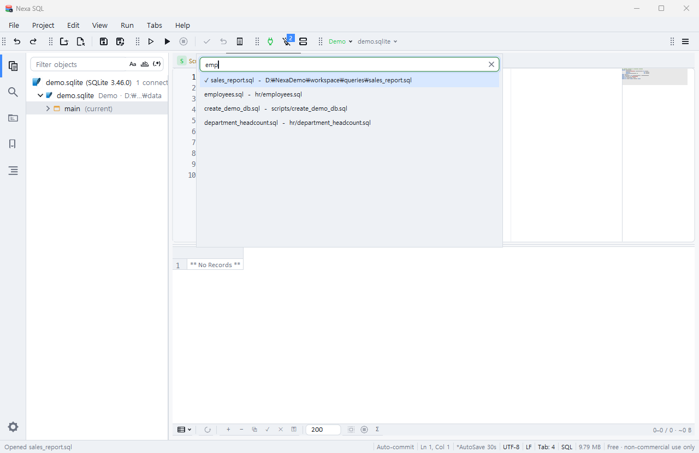

# Goto Anything (Ctrl+P) — jump to files · lines · commands · symbols

**English** | [한국어](Goto-Anything-ko)

Press **Ctrl+P** (Mac ⌘P · View ▸ Goto Anything) to open an input field and a list at the top of the screen. It works like VS Code's Quick Open: **the first character (prefix) of the input** decides what is searched. Typing letters without any prefix searches files.

*Ctrl+P — fuzzy file name search (open tabs · recent · project folders)*

*`>` prefix = find commands*

*`@` prefix = symbols of the current document (statements · objects)*

## Input prefixes at a glance

| Input example | Action |
|---|---|
| `emp` | Fuzzy file name search (open tabs → recent files → project folders) · typos tolerated |
| `cache file 35` | **Space = word split** — each word is matched separately and files matching all of them remain (order does not matter · typos too, like `chche file 35`) |
| `sql/emp` | Narrow by a path fragment |
| `emp.sql:12` | Open the file and go to that line |
| `>` | Run a command (Command Palette · finds by the Korean name and the English command name alike — e.g. `>save`) |
| `:12` | Go to that line of the current file |
| `@select` | Go to a symbol of the current file |
| `@:` | Symbols of the current file grouped by kind |
| `#emp` | Workspace-wide symbol search (**next step** — only a notice for now · use `@` for the current file) |
| `%where` | Quick search in file contents (Quick Search · `line number: content`, up to 300 rows) |
| `?` | Help on the available prefixes (pick an item and press Enter = that prefix goes into the input) |

> After opening a file, you can press Ctrl+P again and continue right away with `@` or `:`.

## Search details

These are all the methods and symbols you can use in the input field. Typing `?` shows in-app help with 10 prefix rows and the 6-line summary below.

> · Matching: typed letters must appear in that order, gaps allowed (cfl -> cache_file); every typed letter must exist; case ignored  
> · Space = words: every word must match (AND), e.g. `cache file 35`; `_` `-` `.` `/` separate words  
> · Ranking: open tabs > recent > project files; match inside the file name > path; consecutive letters and word starts score higher; scattered matches lower  
> · Scope: all project folders (indexed in the background, cached 60 s); folders in `project.exclude` are skipped (Settings > Project > Excluded folders [Edit...]); hidden/dot files follow `file.show_hidden` / `file.show_dot`  
> · Results: top 400 shown - `...and N more` means type more; the line above the list reports scanning progress or a `project.scan_max` cap  
> · Keys: Up/Down move - Enter open - Esc close - after opening a file press Ctrl+P again and continue with @ or :

Each line is explained in detail below.

### Prefix symbols (first character)

| Symbol | Searches | Example |
|---|---|---|
| (none) | Files | `emp` · `sql/emp` · `cache file 35` |
| `name:line` · `name#Lline` | Open the file at that line | `emp.sql:12` · `emp.sql#L12` |
| `>` | Commands (Korean name · English command id alike) | `>save` · `>저장` |
| `:` | A line of the current file | `:120` |
| `@` | Symbols of the current file | `@select` |
| `@:` | Symbols of the current file by kind | `@:` |
| `#` | Workspace symbols (next step · only a notice for now) | `#emp` |
| `%` | Quick search in file contents (up to 300 rows) | `%where` |
| `?` | This help | `?` |

### Fuzzy rules (shared by files · commands · symbols)

- **Contained in order**: it matches when the typed letters appear in the name **in that order** — other letters may sit between them (**gaps allowed** · `cchfl` → `cache_file`).
- **Case ignored**: `CACHE` = `cache`.
- **`\` and `/` are the same**: `downloads\many` and `downloads/many` give the same result (both project files and recent files).
- **Space = word split (AND)**: each space-separated word is matched separately, and only items where **every word matches** remain (word order does not matter). `_` `-` `.` `/` inside a name count as word boundaries, so `cache file 35` matches `cache_file_35.txt`.
- **How far typos are tolerated**: a file row contains the name twice, as `name  -  path`, so a typo with slightly shuffled order is still found when the letters match in order across the name in front and the path behind it (`chche` → `cache_file…  -  …/cache_file…`). Typing a letter that is **not in** the name (`xache`) does not match — this is not spelling correction (edit distance).

### Ranking

1. Source: **open tabs (✓) > recent files > project folders** (the same file appears only once, at the earliest place).
2. Within the same source, by score: a match **inside the file name** ranks above a match only in the path · the query appearing as **consecutive letters** ranks higher · matching word **starts** (after `_` `-` `.` `/` · the first letter) earns a bonus (`cf35` → `cache_file_35.txt`) · the more **scattered** the letters, the lower the score.
3. Up to the **top 400 rows** are shown; beyond that, "…and N more - type more to narrow" appears.

### Scope

- All project folders (when a project is open) · open tabs · recent files.
- The project folder list is **cached for 60 seconds** (setting `project.index_ttl_secs` · default 60 · 0 = every time) — opening it again after 60 seconds re-reads it in the background, and the previous list is used meanwhile.
- Excluded: folders whose names are in the setting `project.exclude` (default `.git,.svn,.hg,node_modules,target,.nsql` · add/remove them as a list in **Preferences ▸ Project ▸ Excluded folder names (Goto Anything index) [Edit…]**) · hidden/dot files follow `file.show_hidden` · `file.show_dot` · limit for big folders `project.scan_max` (0 = unlimited).

### What you see

- **Notice line** (right below the input · above the results): "Scanning project folders… N files so far" · the limit (`project.scan_max`) was reached · "…and N more".
- **Comet border**: while project folders are being read, a line runs around the input border (at least 0.6 s); when reading finishes it blinks twice and then shows the done border · typing returns it to normal · it is not drawn when the list opens straight from the cache (same drawing as the Object Explorer search box).

### Keys

- ↑ / ↓ = select · Enter = open/run · Esc = close.
- After opening a file, press **Ctrl+P** again → continue with `@` (symbols) · `:` (lines).

## List and ranking

- The file list comes in the order **open tabs (✓) → recent files → files in project folders**. When the same file is in several places, only the earliest one is shown.
- Ranking: a match inside the file **name** ranks above a match in the path · consecutive letters rank higher · matching word starts (after `_` `/` `.`) earns a bonus (`cf35` → `cache_file_35.txt`) · scattered matches rank lower. Up to 400 rows are shown; beyond that, "…and N more - type more to narrow" appears.
- Each row is shown as `name  -  location` (project files = relative path from the project folder).
- Project folder files are read in parallel in the background, and the list grows as they come in. While reading, "Scanning project folders… N files so far" is shown **right below the input** (above the results). When it re-reads after a minute, it **keeps showing the previous list** and swaps it when the read is done (limit for big folders = setting `project.scan_max` · threads = `project.scan_threads`).
- **Excluded folders**: Goto Anything does not read folders whose names are in the setting `project.exclude` (default `.git,.svn,.hg,node_modules,target,.nsql`) (fast even with hundreds of thousands of build outputs · they still show in the Project Explorer tree). Hidden and dot files follow `file.show_hidden` · `file.show_dot`.
- ↑/↓ = select · Enter = open/run · Esc = close.

## Shortcuts shown in menus

Items of the pull-down menus (File · Edit · View …) show the command's shortcut on the right (for example Save Ctrl+S · Goto Anything Ctrl+P · Log window F10). When you change a shortcut, the menu follows.

> Technical notes: journal 2026-10-07 §7 · §10–§12 · TODO T-286 (Goto Anything) · T-287 (menu shortcuts) · T-289 (swap-in list) · T-290 (excluded folders) · survey [105](../105-fast-file-enumeration-survey.md).
