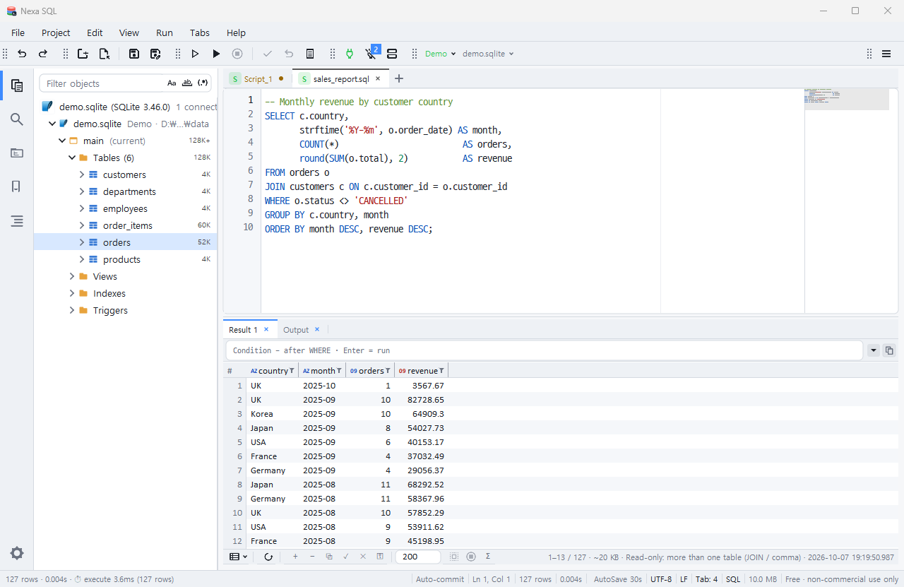
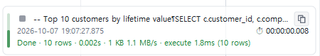
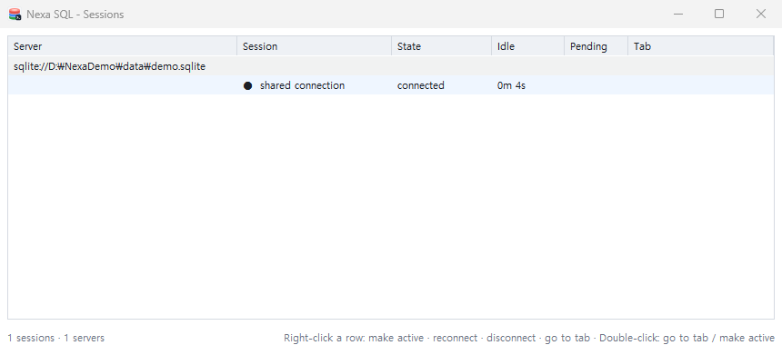
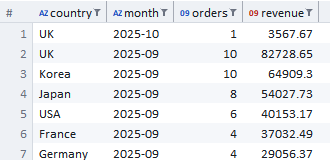

# Nexa SQL 위키

[English](Home) | **한국어**

Nexa SQL = 크로스플랫폼 경량 SQL 클라이언트(IDE) + CLI `nsql`(Windows, macOS, Linux · 올 러스트 단일 바이너리).

지원 데이터베이스 = Oracle · SQL Server · PostgreSQL · SQLite · **MySQL/MariaDB**(접속 문자열 `mysql://사용자@호스트:3306/DB` · `mariadb://`도 같음) 등([접속](Connections-ko.md) 참고). 설치본에는 Oracle OCI 드라이버만 들어 있고, 이 드라이버는 Oracle Instant Client가 필요하다. Oracle Thin을 포함한 나머지 드라이버는 모두 확장 드라이버로, 처음 접속할 때 자동으로 내려받아 설치한 뒤 연결한다(설정 `driver.auto_install` · 기본 켬). 개발 빌드는 드라이버를 모두 내장한다.

*Nexa SQL 메인 화면 — 객체 탐색기 · 편집기 · 결과 그리드(열 머리 타입 배지 · 조건 입력란)*

## 페이지

| 페이지 | 내용 |
|---|---|
| [드라이버](Drivers-ko.md) | 드라이버 자동 설치(Db2 네이티브 · 최신 드라이버 릴리스) · ODBC 폴백용 IBM Db2 clidriver · ODBC 드라이버 등록 확인 |
| [접속](Connections-ko.md) | 간략 접속(접속 문자열 한 줄 → 바로 접속 · 프로필 자동 저장 · 비밀번호는 저장 안 함) · 비밀번호 없음 · Oracle 역할 · 지원 데이터베이스 · ODBC |
| [프로젝트와 작업 환경](Project-Workspace-ko.md) | 프로젝트 파일에 무엇이 저장되고(탭 · 캐럿 · 북마크 · 미저장 스크립트) 어떻게 복원되는지 · 자동 저장 · 종료 흐름 · OPEN FILES · 탐색기 |
| [북마크](Bookmarks-ko.md) | 키 · 니모닉 · 표시(거터 · 미니맵 · 줄 끝 라벨) · 패널 · 저장 위치 · CLI `nsql bookmark` |
| [변수](Variables-ko.md) | 바인드/치환 변수 · 변수 안의 변수 확장 시점(`vars.expand_at`) · 변수 창 |
| [탐색기와 필터](Explorers-and-Filters-ko.md) | 필터 토글(Aa · ab · 정규식 · 경로) · 타입어헤드(글자를 치면 그 이름으로 이동 · 한글) · 선택 규칙(빈 곳 클릭) · DBMS 아이콘 · 탭 색(미저장 탭 이름 색) · 객체 상세 패널 |
| [테이블 편집기](Table-Editor-ko.md) | 테이블의 컬럼 · 키/제약 · 인덱스를 그리드에서 편집 · 실시간 DDL 미리보기 · 적용 = 재확인 + 위험 검사 + 객체 백업 · 실패한 문장에서 멈춤 |
| [Goto Anything(Ctrl+P)](Goto-Anything-ko.md) | 파일 이름 퍼지 검색 · `이름:줄` · 접두 `>` 명령 · `:` 줄 · `@` 심볼 · `%` 내용 · `?` 도움말 · 메뉴의 단축키 표시 |
| [코드 완성과 아웃라인](Code-Completion-and-Outline-ko.md) | 완성 팝업(트리거 · 문맥별 후보 · 일치/순서 규칙 · 설정) · 아웃라인 패널 · Goto Symbol(Ctrl+R) |
| [결과 그리드에서 데이터 편집](Data-Editing-ko.md) | 편집 가능 조건 · 행 식별 등급(키 · 숨은 키 열 · ROWID · 전 열) · 키 · 표시 · 적용의 안전 규칙(사전 검사 · 1행 · 롤백) · 적용 뒤 갱신 · 동시성 · 설정 |
| [라이선스](License-ko.md) | 무료로 쓸 수 있는 것 · Pro가 여는 것과 무료 대체 경로 · 요청 코드 → 이메일 → 설치 3단계 · PC 추가/교체(재발급) · 백업·제거 · 상태가 이상할 때 |
| [파일로 넣기·내보내기(대량 적재)](Bulk-Import-Export-ko.md) | CSV/TSV/JSON Lines를 표에 넣기(GUI 데이터 가져오기 창 · CLI `nsql import`) · 빠른 내보내기(`--fast`) · 속도와 경로 · 실패했을 때 · 설정 `bulk.*` |
| [단축키와 사용자 키맵 파일](Keyboard-Shortcuts-ko.md) | 단축키 설정 창 · `Packages/User/Default (<OS>).sublime-keymap`(Sublime 형식) · 조건(context) 키 표 · 2단 코드 · "(파일)" 표시 |
| [설정 창](Settings-ko.md) | 카드 순서 · 키 이름 복사(Shift/Ctrl+클릭 = 보이는 설정 전부) · 고급 · 키 이름 규칙과 바뀐 키 · 바뀐 기본값 |
| [트랜잭션 로그](Transaction-Log-ko.md) | 문장·트랜잭션 결과 · 행 클릭 = 보낸 문장 / 바인드 변수 / 값 치환 문장 세 층 · 거르기 |
| [큰 파일과 기능 제한](Large-Files-and-Limits-ko.md) | 파일 크기·줄 수에 따라 무엇이 꺼지고(L1/L2) 어떤 상한이 늘 걸리는지 · 바꾸는 설정 |
| [SQL 포맷](SQL-Formatting-ko.md) | Shift+Alt+F 기본 포맷 · 내장 Basic 공통 옵션(콤마 위치 · 공백/탭 · `WHERE 1=1` · 별칭) · 확장 포맷터(SQL Formatter for kiros33)를 기본으로 지정 · 미리보기 탭 |
| [Output 탭](Output-Tab-ko.md) | 서버 메시지(DBMS_OUTPUT · PRINT · RAISE NOTICE) · 컴파일 결과 · 오류 · 문장 완료 줄이 모이는 탭 · 언제 나타나는지(`output.show`/`output.activate`) · 객체 소스 탭의 F5 = 한 단위 실행 |
| [Ctrl 객체 링크와 설명 툴팁](Object-Links-ko.md) | Ctrl(⌘)을 누르는 동안 테이블·컬럼·루틴이 링크 · 코멘트 툴팁(우상단 · 위치 설정) · 좌클릭 = 설명 복사 · 우클릭 메뉴 · 향상 모드·큰 파일 자동 끔 |

## 화면 둘러보기

*실행 상태 카드 — 문장 · 시작 시각 · 경과 · 행 수 · 전송량*

*세션 창 — 서버별 공유/전용 연결 · 상태 · 유휴 시간*

*결과 열 머리의 타입 배지(AZ 문자 · 09 숫자 · DT 날짜 · ID 식별자) — 색 = 레거시 / 일반 / 특수*

> 그림은 영어 화면, 라이트 테마, SQLite 데모 DB로 찍었습니다(2026-10-07 · Windows · 위키와 홈페이지 공용).

> 이 폴더(`docs/wiki/`)가 원본이고 `scripts/wiki-publish.sh`가 GitHub 위키 저장소로 복사합니다. 이미지는 `images/`(Windows 캡처 = 격리 홈 + 기동 명령 · 맥 캡처 = `scripts/mac-capture.sh`).
> 기술 원장·설계 문서는 저장소 `docs/`(예: 제한 원장 = docs/72).
