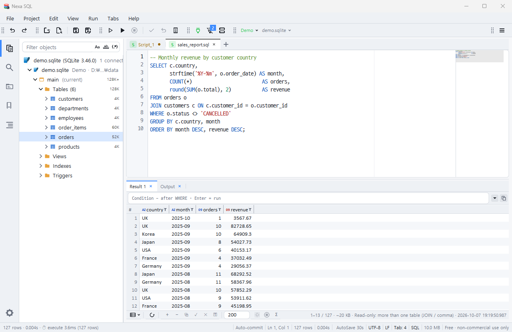
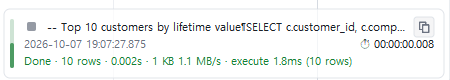
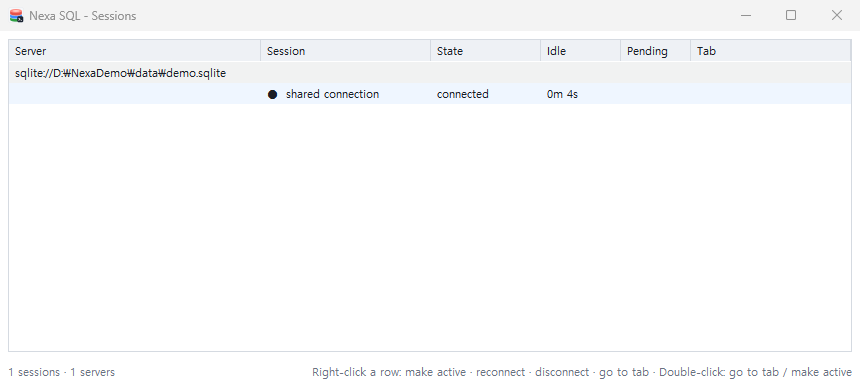
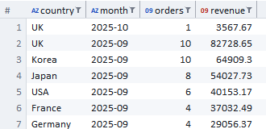

# Nexa SQL Wiki

**English** | [한국어](Home-ko)

Nexa SQL = a cross-platform, lightweight SQL client (IDE) + the CLI `nsql` (Windows, macOS, Linux · an all-Rust single binary).

Supported databases = Oracle · SQL Server · PostgreSQL · SQLite · **MySQL/MariaDB** (connection string `mysql://user@host:3306/DB` · `mariadb://` works the same) and more (see [Connections](Connections.md)). The installer includes only the Oracle OCI driver, which needs Oracle Instant Client. Every other driver, Oracle Thin included, is an extension driver: the first time you connect, it is downloaded and installed automatically (setting `driver.auto_install`, on by default) and then the connection opens. Developer builds include all drivers.

*Nexa SQL main window — Object Explorer · editor · result grid (type badges in the column headers · condition bar)*

## Pages

| Page | Contents |
|---|---|
| [Drivers](Drivers.md) | Automatic driver install (native Db2 · the latest drivers release) · IBM Db2 clidriver for the ODBC fallback · checking ODBC driver registration |
| [Connections](Connections.md) | Quick connect (one connection string → connect right away · profile saved automatically · the password is not saved) · No password · Oracle Role · supported databases · ODBC |
| [Projects and workspace](Project-Workspace.md) | What a project file stores (tabs · carets · bookmarks · unsaved scripts) and how it is restored · Autosave · exit flow · OPEN FILES · explorer |
| [Bookmarks](Bookmarks.md) | Keys · mnemonics · display (gutter · Minimap · end-of-line labels) · Bookmarks Panel · where they are stored · CLI `nsql bookmark` |
| [Variables](Variables.md) | Bind/substitution variables · when variables inside variables are expanded (`vars.expand_at`) · Variables window |
| [Explorers and filters](Explorers-and-Filters.md) | Filter toggles (Aa · ab · regex · path) · Type-ahead (type letters to jump to that name · Korean too) · selection rules (click on empty space) · DBMS icons · tab colors (name color of unsaved tabs) · Object Details panel |
| [Table editor](Table-Editor.md) | Edit a table's columns, keys/constraints and indexes in a grid · live DDL preview · Apply with a re-check, risk checks and an object backup · stops at the first failing statement |
| [Goto Anything (Ctrl+P)](Goto-Anything.md) | Fuzzy file-name search · `name:line` · prefixes `>` command · `:` line · `@` symbol · `%` content · `?` help · shortcuts shown in menus |
| [Code completion and outline](Code-Completion-and-Outline.md) | Completion popup (triggers · candidates by context · matching/ordering rules · settings) · Outline panel · Goto Symbol (Ctrl+R) |
| [Editing data in the result grid](Data-Editing.md) | When editing is possible · row identity levels (key · hidden key columns · ROWID · all columns) · keys · display · safety rules for applying (pre-check · one row · rollback) · refresh after applying · concurrency · settings |
| [License](License.md) | What you can use for free · what Pro unlocks and the free alternatives · request code → email → install in 3 steps · adding/replacing a PC (reissue) · backup and removal · when the status looks wrong |
| [Import and export files (bulk load)](Bulk-Import-Export.md) | Loading CSV/TSV/JSON Lines into a table (GUI Import Data window · CLI `nsql import`) · fast export (`--fast`) · speed and paths · when it fails · settings `bulk.*` |
| [Keyboard shortcuts and the user keymap file](Keyboard-Shortcuts.md) | Keyboard Shortcuts window · `Packages/User/Default (<OS>).sublime-keymap` (Sublime format) · context key table · two-step chords · the "(file)" marker |
| [Preferences window](Settings.md) | Card order · copying key names (Shift/Ctrl+click = all visible settings) · Advanced · key naming rules and renamed keys · changed defaults |
| [Transaction log](Transaction-Log.md) | Statement and transaction results · click a row = three layers: statement sent / bind variables / statement with values substituted · filtering |
| [Large files and feature limits](Large-Files-and-Limits.md) | What turns off by file size and line count (L1/L2) and which limits always apply · settings that change them |
| [SQL formatting](SQL-Formatting.md) | Shift+Alt+F default format · built-in Basic common options (comma position · spaces/tabs · `WHERE 1=1` · aliases) · making an extension formatter (SQL Formatter for kiros33) the default · preview tab |
| [Output tab](Output-Tab.md) | The tab that collects server messages (DBMS_OUTPUT · PRINT · RAISE NOTICE) · compile results · errors · statement completion lines · when it appears (`output.show`/`output.activate`) · F5 in an object source tab = run as one unit |
| [Ctrl object links and description tooltips](Object-Links.md) | While Ctrl (⌘) is held, tables, columns and routines become links · comment tooltip (top right · position setting) · left click = copy the description · right-click menu · turned off automatically in enhanced mode and for large files |

## A tour of the screen

*Run status card — statement · start time · elapsed · row count · data transferred*

*Sessions window — shared/private connections per server · state · idle time*

*Type badges in result column headers (AZ text · 09 number · DT date · ID identifier) — color = legacy / normal / special*

> The screenshots were taken with the English UI, the light theme and the SQLite demo DB (2026-10-07 · Windows · shared by the wiki and the homepage).

> This folder (`docs/wiki/`) is the source; `scripts/wiki-publish.sh` copies it to the GitHub wiki repository. Images are in `images/` (Windows captures = isolated home + startup command · Mac captures = `scripts/mac-capture.sh`).
> The technical ledgers and design documents are in the repository's `docs/` (e.g. the limits ledger = docs/72).
