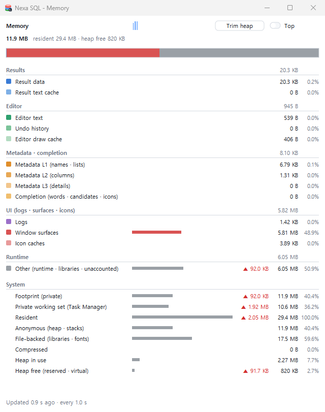

# Large files and feature limits — what Nexa SQL turns off by size

**English** | [한국어](Large-Files-and-Limits-ko)

> This is the user guide. The technical ledger (source code · measurements) is [docs/72](../72-size-limits-and-large-file-constraints.md) in the repository.

As an SQL script grows, Nexa SQL sets a level **per tab** and automatically turns off the extra features that are costly at that level. Editing, selecting, finding and running work at any size — only the features that "make it look nice" are turned off.

## 1. How the level is decided

| Level | Criterion (exceeding either one) | Default |
|---|---|---|
| Normal | — | — |
| **L1** | File size **or** line count | **5 MB** / **100,000 lines** |
| **L2** | File size or line count | **20 MB** / **300,000 lines** |
| Ask before opening | File size | **50 MB** |

- The level is decided again when the file is **opened and saved**. A notice appears in the status bar when it opens, and while that tab is active an `L1`/`L2` marker is always shown at the right of the status bar.
- To change the criteria: settings window ▸ **Large files** ▸ "Large file level 1: size (MB)" · "Large file level 1: lines" · "Large file level 2: size (MB)" · "Large file level 2: lines", or the CLI
  `nsql config set file.large_l1_mb 10` · `nsql config set file.large_l2_lines 500000`
- **To turn everything on for this tab only**: Command Palette (Ctrl+Shift+P) ▸ *Toggle Large File Optimizations (This Tab)* — the `L1`/`L2` marker in the status bar disappears and every feature is on (until the next open or save).

## 2. Features turned off per level

| Feature | From L1 | From L2 | Setting |
|---|---|---|---|
| Minimap | off | off | (fixed by level · even at normal size it draws only up to 4,000 lines) |
| Same-word boxes (selection-word highlight) | off | off | fixed by level |
| Line change marks (gutter band) | off | off | fixed by level |
| Bracket colors and pair marks (Rainbow Pairs extension) | off | off | `file.large_ext_level` = `off` (no limit) / `l1` / `l2` · the extension's own limit `ext.rainbow_pairs.max_kb` (default 0 = follow the level) |
| **Syntax highlighting** | on | **off** (plain text) | `file.large_syntax_level` = `off` / `l1` / `l2` |
| Undo after restart (history file) | not saved | not saved | fixed by level (only files up to `editor.undo_persist_mb` 4 MB) |
| Automatic merge of files changed outside | re-read as is if you made no edits · asks what to do if you did | same | `file.external_merge_max_kb` (2 MB) |
| SQL Format (Shift+Alt+F) — whole document | not available · only the selection or the statement at the caret (searched within 256 KB before and after the caret) | same | `format.max_kb` (1 MB · the same rule for larger documents · 0 = no limit) |

## 3. Limits that always apply, whatever the size

| Action | Limit | Beyond it | Setting |
|---|---|---|---|
| Typing, pasting or deleting over a large selection | **32 MB** of characters removed at once | A notice appears first; doing the same action **once more** runs it | `editor.undo_giant_mb` (0 = never ask) |
| Number of multi-selection ranges (Ctrl+D · Alt+F3 · Ctrl+click · Split into Lines · column selection) | **10,000** | Stops there with a notice in the status bar | `editor.max_occurrences` |
| Copy/cut of a large selection (Ctrl+C/X) | **32 MB** | The first press shows a notice; pressing again within 3 seconds runs it | `editor.copy_confirm_mb` (0 = never ask) |
| Undo memory | **64 MB** · 1,000 steps | Oldest steps are dropped first | `editor.undo_budget_mb` · `editor.undo_max` |
| Undo selection (Ctrl+U) | 500 steps | Oldest steps are dropped first | — |
| Find in Files | **8 MB** per file (2 MB in Speed boost mode) | That file is skipped | `search.max_file_kb` (0 = no limit) |
| Automatic result fetch | **200 rows** at a time | Next 200 rows at the end of the scroll · Σ = row count · **Fetch all** button | `grid.max_rows` |
| Result memory | **1 GB** | Fetching stops with a notice | `grid.memory_budget_mb` |
| Result tabs | **8** | The oldest unpinned tabs are closed first | `grid.result_tabs_max` |
| Run cards | **30** (8 in boost mode) | Finished cards disappear first | `run.toast_max` |
| Variable value | **1 MB** | Truncated when stored + notice | `vars.max_value_kb` |
| Project Explorer filter scan | **No limit** by default (0) · otherwise that many entries | "Scan stopped at N entries" | `project.scan_max` |
| Multi-select in the open dialog | **10** | The rest are marked as excluded | `file.open_max` |
| Grid regex filter → value list in the query SQL | **1,000** | The list stops at that count and a comment says so | `grid.filter_list_max` |
| Project auto-save — text of unsaved tabs | **8 MB** per tab (per tab, not in total) | That tab is not kept by auto-save · one notice → save it to a file | `project.unsaved_max_mb` (0 = no limit) |
| Ctrl end-of-line labels and descriptions (bookmarks · table/column descriptions) | The chosen range up to a **256 KB** document · up to **2 MB**, "whole document" becomes the visible area · beyond that, off | The range shrinks or it turns off | `ctrl.full_kb` · `ctrl.off_kb` |
| Object hover card (description · buttons) | **2 MB** document | The card does not appear (also off in boost mode and large-file mode) | `ctrl.off_kb` · `objlink.tooltip` |

## 4. What works without limits (things you may wonder about)

- **Select All (Ctrl+A)** · drag and Shift selection · multiple carets · column selection — instant at any size. A selection is just two positions, "start and end", and only the visible lines are drawn. If you edit over such a selection, the **32 MB confirmation** above stops you once.
- **Find/Replace** (find bar) — it searches line by line, so it works even on a 65 MB file.
- **Run** — you can also run straight from the file without loading it into the editor (File ▸ *Run SQL File*). However, this path and the CLI `nsql` **read the whole file** and split it into statements (no streaming), so memory of 2–3 times the file size is needed for a while.

## 5. Above 50 MB you are asked before opening

| Choice | Meaning |
|---|---|
| Open normally | Opens at L2 (extra features off as in the table above) |
| Open only the first 8 MB (read-only view) | Opens only the first part, read-only (`file.large_head_mb`) |
| Open read-only | So you do not change it by accident |
| Run the script without opening it | Only runs it, without loading it into the editor |

To stop being asked: `nsql config set file.large_ask_mb 0`.

**Binary files** (images, archives, executables, etc. · a NUL in the first 8 KiB or more than 10 % control characters) open, whatever their size, as a **notice tab** `name (binary)` instead of their content — it shows only the path and size, is read-only and is never saved. UTF-16 text files (with BOM) open as text. Viewing images and documents will come later through extension viewers. The check reads only the beginning of the file (8 KiB), so even an image or archive of hundreds of MB opens as a notice tab right away, and a single click in the Project Explorer opens it as a preview tab regardless of size. When a text file opens as a regular tab instead of a preview (the setting is off, or it is at or above `file.async_load_mb`), the reason and the path are written to the log window.

## 6. Difference from Speed boost mode

Settings ▸ **Performance** ▸ *Speed boost* (`perf.boost`) is a global switch that turns off the minimap, highlighting, animations and so on in **every tab**, while the levels above are decided by **the size of that one file**. If both are on, the feature is off under both.

## 7. Seeing memory usage

*Memory window (View ▸ Memory Usage) — usage per area · group subtotals · change ▲/▼*

**`NN MB`** at the right of the status bar is this app's total memory (Mac = "Memory" in Activity Monitor · Windows = Private Bytes). Click it to open the **Memory window** (View ▸ Memory Usage · palette "Memory Usage").
- The top bar = the total as 100 %, split into the **data area (color)** and **other (gray · runtime and libraries)**.
- **Data area** = one row per group — **Results** · **Editor** · **Metadata · completion** · **UI (logs · surfaces · icons)** · **Runtime**. Turn on the **Details** switch for one row per category (Result data · Result text cache · Editor text · Undo history · Editor draw cache · Metadata L1 (names · lists) · Metadata L2 (columns) · Metadata L3 (details) · Completion (words · candidates · icons) · Logs · Window surfaces · Icon caches · Find Objects results · Other (runtime · libraries · unaccounted)). The values are estimates.
- **System** = Footprint (private) · Private working set (Task Manager) · Resident · Anonymous (heap · stacks) · File-backed (libraries · fonts) · Compressed · Heap in use · Heap free (reserved · virtual).
- While the window is open it refreshes **every second** (setting `mem.refresh_ms`); when closed, nothing runs. The two rows Heap in use and Heap free have to walk the whole heap, so they refresh separately **every 5 seconds** (setting `mem.heap_refresh_ms`) — so that keeping the window open with a large result uses almost no CPU (10-08). **Top** switch = keep it above other windows (setting `mem.always_on_top`). To hide the status bar number: `mem.statusbar`.
