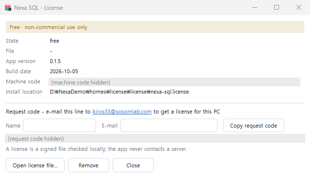

# License

**English** | [한국어](License-ko)

Nexa SQL verifies a genuine copy with a single **offline license file**. It does not contact a server, and the file is signed, so any change makes it invalid.

## What you can use for free

> **Now (since 09-28)**: **every feature works even without a license** (personal use = all features). The "What Pro unlocks" table below is the rule set that applies when feature gating is **turned on** (hidden setting `license.gates=on` · off by default), and some features may be restricted in the future.

Connections (4 DBMS types) · running statements · the result grid (including editing) · scripts and variables · the whole editor · the explorer · the CLI (`nsql run/export/import`) — **there are no performance limits** (row counts, speed and memory are never limited by the license). The free edition shows `Free · non-commercial use only` in the status bar (license PolyForm NC · commercial use requires a paid license).

## What Pro unlocks (convenience features with a free alternative)

| Feature | Free edition | Alternative |
|---|---|---|
| Import Data window (file → table) | Pro | `nsql import` (CLI · free) |
| Installing from the Driver Manager | Pro | Copy the extension folder by hand |
| Workspace auto-restore and unsaved-tab recovery | Pro | Save and open the project by hand |
| Bookmark groups | Pro | Plain bookmarks (toggle / next / previous) are free |
| Clause-aware completion and detail cards | Pro | Keyword and object-name completion is free |
| Image preview and file insert in the value window | Pro | Save the value to a file and open it there |
| Formatted (HTML) copy | Pro | Plain-text copy |
| Log export to a file | Pro | Select and copy in the log window |
| Simultaneous connections | 2 (shared) / 2 (dedicated) | Disconnect first, then another server · 2 instances |
| Editor tabs | 5 | Close a tab · split the work into projects |
| Editing size | 2 MB or more = read-only (running still works) | `nsql run <file>` · split the file |
| Result tabs | 2 | Save results to a file · re-run |

Locked features do not disappear from the menus. When you choose one, the status bar and the License window show "Pro feature. Free alternative: …".

## Getting a license (3 steps)

*License window: state · version · copy request code (the machine code and request code are hidden in the picture)*

1. **Create a request code**: in the app, Help ▸ License (or click the status bar badge) → enter your name and e-mail → **Copy request code**. Command line: `nsql license request "Name" email`. It is a single line and contains only a **hash** of this PC's machine ID.
2. **Send it by e-mail**: send the one-line request code to **kiros33@sosomlab.com** (the address is also in the hint line of the window). Once issued, a `nexa-sql.license` file comes back as an attachment.
3. **Install**: License window ▸ **Open license file…** or `nsql license install <file>`. Only a file that passes verification is copied to `<settings folder>/license/` (the original stays as it is). Check for `licensed` with `nsql license status`.

## Changing or adding a PC

A license is valid only on the registered PCs (personal = up to 5). Create a request code on the new PC and send it, and the license is **reissued** under the same license ID (5 times a year); you only need to replace the file. A file copied from another PC is rejected as `invalid(machine)`.

## Backup and removal

- Backup: `nsql license export <file>` (copies the installed file) · restore: `nsql license import <file>` (= install).
- Removal: License window ▸ Remove, or `nsql license remove` (deletes only the file in the user folder).
- **Validity period**: by default **issue date + 3 years** (`expires` in the file · Expires in the window). After expiry you are back to the free level; renew by reissue.
- **Version range**: a license is valid up to the **major version** at the time of issue ("Valid up to major" in the window · e.g. `0.x`), and an edition with a different major version needs a new license. If a new license is required from a specific version on, "Invalid from version" shows that version. Editions outside the range become `outdated` (free level), and **earlier editions remain fully licensed**.

## When the state looks wrong

| Status bar | Meaning | What to do |
|---|---|---|
| `⚠ License invalid (signature)` | The file is damaged or tampered with | Reinstall the file you received |
| `⚠ License invalid (machine)` | A file from another PC | Get it reissued with this PC's request code |
| `⚠ License invalid (norootkey)` | An edition whose app does not know the public key yet (internal build) | Use an official release |
| `⚠ License does not cover this version` | This edition is after `updates_until` · the major version changed · at or after `max_version` | Reissue, or use an earlier edition |
| `⚠ License expired` | Trial or subscription expired | Reissue |

For developers: the gates are off by default in both Debug and Release builds (D-145). To test them, turn on the hidden setting `license.gates` (`nsql config set license.gates on` · the old name `license.gates_dev` is still read).
