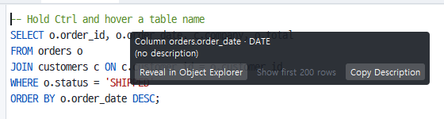

# Ctrl object links and description tooltips

**English** | [한국어](Object-Links-ko)

In the SQL editor, **while you hold Ctrl (⌘ on macOS)**, the names of tables, views, columns and procedures/functions in a statement become **links**. When you move the mouse over one, the name is underlined and the object's **description (comment)** appears as a tooltip; clicking can copy the description.

## Quick start (3 minutes)

*Ctrl link card — column · type · description · Reveal in Object Explorer / Copy description buttons*

1. While connected, put the cursor in an SQL tab, hold **Ctrl** and move the mouse over a name. By default **only the link under the mouse** gets a 1 px underline (you can change it to "All links while Ctrl is held" in the setting `objlink.display`).
2. `Table TB_ORDER` + the description appears **at the top right** (schema prefix with `objlink.show_schema` · off by default). Without a description you see "(no description)". If the name is **not in the current connection's metadata** (a table in another DB · a typo), the underline becomes a **light brick-red wave** and **no tooltip or card appears** (10-08 · underline only) — the position is structurally an object, but there is nowhere to get a description from.
3. **Ctrl+click** = by default it **adds a caret** (multi-cursor · the same spot again = remove), as elsewhere in the editor. The setting `ctrl.click` can change it to **Copy description** (description to the clipboard · the status bar says "Copied description of …") or **Reveal in Object Explorer**. **Ctrl+Shift+click** = copy as `name - description` (table `TB_ORDER - Orders` · column `TB_ORDER.ORD_NO - Order number` · schema prefix with `objlink.show_schema`). **Ctrl+right-click** = the editor menu by default; with the setting `ctrl.right_click` = **Link menu** you get the menu "Copy Description" · "Copy Name - Description" · **"Reveal in Object Explorer"** (enabled only on links confirmed as real objects — it expands the Object Explorer on the left down to that object and selects it. Besides tables, views, procedures, functions and packages, `package.procedure` selects that member under the package's Procedures/Functions, and a column selects that column under the table's Columns. If the folder has not been read yet, it waits a moment while it is read and then selects it).
4. Release Ctrl and the underline and tooltip disappear; the editor behaves as usual.

> **From the keyboard**: put the caret on an object name and press **F4** (or palette ▸ "Reveal in Object Explorer") to select that object in the Object Explorer on the left — for a column, that column under its table. No need for Ctrl or the mouse (2026-10-05).
> **Object info in a tab**: pick an object in the explorer and press **Shift+F4** (palette ▸ "Open object info in a tab") to open the content of the object detail panel below as a read-only tab `ℹ schema.name` (for copying, searching, comparing · no need to save). Palette ▸ **Show first 200 rows** queries the selected table or view right away and shows it in a new result tab.
> **The same name in another schema**: if a name written without a schema is not in the current schema, the link stays "unconfirmed" and is not quietly switched to another schema. Instead, if another schema has the same name, the right-click menu (or F4) shows a **Same name in other schemas ▸** list so you can choose one yourself and reveal it in the explorer.
> **From the result grid**: right-click a column header ▸ "Reveal in Object Explorer" to select that column of that table in the explorer. It works only for a result that queries one table as is — for results with joins · GROUP BY · DISTINCT · computed columns the item is dimmed (it goes there only when it is certain which table the column belongs to).

> **Hovering without Ctrl**: leave the pointer on an object name for about 0.7 seconds and only the description tooltip appears (no underline · a click moves the caret as usual). It disappears when you move away or press a key. To turn it off = `objlink.hover_ms` 0 (2026-10-05).
>
> **Buttons on the hover card**: three buttons are attached under the tooltip — **Reveal in Object Explorer** (expand and select the object in the tree) · **Show first 200 rows** (query a table or view in a new result tab) · **Copy description** (Shift+click = `name - description` · 10-08). Moving the pointer onto the card keeps it open, and pressing a button closes it. For text only, without buttons: `objlink.card_buttons` off (2026-10-06).

## What becomes a link

| Position | Treated as |
|---|---|
| `FROM t` · `JOIN s.t` · `INSERT INTO t` · `UPDATE t` · `FROM a, b` | Table/view |
| `a.col` (a = alias) | Column of a's table |
| `col` (no prefix) | The table in the statement that has that column (if the column lists are not read yet, on the next Ctrl) |
| `fn(` · `pkg.fn(` · `s.pkg.fn` | A procedure/function/package in the catalog (not built-in functions like `NVL` · `SUM`) |
| Keywords · aliases themselves · WITH/derived table names · strings · numbers · binds · comments | Not a link |

Descriptions come from the Object Explorer's metadata (comments). Comments not read yet are requested on the first hover and filled in shortly.

> **When the schema you wrote does not have it** (10-08): if the schema you wrote, as in `APPDB.SP_X`, does not have that object, you only see the brick-red wave (unconfirmed). It does not look in other schemas for you — a link only checks whether the object **really exists in the schema written (or the current schema if none)**.

> **In DDL and extended properties too** (10-08): columns in `ALTER TABLE … ADD (…)` · `MODIFY`, SQL Server's `ADD a T, b T` without parentheses, `COMMENT ON COLUMN schema.table.column`, and `PRIMARY KEY (…)` lists become column links. **Constraint names** (`ADD/DROP CONSTRAINT PK_…`, `CONSTRAINT DF_… DEFAULT …`) are links too; hovering shows the kind (PK/UK/FK/CHECK), columns and references, and right-click ▸ Reveal in Object Explorer selects that constraint under the table. **Names inside extended property argument strings**, as in `EXEC sys.sp_addextendedproperty … @level0name = N'dbo', @level1name = N'TB_ORDER', @level2name = N'ORD_NO'`, also become schema, table and column links.

## System objects

**System package members** such as `DBMS_XPLAN.DISPLAY_CURSOR` · `DBMS_OUTPUT.PUT_LINE` and **dictionary objects** such as `ALL_TABLES` · `DUAL` become links even though they are not in the explorer (built-in table). The tooltip of a system package member is its **signature** (argument list). "Reveal in Object Explorer" is off for them because they are not in the explorer. Packages not in the built-in table are not links yet.

## In boost mode and large files

- In **Speed boost mode** (Preferences ▸ Performance `perf.boost`) and **large-file mode** (L1 and up) the underline is **not drawn** (the display mode is fixed to "Do not draw" · nothing to redraw). Holding Ctrl over a name still gives the tooltip and the clicks.
- In large-file mode, or when the document is larger than `objlink.max_kb` (default 512 KB), only the **visible part** (out to the ends of the statements before and after) is analyzed.
- It does not work in tabs whose syntax is not SQL. Without a connection, every name shows as an unconfirmed object (brick-red underline · no card).

## Settings (Preferences ▸ Editors ▸ Object Links)

| Key | Default | Meaning |
|---|---|---|
| `objlink.enabled` | on | Links while Ctrl is held |
| `objlink.display` | Only under the pointer | How underlines are shown: All links while Ctrl is held · Only under the pointer · Do not draw (actions only) |
| `objlink.tooltip` | on | Show the description tooltip |
| `objlink.tooltip_pos` | Top right | Tooltip position (Top right · Top left · Bottom right · Bottom left · never goes outside the window) |
| `ctrl.click` | Add caret | **Ctrl+click action** (Settings ▸ Ctrl Key): Add caret (multi-cursor · the same spot again = remove) · Copy description · Reveal in Object Explorer. An old `objlink.click` value is moved over automatically. |
| `ctrl.right_click` | Editor menu | **Ctrl+right-click**: Editor menu · Link menu (Copy Description · Copy Name - Description · Reveal in Object Explorer). |
| `ctrl.shift_click` | Copy name - description | **Ctrl+Shift+click**: Copy name - description · Copy description · Editor (range selection). |
| `objlink.hover_ms` | 700 | Without Ctrl, leaving the pointer on an object name this long (ms) shows only the description tooltip (no underline or click action) · 0 = off (only while Ctrl is held) |
| `objlink.card_buttons` | on | Attaches three action buttons to the hover tooltip (Reveal in Object Explorer · Show first 200 rows · Copy description) · off = text only |
| `objlink.show_schema` | off | Adds the schema to names in the tooltip and status bar (`APPDB.TB_ORDER`) · off = `TB_ORDER` (columns as `table.column`) |
| `objlink.line_color` · `line_width` · `line_style` | theme accent · 1 px · Solid | Underline color `#RRGGBB` · thickness (0 = no underline) · shape (Solid · Dashed · Dotted · Wavy · Dashed wavy) for **known objects** (in the metadata) |
| `objlink.bad_color` · `bad_width` · `bad_style` | `#B7472A` brick red · 1 px · Wavy | Underline color · thickness · shape for **unconfirmed objects** (not in the current connection's metadata) |
| `objlink.max_kb` | 512 | Documents larger than this are analyzed only in the visible part (0 = unlimited) |

> The click action may later change to an "object info tab" (design [docs/77](../77-data-workbench-architecture.md) · [docs/96](../96-object-links.md)).
