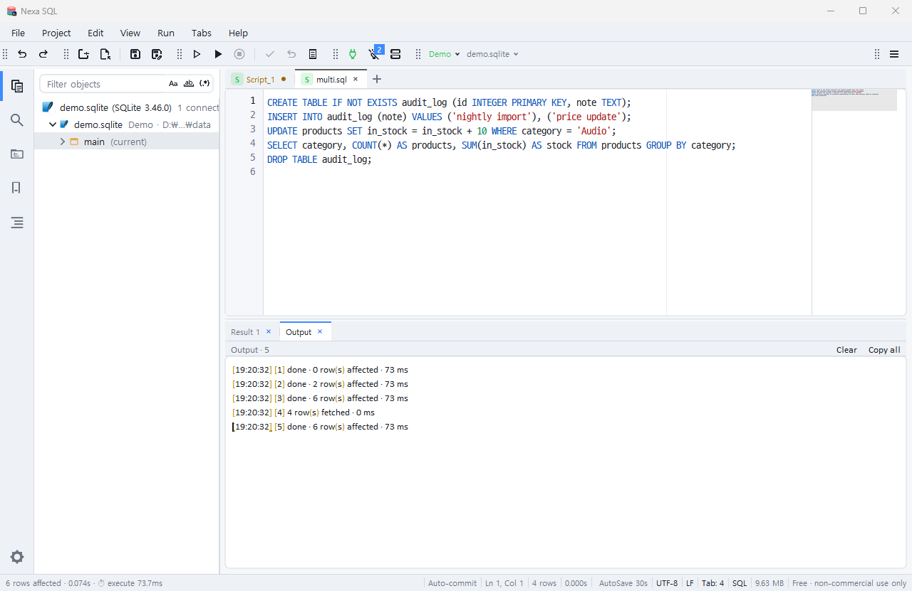

# Output tab — server messages · PRINT · compile results

**English** | [한국어](Output-Tab-ko)

The result area has an **Output** tab (next to Result 1, Result 2 …). It collects "messages" rather than query results.

- Text sent by the server: Oracle `DBMS_OUTPUT.PUT_LINE` · SQL Server `PRINT`/`RAISERROR` · PostgreSQL `RAISE NOTICE`
- SQL*Plus-style `PRINT variable` · `EXEC` results (`:X = 7`) · `SHOW VARIABLES`
- **Compile results** when you create a procedure, function, package, trigger or type: `PROCEDURE APPDB.SP_X compiled · no errors` or `Warning: … created with compilation errors` + a list of lines/columns
- Warnings (`⚠`) · errors (`✖ line 3: …`) · statement completion lines (`[2] done · 0 row(s) affected · 57 ms` · `[6] 1 row(s) fetched · 41 ms`)

Each line starts with `[HH:MM:SS]`. The header has **Clear** and **Copy all** buttons, and you can use drag selection, Ctrl(⌘)+C, right-click **Copy** and **Select All** — all of these work. **Double-click** an error line (`✖ line 3: …`) to jump to that line in the editor. If a new message arrives while you are looking at another tab, the tab title changes to `Output (N)` and goes back once you look at the tab. A run that produced only messages and no query result (compile, DDL, PRINT) does not create an empty result tab.
Each editor tab has its own Output, and its content stays when you close the tab (it is still there when you reopen it).

*Output tab — completion line per statement · rows affected · time*

## When it appears

| Way | How |
|---|---|
| Open/close it yourself | **View ▸ Output** (Ctrl+Shift+O · Mac ⌘⇧O) · Command Palette "View: Show Output" · the × on the tab |
| Automatically when a message arrives | Setting `output.show` = **auto** (default · the tab appears when the first message arrives) · `errors` (only when a warning or error arrives) · `always` (from the start) · `off` (only when you open it) |
| Switch to that tab automatically | `output.activate` = **When the run has no result set** (default · switch to Output for runs with no query result, such as compile, DDL or PRINT · errors always switch) · `always` · `never` (the tab appears but stays in the background). Switching keeps the focus in the editor |

## Line colors · Find

- Error lines (`✖`) are shown in **red**, warning lines (`⚠`) in **yellow**. PostgreSQL `RAISE WARNING` is a warning; `RAISE NOTICE` and `INFO` are normal lines (regardless of the server language setting). SQL Server `RAISERROR` with severity 10 or lower (informational messages) is shown as a normal line.
- Click the Output tab, then press **Ctrl+F** (Mac ⌘F) to find inside Output (next/previous, match markers). There is no Replace (read-only).

## Moving between result tabs

Even while you are looking at the Output tab, running a statement that returns a result set **brings you back to the result tab** (with `output.activate` set to `always`, Output stays in front). Even when Output is open, results always go to the most recent result tab.

## F5 in an object source tab

In a tab opened from the Object Explorer with **Open source** for a procedure, function, package (Body), view, trigger or type, F5 (**Run all**) does not split the text into statements but sends it **as one unit**
(one CREATE OR REPLACE = one compile). The result arrives in Output as `▶ PROCEDURE APPDB.SP_X - running the whole source as one unit (F5)`, then a completion line and the compile result.
That tab is attached to a session on the server that owns the object (even if another server is active). If the object's schema differs from the session's current schema, F5 shows a ⚠ notice in Output (a strong warning that it will be created in the current schema if schema qualification is turned off). The same applies to a tab created with **Open in editor** in the **SQL Preview** window (a DDL preview). Ctrl+Enter (**Run statement**, run selection) works as usual, so you can run just a SELECT inside it and see the result grid.

## Related settings (Output category)

| Key | Default | Meaning |
|---|---|---|
| `output.show` | auto | When the tab appears |
| `output.activate` | no_results | Rule for switching to the Output tab when a message arrives |
| `output.done_lines` | on | Statement completion lines (off = messages only) |
| `output.timestamps` | on | Time at the start of each line |
| `output.max_lines` | 5000 | Lines kept per editor tab (oldest lines are dropped beyond this) |
| `output.serveroutput` | on | `SET SERVEROUTPUT ON` for every new Oracle session (off = only when the script turns it on · applies to new connections) |
