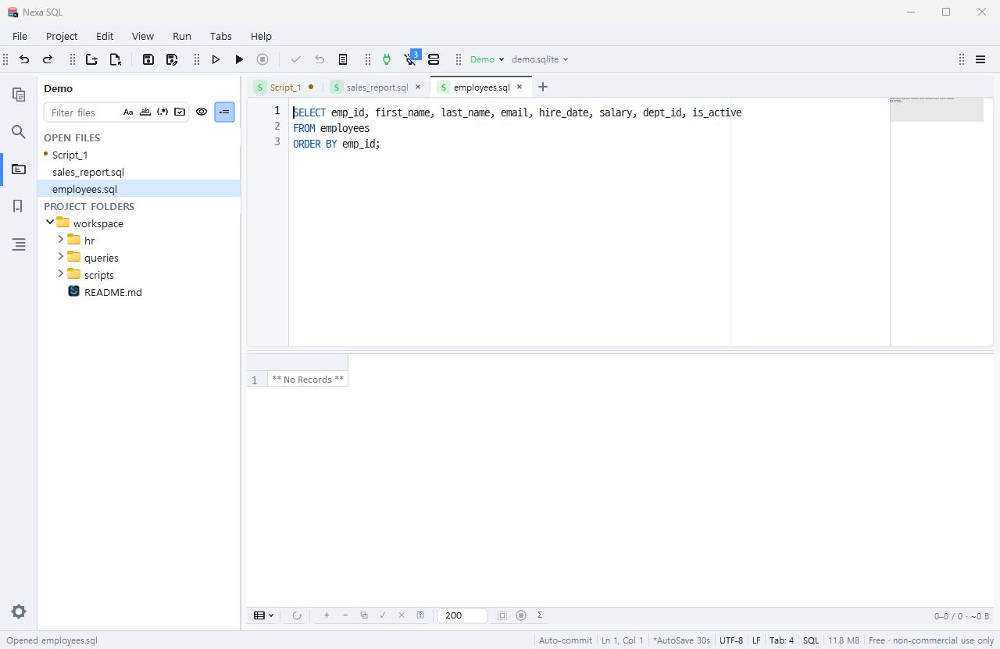
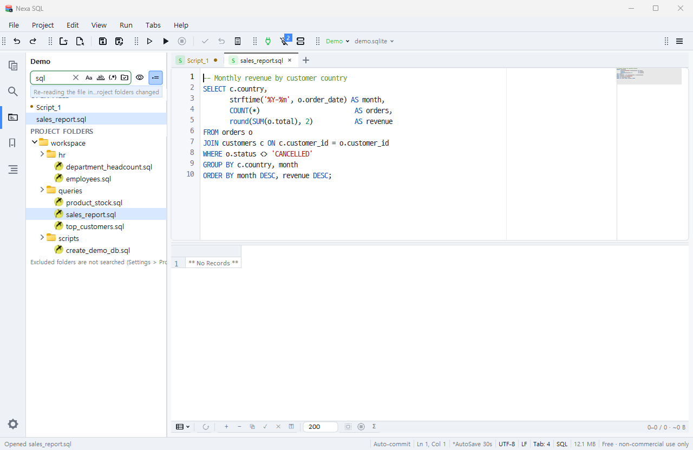

# Projects and the workspace

**English** | [한국어](Project-Workspace-ko)

## Three working modes

| Mode | How to turn it on | Where state is kept |
|---|---|---|
| **File mode** | Just start the app | Global settings (`%APPDATA%\nexa-sql`) |
| **Folder mode** | `nexa-sql .` · `nexa-sql <folder>` | That folder's **`.nsql/`** (for now bookmarks · `${workspaceFolder}` = that folder · start folder of the file dialog — designed so that settings and other features can share the same place) |
| **Project mode** | Open a `.nsql-project` or pass it as an argument | Inside the **project file** (below) |

The priority is project > folder > file. When you close a project, you return to the mode you started in (folder or file).

The project file (`<name>.nsql-project` · JSON · anywhere · fine to put in version control) holds the **folder list + the workspace**. When you open the project, your last working state comes back as it was.

## What goes into the project file

| Item | Description |
|---|---|
| `folders` | Explorer root folders (relative to the project file) |
| `selected` | The item last selected in the explorer |
| `tabs` | Editor tabs **in order** — file tabs keep only the path, untitled script tabs keep the **text** too (up to 1 MB) · per tab, the caret position + the text of that line and the lines around it (a **fuzzy re-search** finds the same line even if the file was changed outside) |
| `active` | The active tab |
| `bookmarks` | All bookmarks (while a project is open, bookmarks are saved only in this file) |
| `expanded` | The **folders you expanded** in the Project Explorer (relative paths) |
| `panel` | The side panel that was showing (`project` · `bookmarks` · `search` · `ext`) |
| `search` | The search text of the Find in Files panel |
| `bm_collapsed` | Groups collapsed in the Bookmarks panel |
| `profiles` | Names of the connection profiles that were connected last — **a marker only**. Reopening does not connect automatically; you are told in the log and a toast, so connect yourself |

**Paths in the project file** are written so the project survives being moved or copied to another PC or OS (format version 2): a file under the project file's folder is written **relative** (`sql/a.sql`) · a file inside another registered folder is written as `${workspaceFolder:<folder name>}/…` (for example `${workspaceFolder:lib}/b.sql`; the name is the folder's own name, and no anchor is used when two registered folders share a name) · a file under your home folder is written as `${userHome}/…` · anything else stays absolute. These are the same names as the script built-in variables. Older files (version 1, relative paths only) open as before. A file written by a **newer** version of Nexa SQL is not opened (the status bar says `project file version N is newer than this app supports`), because saving it would drop what this version does not know. If a tab's file cannot be found when the project opens, the tab is not opened, the log says `Project tab not opened - file not found: … (kept in the project file)`, and the entry stays in the project file.

`preview: true` on a tab entry means it was a preview tab (opened with a single click in Bookmarks or the explorer), and it is restored as a preview tab.

**Saving always captures the current workspace** — **Save Project** · **Save New Project** · **Save Project As** · adding/removing folders · auto-save · exit (when auto-save is on) all go the same way. **Opening replaces the workspace** — open tabs that are not in the restore list are closed (if there was a previous project, their state is already in that file and its snapshots · unsaved tabs you were using without a project stay). Choosing or saving the same project again does not run the restore, so tabs do not pile up.

The project file has **two layers**: on top a human-readable JSON header (folders · tab metadata · panels · bookmarks), and from the `%%NSQL-BLOBS%%` line down, for each tab one `tab=<id> len=<bytes>` line + **the text bytes as they are** (no escaping). **Unsaved edits** of file tabs are not written to the original file but kept **per tab** in this block (up to 1 MB · the header holds the disk hash at that time, `hash`, and `"blob": true`). The next time you open the project that text **comes back automatically** (unsaved mark ●), and if the file was changed outside in the meantime the log says so. The `backups/files/` snapshots in the user settings folder are kept **only as backups** (not used for restore · cleaned up after `project.backup_days`). Bookmarks placed in untitled tabs are saved with the project too and attach to the same line when you reopen (tab `id` remapping).

## Auto-save · exit

Settings category **Project**:

| Key | Default | Meaning |
|---|---|---|
| `project.autosave` | on | Saves the project file every 30 seconds (only when something changed) + 2 seconds after you open, close or move a tab + at exit |
| `project.autosave_secs` | 30 | Interval (seconds · 5~3600) |
| `project.backup_days` | 7 | Days to keep unsaved snapshots |
| `project.auto_reveal` | off | When you select a tab, the explorer expands down to that file and scrolls to it (off = no expanding, only the selection mark) |
| `project.icons` | on | File/folder icons in the explorer (OS icons · off in boost mode). When on, the OS shell icon cache is loaded into the process once and uses about 2 MB more; the lookup thread retires by itself 5 seconds after the lookups end |

**Auto-save indicator in the status bar** (`statusbar.autosave`): shows the setting value (`AutoSave 30s` / `AutoSave off`). Click it for a menu.

| Item | Action |
|---|---|
| Open project folder | While a project is open — opens its folder in the OS file manager **with the project file selected** |
| Open auto-save location for files | The unsaved-snapshot folder for file tabs — **with the current tab's latest snapshot selected** (or just the folder if there is none) |
| Auto-save settings | Opens the settings window at `project.autosave` |

(On Linux only the folder is opened, without selecting the file — every desktop does it differently.)

**Close Project** (Project ▸ Close Project · "No project" in the switch list): saves the whole state to the project file (+ unsaved snapshots), then returns to the **first-start state** — only one empty `Script_1` tab is left, the side shows only the Object Explorer, and the Bookmarks panel shows the **local set** (the project's bookmarks live only in the project file). If you use **Save New Project** in file mode, the bookmarks you had are **moved** into the project (the local file is emptied) and do not remain after you close the project. Connections stay as they are.

Exit (the window's X and File ▸ Exit follow the same flow): with auto-save, the project is saved (the bookmark file is also written right away, without waiting for the debounce) and the app exits → otherwise, **only when there is something to save**, you are asked "Save project and exit / Exit without saving project / Cancel" (not asked if you just saved) → then for **each unsaved file tab** you are asked whether to save it (untitled script tabs are not asked about, because their text is kept in the project · without a project you are asked about all of them).

- **When an open file changes outside** (10-07): if the tab has no edits it is re-read; if it has edits that do not overlap, it is merged automatically. A toast **"External change applied"** then appears at the bottom right of the editor (reloaded / merged N places - Ctrl+Z undoes it). To turn it off: Settings ▸ External changes (`file.external_notify`). Even when off, it still shows in the status bar and the log. It is checked when the window becomes active · when you switch tabs · on the active window's periodic check (`file.external_poll_ms`).

- **Saved time in the tab tooltip** (10-07): hovering over a tab shows `saved: YYYY-MM-DD HH:MM:SS.mmm` on the card — the file's last modified time (whether you saved it in the app or changed it outside). A tab that was never saved shows `saved (project file)` with the time the project file was last saved (`-` if there is no project). This line is at the very bottom of the card.
- **Tab of a file deleted from disk** (10-07): if an open file is deleted outside, a red band appears above the editor and the tab line and dot turn dark red. The tab is treated as unsaved, so you are asked when you close it, and saving it creates the file again. If it was a preview tab, it becomes a regular tab and does not disappear when you click another file.
- **File index refresh notice** (10-07): at the top of the Project Explorer you briefly see "Re-reading the file index - <reason>" (new file saved · folder watch overflow or root removed · refresh interval · project folders changed · first read) or "Folder change applied: <folder>". When folder watching (`project.watch`) is on, there is no periodic re-scan (`project.index_ttl_secs`); only the changed folders are re-read.

## Project Explorer (activity bar ▸ Project)

*Project Explorer — open files · project folders*

*File filter = the same file index as Ctrl+P · only matching files and their parent folders*

- **OPEN FILES** (at the top · shown **even without a project**): open tabs in order · small dot = unsaved · the active tab is highlighted · tabs in side-by-side editing panes are outlined · click = go to that tab · the × on the hovered row = close.
- **File filter = the same file index as Ctrl+P** (10-07): as you type, it looks up the index right away without walking the folders again, and the tree shows **only matching files and their parent folders** (up to 2,000 · beyond that "…and N more matches - type more to narrow") · while the index is being read the filter box shows a progress ring · a note says that excluded folders (Settings ▸ Project ▸ Excluded folder names) are not searched · expanding a result folder fills in that folder's real files again · clearing the text brings back the normal tree.
- **File filter**: toggles inside the box `Aa` (match case) · `ab` (whole word) · `(.*)` (regex) · **include path** (when on, matches against the `folder/name` path) · to the right of the box = toggles for showing hidden files · dot files (Windows) (the same settings as the file dialog).
- **Type-ahead**: when the list has focus, typing letters jumps to that name (OPEN FILES included · Korean too · [Explorers and filters](Explorers-and-Filters.md#type-ahead--type-letters-to-jump-to-a-name)).
- Tree: chevrons · OS icons · horizontal scrolling · right-click on a root = **Remove Folder from Project** · click on empty space = clear the selection (the last row keeps only its border as the starting point for ↑/↓).
- Right-click an editor tab ▸ **Reveal in Project Explorer** (enabled only for files inside the project folders).
- If the filter would have to list a lot, "Scan stopped at N entries (project.scan_max)" (only when a limit is set in `project.scan_max` — default 0 = unlimited — and folders are still left to list).
- **Rules that move with the tabs** (10-07): clicking an editor tab = selects that row in OPEN FILES + scrolls it into view · the tree only shows the selection mark · clicking an OPEN FILES row = activates that tab · the tree only shows the selection mark · clicking a file in the tree = opens a tab (preview) · the focus stays on the clicked tree row · only "Reveal in Project Explorer" scrolls the tree.
- **When a tab closes**: when a preview or extension tab closes, the current position is kept (`tabs.close_preview_focus` = keep) · when an editor tab closes, focus moves to the OPEN FILES row of the newly selected tab (`tabs.close_editor_focus` = move) — [Settings ▸ Tabs](Settings.md#tabs-10-07).

## Commands

Project menu: **Save New Project** (also from file mode) · **Open Project** · **Switch Project** (recent list) · **Save Project** · **Save Project As** · **Close Project** · **Add Folder to Project**. Bookmarks inside a project from the CLI: `nsql bookmark list --project x.nsql-project`.

## File open/save window

- **Start folder** = the first open after starting the app (or after the working mode changes) uses the folder the project file is in · in folder mode that folder · after that, the folder you were last in.
- At the top of **Recent** on the left, the location of the current mode ("Project location" · "Folder location" · "File location") is always shown.
- **Rename** = right-click ▸ **Rename**, or click the selected item once more · **Delete** = Delete moves it to the Recycle Bin (restore from the OS) · Shift+Delete deletes permanently (press it again within 5 seconds to confirm).
