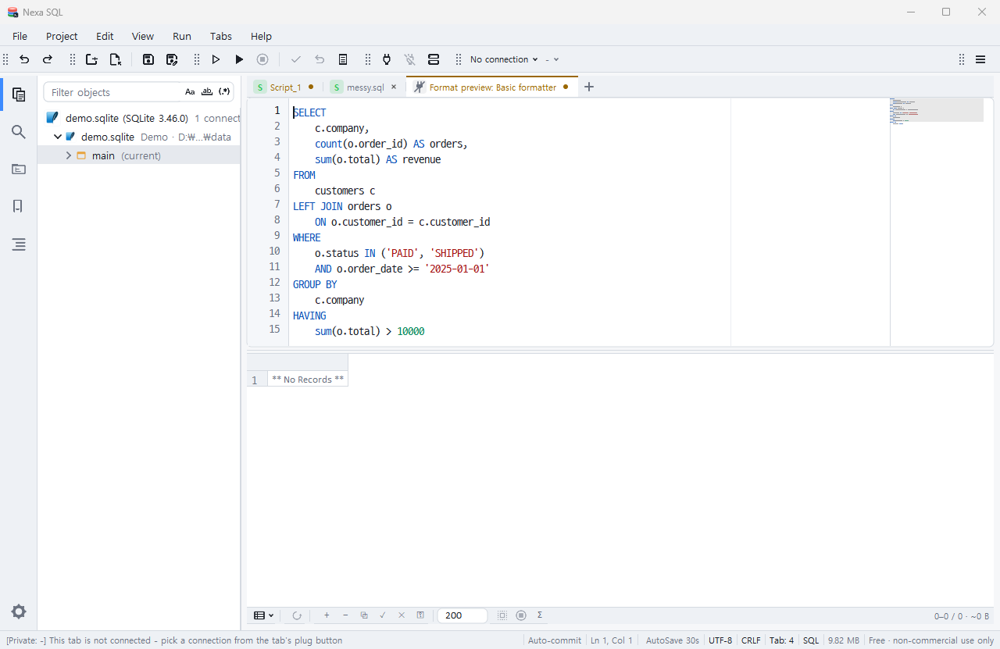

# Format SQL

**English** | [한국어](SQL-Formatting-ko)

**Shift+Alt+F** = format with the default formatter (only the selection if there is one, otherwise the whole document · undo with Ctrl+Z).
The Edit menu and the Command Palette have the same items.

## Two formatters

| Formatter | Where | Features |
|---|---|---|
| **Basic** (built in) | Default | Clauses on their own lines · one item per line · comma position/spacing · `WHERE 1=1` seed · letter case · subqueries expanded · short CASE on one line |
| **SQL Formatter for kiros33** (extension) | Command Palette ▸ Extension Manager: Install Extension | On top of the Basic common options: **vertical alignment with tabs** (AS · comparison operators · ORDER BY direction) · AND/OR in the WHERE column · dashed separator lines around set operators · `ext.sqlfmt_kiros33.strict` (default on) = enforce the skill's prescribed values |

*Format preview tab — SQL written on one line, tidied by the Basic formatter*

## Common workflow

1. **Use once**: Palette ▸ "Format With" ▸ `Format with SQL Formatter for kiros33`.
2. **Make it the default**: in the same list, "Set … as the default formatter" → from then on Shift+Alt+F uses that formatter (setting `format.default`).
3. **Preview**: Palette/Edit ▸ "Format Preview" → a read-only tab shows the formatted result of the current document (or the selection · example SQL if empty). Changing `SQL Formatting`/`SQL Formatter for kiros33` values in the settings window **redraws it immediately** (the original is not changed · closing the tab ends it).

## Common options (Preferences ▸ Editors ▸ SQL Formatting · `format.*`)

Indent unit (tab/spaces) · width · keyword/identifier/function case · comma position (line start/line end) · spacing after the comma (space/tab) · AND/OR position · `WHERE 1=1` seed · lists (one item per line/one line/auto) · line width · CASE one-line limit · operator spacing · aliases on every column · column/table alias `AS` (keep/add/remove) · JOIN indentation · keep one-line DML · blank lines between statements · maximum consecutive blank lines · newline · final newline · `;` line.

**Basic and the extension both** read these options. With `ext.sqlfmt_kiros33.strict` on, kiros33 enforces the skill's prescribed values (tab · width 4 · leading comma · `,\t` · `1=1` · uppercase · AND at line start); with it off, it follows the common values above.

## What is kept as written

DDL · SQL inside comments · short `INSERT … VALUES`/`UPDATE`/`DELETE` written on one line (setting `format.keep_oneliners`). PL/SQL blocks (`DECLARE`/`BEGIN`/`CREATE … PROCEDURE …`) are kept as written by default; with `format.plsql` = indent, the original line breaks stay and each line is re-indented by block depth. Automatic aliases (`format.auto_alias`) and dialect renaming of functions and set operators (`format.dialect_target`) are off by default. Table description comments are not added yet.

## Building a formatter extension (SDK)

Copy the `extensions/sdk` sample `sql-formatter-kiros33`, declare `Meta.formatter` and implement `Extension::format(&FormatRequest)`. The common options can be read as is with `Options::from_pairs(req.options)` from `nsql-format`. Details = `docs/95-sql-formatter.md` §5.
