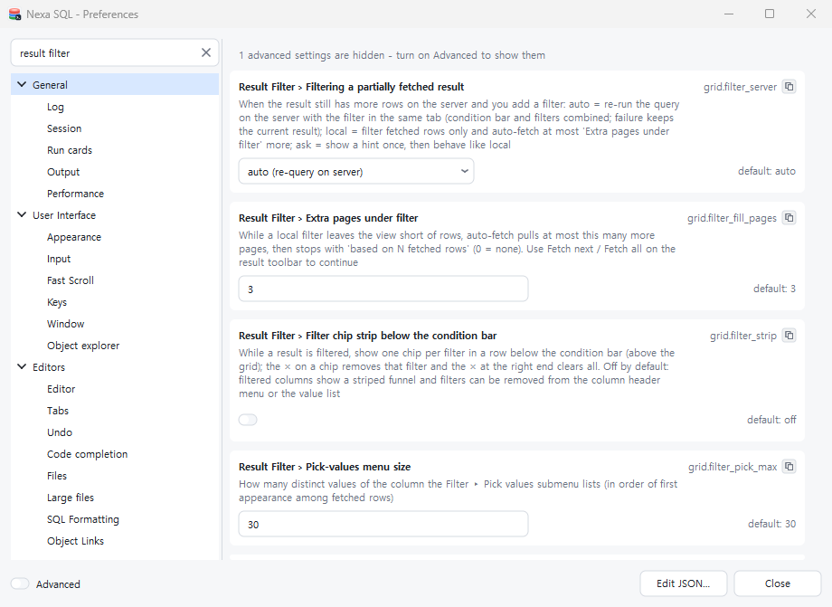

# Settings window

**English** | [한국어](Settings-ko)

Open it with **Edit ▸ Preferences** (Ctrl+,). The left side has a search box and the category tree; the right side lists the setting cards. Values are saved and applied as soon as you change them.

*Settings window — cards filtered by the search text (result filter) · key names · default values · category tree on the left*

## Card order

Cards are laid out **group → category → key prefix → registration order**. Even when one category holds several prefixes (for example `session.` `tx.` `vars.` `run.` `db.` in the Session category), keys with the same prefix stay together instead of scattering. Search results use the same order.

## Copying key names

Next to the key name at the top right of a card (such as `session.autocommit`) there is a **copy button**.

| Action | Result |
|---|---|
| Click | Copies that key name → the button turns into ✓ and changes back after a moment (`ui.copy_feedback_ms`) |
| **Shift+click** or **Ctrl+click** (Mac ⌘) | Copies **every** setting shown on screen right now — a `# Category › Title` line + `key=value` lines (settings.conf format, so you can paste it as is) |

Copied keys work directly in the CLI: `nsql config get session.autocommit` · `nsql config set …`.

## Advanced

When the **Advanced** switch at the bottom left is off (default), settings you rarely change are hidden. If anything is hidden, "N advanced settings are hidden - turn on Advanced to show them" appears at the top of the list. Turn it on to see everything; advanced settings show their **key name in the accent color**.

What counts as advanced:
- Every setting in the DBMS group (Drivers · Oracle · SQL Server · PostgreSQL · MySQL / MariaDB · SQLite)
- Implementation constants — millisecond times · budgets · limits · thread counts · cache sizes · polling intervals · retries
- Behavior rules you set once and rarely touch again (for example the row-identification details of grid editing)

Settings you touch often, such as fonts, colors, on/off switches, modes and the autosave interval, are shown by default. CLI `nsql config list` also lists the advanced settings.

The following settings are also described here; they are shown by default (not advanced):
- **Back up DDL before DROP** (`backup.object_drop` · default on · Object backup category · formerly `explorer.drop_backup`, 10-01): before an object is dropped (Explorer ▸ Delete… or a DROP statement run from the editor) its current DDL is written to a file first. On a Production connection a failed backup blocks the drop.
- **Ignore repeated button clicks within (ms)** (`ui.click_guard_ms` · default 350 · 09-30): a second press of the same button or toolbar item within this time is handled only once (guards against accidental double clicks on Run, Commit, Save). 0 = off.
- **Open source: qualify with owner schema** (`explorer.source_schema` · default on · 09-30): the header line of "Open source" in the object explorer becomes `CREATE OR REPLACE PROCEDURE SCHEMA.NAME` (same as DBeaver · one space between the kind word and the name). When the same name exists in several schemas, running it does not overwrite the object in your current schema. Off = the stored name as is.
- **Select All keeps the view** (`editor.select_all_view` · default **Keep current position** · 09-30): after Ctrl(⌘)+A the view stays where it is (the caret goes to the end). Choose "Move to the end" to scroll to the end as before.
- **Time units** (09-30): time settings whose default is 10 seconds or less use ms (`_ms`); longer ones use seconds (`_secs`) or minutes (`_min`). Old keys whose unit changed (`ui.toast_secs` · `probe.timeout` · `probe.retry_delay` · `run.toast_hide_secs` · `meta.refresh_idle_secs` · `project.autosave_change_secs`) are migrated automatically in the file (seconds × 1000), and `nsql config get/set old-key` still works in the old unit (seconds · decimals allowed).

## Changed

Turn on the **Changed** switch to the right of **Advanced** to see **only settings that differ from their defaults** (regardless of Advanced · narrowed further by the search text). It is a review view, so it starts off every time the window opens. After you turn it on, a card stays in the list even if you set its value back to the default (turn the switch off and on again to recompute the list). If nothing has changed, "No settings differ from their defaults" is shown; if hidden keys that do not appear in the settings window have changed, "N hidden settings also differ from their defaults" is shown (list them with CLI `nsql config list all`).

## Categories · key naming

- A key has two parts: `<prefix>.<name>`. The prefix says what the setting **does** (`tx.` transactions · `vars.` variables · `grid.` result grid).
- There is a separate **Large files** category (Editors group · after Files) — large-file levels L1/L2 · open choice · partial view · asynchronous loading ([Large Files and Limits](Large-Files-and-Limits.md)). Right after it come **External changes** (`file.external_*`) and **Find in Files** (`search.*`), split out of Files on 11-21.
- Renamed keys keep working under their old names (the settings file is migrated to the new key when read, and the CLI accepts the old name too):

| Old key | New key | Location |
|---|---|---|
| `ui.ime_hint` | `input.ime_hint` | Input ▸ Hidden-input language hint (3-OS) |
| `ui.ime_hint_watch` | `input.ime_hint_watch` | Input ▸ Hidden-input hint: subscribe to the input method (Linux · ibus · advanced) |
| `editor.tab_line_scratch` | `editor.tab_line_unsaved` | Tabs ▸ Tab line: unsaved tab |
| `license.gates_dev` | `license.gates` | Hidden (default off = every feature without a license) |
| `explorer.drop_backup` | `backup.object_drop` | Object backup ▸ Back up DDL before DROP |

## Settings added on 10-12

| Key | Default | What |
|---|---|---|
| `grid.refetch_confirm` | off | Result Sets ▸ in strict mode only: when an automatic re-fetch at the end of the scroll or a fetch-all would become a **replacement that re-fetches everything from the start** (strict consistency when there is no cursor and no ORDER BY), it asks first — data is fetched only when you press [Continue] on the "Re-fetch from the start?" toast. Off (default) = fetch right away (■ can stop it). |
| `ui.theme_cache_ms` | 1500 (hidden) | On Linux, the result of querying the system dark mode through `gsettings` is reused for this long (avoids repeating the external command when you open menus one after another · 0 = query every time). No effect on Windows or macOS. |

## Defaults changed on 09-28

| Key | Old default | New default | Why |
|---|---|---|---|
| `explorer.disconnect_pick` | auto | **always** | Disconnecting a server node asks "all / this connection" even when there is only one connection |
| `search.max_file_kb` | 1024 | **8192** | Per-file limit of Find in Files = SSD baseline (about 16 ms per file) · speed boost forces 2048 (HDD baseline) |

If the old default was still stored in your settings file, the new default applies.

## Settings added on 09-30

- **Fast scrolling** (`scroll.*` · Fast Scroll category, User Interface group): `scroll.fast` (on/off · default on) · `scroll.fast_speed` (Slow (×4) · Normal (×8) · **Fast (×16)** · Turbo (×32)) · `scroll.fast_grid_extra` (result tabs one step faster · on) · `scroll.fast_hud` (speed badge · on) · `scroll.fast_hud_pos` (badge position · top right) · `scroll.fast_hud_fade_ms` (badge fade time · 600). Spinning the wheel quickly in the same direction (or holding ↑/↓ in the grid) multiplies the distance, and it stops the moment you stop (no inertia). Applies to the editor · results (all view modes) · object explorer · search results · project · bookmarks · outline · extension panels.
- **Show object sizes** (`explorer.sizes` · default on): the storage size of tables · materialized views · indexes is shown at the right of the row in the object explorer (schema row = sum of the tables · MVs · indexes read so far · format = integer + one-letter unit = `400M` `2G` `576K`). One catalog query when a folder is first read · turned off in speed boost mode. Each unit has its own color (B gray · KB blue · MB green · GB amber · TB deep orange · PB purple). The `size` row of the object details panel (expanded) shows the exact bytes and block count (when the DBMS reports them).

## UI language — System (10-04)

`ui.lang` (Settings ▸ User Interface ▸ Appearance ▸ Language) is one of **System** (default) · English · 한국어. System follows the OS display language (Korean OS = Korean · anything else = English), and the combo shows the language currently applied in parentheses, like `System (한국어)`. Each press of ⌘⇧L (Windows·Linux = Ctrl+Shift+L) cycles System → English → 한국어. Settings saved earlier as `en`/`ko` keep working. CLI = `nsql config set ui.lang system`.

## Status bar items — order and visibility (10-04)

On the **Status bar items** card in Settings ▸ User Interface ▸ Window, press [Edit…] to open the items window. Uncheck an item to remove it from the status bar; change the order with the ▲▼ buttons · Ctrl+↑↓ (Mac ⌘+↑↓) · drag and drop. Space = toggle the check · Esc = close (cancels a drag in progress first) · Reset = default order. Changes show in the status bar right away and are saved (`statusbar.layout`). The license indicator is locked and cannot be turned off.

Items are bundled into **groups**. Moving a group row (bold) moves its cells together, and unchecking a group hides it entirely (the checks inside are remembered). Cells inside a group can only be reordered within that group.

| Order (default) | Group / cell |
|---|---|
| 1 | Transaction mode |
| 2 | &substitution mode |
| 3 | Boost mode (only while `perf.boost` is on) |
| 4 | **Document state** = Large file mode · Read-only · Bookmarks |
| 5 | Position / selection |
| 6 | **Result** = Row count · Elapsed time |
| 7 | **Project** = Autosave · git |
| 8 | **File format** = Encoding · Line ending · Indentation · Syntax |
| 9 | Memory (right next to License) |
| 10 | License (locked · cannot be turned off) |

## Toolbar — context menu and toolbar settings (10-04)

Right-clicking a toolbar button or group first shows **extra commands for that area** (for example the run group = Run statement in new result tab · Explain plan), that button's visibility check and Float for the group, and then, below a separator, the **common menu** (Toolbar settings… · Reset toolbar layout). Empty space outside the groups shows only the common menu.

**Toolbar settings…** (or [Edit…] on the toolbar card in the settings window) opens the same editor window as the status bar items. Moving a group row changes the order of toolbar groups, and unchecking a button inside a group removes that button from the toolbar. Hiding a whole group or reordering buttons inside a group is not supported yet. Saved in `toolbar.layout` (group order) · `toolbar.hidden` (hidden buttons).

**Dock a toolbar group to the left or right edge (11-23)** — drag a toolbar group (or a floating toolbar window) to the left or right edge of the main window and drop it there: the group becomes a **vertical toolbar** along that edge, and the explorer · panels · editor move in to make room. The toolbar context menu has the same choices: **Dock to Left Edge** · **Dock to Right Edge** · **Dock to Top** (the one where the group already is is not shown). The place is remembered with the rest of the toolbar layout (`toolbar.layout` · `edit@L` = left · `run@R` = right). Floating a group from an edge makes it a normal horizontal toolbar window again.

## Status bar — context menu (10-04)

Right-clicking a status bar cell first shows **commands related to that cell** (for example Transaction mode = Transaction Log · Memory = Memory Usage · Row count/Elapsed time = Output) and `Hide "<name>"`, and then, below a separator, the **common menu** (Status bar settings… · Reset status bar items). The menu opens just above the status bar so it does not cover the cells. The status text area on the left, which has no cells, shows only the common menu. The license cell cannot be hidden. Left-clicking a cell still does what it did before (changing syntax · indentation · line ending · encoding, and so on).

## File encoding — reopen with another encoding (11-23)

Click the **encoding** cell of the status bar (for example `UTF-8`). The popup lists the encodings twice: **Reopen ▸** reads the file from disk again and decodes it with the encoding you pick (use it when a file opened with broken characters, for example a Korean EUC-KR / CP949 file opened as UTF-8); the list below only changes the encoding used **when saving**. Reopening is one Undo step — Ctrl+Z brings back the text you had before. It is refused, with a message in the status bar, when the tab has unsaved edits (save or undo them first) and for large files (close the tab and open the file with the encoding instead). After reopening, saving keeps the file in that encoding.

## File encoding — reopen with another encoding (11-23)

Click the **encoding** cell of the status bar (for example `UTF-8`). The popup lists the encodings twice: **Reopen ▸** reads the file from disk again and decodes it with the encoding you pick (use it when a file opened with broken characters, for example a Korean EUC-KR / CP949 file opened as UTF-8); the list below only changes the encoding used **when saving**. Reopening is one Undo step — Ctrl+Z brings back the text you had before. It is refused, with a message in the status bar, when the tab has unsaved edits (save or undo them first) and for large files (close the tab and open the file with the encoding instead). After reopening, saving keeps the file in that encoding.

## Tabs (10-07)

The **Editors** group of the settings window has a **Tabs** category (right below Editor). It gathers the tab-related settings in one place — rows `tabs.rows` · tooltip `tabs.tooltip` · active tab line color `editor.tab_accent_color` · tab line colors `editor.tab_line_unsaved/file/preview` · unsaved tab text `editor.tab_unsaved_text`/`editor.tab_unsaved_color` · close mark `editor.tab_close_show` · closing unsaved tabs `editor.close_unsaved` · plus two new keys (key names unchanged · only the category shown moved).

| Key | Default | Meaning |
|---|---|---|
| `tabs.close_preview_focus` | `keep` | When a preview or extension (view) tab closes and another tab is selected automatically — `keep` = only mark it in the project explorer and **stay where you are** (you are probably still browsing the folder) · `move` = go to the open file's row as if you had clicked that tab |
| `tabs.close_editor_focus` | `move` | When an editor tab closes and another tab is selected automatically — `move` = go to the open file's row · `keep` = only mark it and stay where you are |

## Excluded folders — list editor (10-07)

Press **[Edit…]** on the **Settings ▸ Project ▸ Excluded folder names (Goto Anything index)** card to open the list window ("Excluded Folders (Goto Anything)"). Folders with these names are not read by Ctrl+P (Goto Anything); they still appear in the project explorer tree.

- Type a folder name in the box below and press **Enter** or **[Add]** · select a row and press **Delete** or **[Remove]** · **▲▼** = order · **[Reset]** = back to `.git .svn .hg node_modules target .nsql`.
- Adding a name that already exists just selects that row · names containing a comma are rejected · Korean input works.
- Removing everything means no exclusions (setting value `-`) · you can also type the names separated by commas in the card's text box (empty = default list).
- After a change, the next Ctrl+P re-reads the project folders.

## Progress ring (comet) — appearance (10-07)

While something slow such as a search or indexing runs, **a line circles the border of the input box (the comet)**; when it finishes, it blinks twice and changes to the done border (green). Editing the text brings back the normal border. Currently used in = the object explorer search box · the Ctrl+P (Goto Anything) input · the project explorer file filter.

| Key (Settings ▸ Appearance) | Default | Meaning |
|---|---|---|
| `ui.busy_ring` | on | On/off (off locks the five keys below and nothing is drawn anywhere) |
| `ui.busy_ring_width` | 3 | Line thickness (px) |
| `ui.busy_ring_color` | (empty) | Color `#RRGGBB` · empty = theme accent color |
| `ui.busy_ring_lap_ms` | 1200 | Time for one lap (ms) |
| `ui.busy_ring_hold_ms` | 600 | Minimum display time (ms) — shown at least this long even when the work ends very quickly |
| `ui.busy_ring_done_ms` | 0 | How long the done border stays (ms) · 0 = until you touch the box |

Off in speed boost mode (`perf.boost`) and in the low performance profile (the card shows as locked).

## When another instance changes the project (11-19)

When the same project file is open in two windows (instances), or it was changed by git pull, the app checks when the main window gets focus and right before the project is saved. **Settings ▸ Project `project.external_change`**:

- **Automatic** (default): merges item by item — tabs changed only on the other side update silently (one Ctrl+Z undoes it · caret kept) · tabs changed on both sides are merged line by line when nothing overlaps · only when the same lines overlap does a bar above the tab ask · opened/closed tabs · folders · project settings · bookmarks are merged too (screen state such as the active tab, caret and panels stays per window).
- **Always ask**: text changes always ask in the bar.
- **Off**: no merge (the window that saves last wins · the old behavior).

## File index lifetime (10-07)

Ctrl+P (Goto Anything) and the project explorer filter share the file list (index) of the project folders. Once **Settings ▸ Project `project.index_ttl_secs`** (default 60 seconds) has passed, the next open re-reads it in the background (the previous list is shown until it is replaced). 0 = re-read every time.

- Saving to a new path inside the app (new file · Save As) re-reads on the next open regardless of the lifetime.
- Changing the excluded folders or adding/removing project folders also re-reads right away.
- Changes made outside the app (file manager · git · builds) show up immediately through folder watching (`project.watch` · Windows ReadDirectoryChangesW · macOS FSEvents · Linux inotify). Where no watcher is available, they appear once the lifetime has passed.

## Flash message appearance (10-07)

The appearance of the short notices that pop up at the top of the project explorer (right of the panel name line) — file index re-read · folder change applied. **Settings ▸ Appearance**:

| Key | Default | Meaning |
|---|---|---|
| `ui.flash_hold_ms` | 2000 | How long it stays fully visible |
| `ui.flash_ms` | 3000 | How long it takes to fade out |
| `ui.flash_font_face` | (empty = UI font) | Font name |
| `ui.flash_font_size` | 10pt | Font size |
| `ui.flash_shape` | `rounded` | Box shape — `rounded` (corner 5) · `rect` · `none` (text only, no box) · color = inverse of the snackbar (light theme = dark gray box + white text · dark theme = light gray + black text) · no border |

In speed boost mode (`perf.boost`) it disappears right after the hold time without fading.

## Session badge on extension tabs (10-07)

View tabs such as the extension details (`Extension: …`) have nothing to do with a DB session, so by default they carry no session badge (plug). To show it as before, turn on `extensions.tab_badge` in **Settings ▸ Extensions ▸ Manager** (Advanced on).

## Theme — System (10-07)

The **System** item in the View ▸ Theme submenu also shows the current OS theme (`✓ System (Dark)`). When you change the theme in the OS, it is re-read the moment you open the menu and the app follows (`ui.theme=system`).

## CLI global variables (10-07)

| Key | Default | Meaning |
|---|---|---|
| `vars.cli_global` | off | When on, CLI `nsql run` also reads and saves the global variables file ([Variables](Variables.md)) |

## Memory window heap statistics interval (10-08)

| Key | Default | Meaning |
|---|---|---|
| `mem.heap_refresh_ms` | 5000 | How often the Memory window re-reads the heap statistics (heap in use · heap free) (1–60 seconds). It walks the whole heap and is expensive, so it is kept separate from the other lines (1 second) |

## Object explorer search auto-expand (10-08)

| Key | Default | Meaning |
|---|---|---|
| `explorer.filter_expand` | off | When on, folders that contain objects matching the search text expand automatically (off = only the folder label shows `matches/total` and you expand it yourself) |

## Server type badge (10-08)

| Key | Default | Meaning |
|---|---|---|
| `statusbar.env_badge` | on | On = for a connected tab the status bar **always** shows a 3-letter server type badge at the far left (`PRD` red · `TST` orange · `DEV` accent color · `NON` dimmed · a type changed briefly with `CONNTYPE` in the editor = outlined) · Off = always hidden (even for production servers). Settings ▸ User Interface ▸ Window. Earlier only production and test were shown. |

> **Changing the type of a production server** (10-08 · user ✓ 10-09): when you pick another type on a Production (PRD) connection, a toast says to select again within 3 seconds to proceed. Pressing the red **[Run]** button on that toast changes it right away; clicking the text part of the card only closes it.

## Context menus (10-09)

| Key | Default | Meaning |
|---|---|---|
| `ui.ctxmenu_exclusive` | on | While a context menu is open, a left/right click **outside** it or a key the menu does not use closes the menu (so menus from other areas do not pile up). Off = it stays as before. |
| `ui.ctxmenu_passthrough` | on | The click that closes the menu takes effect right away (right-clicking elsewhere opens the menu there immediately · clicking the grid selects the cell). Off = the first click only closes and you click again. |
| `ui.menus_close_on_blur` | on | When focus goes to another window (for example the Find Objects window), every pull-down, context and drop-down menu open in the main window closes. Off = they stay open until you click again. |

> **Clicks act on release** (10-09): toasts · notification bars · run cards · status bar items · checkboxes · switches · pull-down menu items act when you **release** the button where you pressed it. Pressing, dragging outside and releasing cancels it. Selection · caret movement · dragging · opening menus react the instant you press.

## Lost server connection (10-08–09)

| Key | Default | Meaning |
|---|---|---|
| `net.notify_quiet_secs` | 60 | The lost-connection toast for the same server is not shown again within this time (the status bar and log still record it). |
| `net.watch` | on | Detects network path changes reported by the OS (VPN connect/disconnect · Wi-Fi change) on Windows · macOS · Linux, and checks whether the server is alive before the next action. Takes effect at the next start. |

> When a lost connection is detected, the toast "Server connection lost" appears, the tab badge and toolbar plug change to disconnected, and "lost hh:mm" is added in front of the server line in the explorer. Click the toast to reconnect. While disconnected, background reading in the explorer stops and resumes after recovery.
>
> Running something after the network is back reconnects the session by itself ("Reconnecting" in the log) — not only sessions connected through the connection window but also **tab-private sessions connected with a `CONNECT` statement in the editor** (since v0.1.8). The password entered earlier in this run is reused.

## Compare with the real object (10-09)

| Key | Default | Meaning |
|---|---|---|
| `compare.view` | diff | **diff** = the editor statement and the server DDL side by side in two panes (green = only in the editor · red = only on the server · yellow = changed · both panes scroll together) · **inline** = as before, a single read-only tab with marks next to the lines only |
| `compare.canon` | on | Before comparing, ignores Oracle's `EDITIONABLE`/`NONEDITIONABLE` words and the quotes of quoted names that do not mix case (`"APPDB"."SP_TEST1"`). Comparing a body opened with "Open source" as is reports a match. The screen still shows the original text. |

> To move to the next/previous difference in the compare tab, pick **Compare: next change / Compare: previous change** in the palette (Ctrl+Shift+P) (it wraps from the end back to the start). To see only the server DDL, use **Open server DDL of last comparison** in the palette after comparing.

## Completion data types (10-09)

| Key | Default | Meaning |
|---|---|---|
| `intel.types` | on | In data-type positions (casts · variable declarations · parameters · RETURN(S) · table column definitions · VAR) the dialect's built-in data types are offered as candidates with their form. Off = only the built-in types are dropped; user-defined types from the server still appear. |

## Result fetch (10-09)

Settings about how results are fetched are gathered in the **Result Fetch** category.

| Key | Default | Meaning |
|---|---|---|
| `grid.fetch_display` | incremental | incremental = shows the first batch right away and appends the rest as it arrives (with a row count of 0 it continues to the end automatically after the run). whole = shows everything at once after it has all arrived (the old behavior). |
| `grid.max_rows` | 200 | Rows fetched per query (0 = all) |
| `grid.auto_fetch` | on | Scrolling the grid to the end fetches the next batch |
| `grid.memory_budget_mb` | 1024 | Row bytes one result tab may hold |
| `grid.fetch_mode` | cursor | How the next rows are fetched (cursor · offset · off) |
| `db.fetch_size` | 200 | Rows received per server round trip |
| `db.fetch_all_size` | 5000 | Array size used during fetch-all |

> Pressing ■ (stop) while rows are arriving keeps the rows received so far, and sorting and filtering also apply to the rows appended later.

## Natural sort (10-09)

| Key | Default | Meaning |
|---|---|---|
| `ui.sort_natural` | on | Sorts by comparing the numbers inside names as values (`ITEM2` → `item3` → `ITEM10`). Off = case-insensitive character order (`ITEM10` → `ITEM2` → `item3`). |

> This one setting applies to text column sorting in the result grid · the object explorer · the project explorer · bookmarks · the login list · the palette (Settings ▸ Appearance). The order of the kind folders in the object explorer (Tables · Views …) does not change.

## `&` substitution — per-dialect default (10-10)

Settings ▸ Script & variables ▸ **`script.define`** (default `auto`).

| Value | Behavior |
|---|---|
| `auto` | Oracle tabs = an undefined `&name` opens an input window (same as SQL*Plus). SQL Server · PostgreSQL · SQLite · MySQL tabs = only names defined with `DEFINE` · `:setvar` are replaced; an undefined `&x` is sent as literal text. |
| `on` | Asks like Oracle on every DBMS. |
| `off` | Always leaves `&` as text. |

`SET DEFINE ON` / `SET DEFINE OFF` inside a script takes precedence over this setting for that run. With strict mode (`script.strict`) on, it behaves as `on`.

## Empty string marker (10-13)

| Key | Default | Meaning |
|---|---|---|
| `grid.empty_text` | `''` | Text shown dimmed in result grid cells holding an empty string (length 0). It distinguishes them from NULL (`grid.null_text`); copying and the text view still output them empty. |

## NULL when copying from the grid (11-19)

| Key | Default | Meaning |
|---|---|---|
| `grid.copy_null` | Blank (`blank`) | What a NULL cell becomes when you copy cells from the result grid — Blank (an empty field) · As shown (`grid.null_text`) · `NULL`. Applies to copying cells · copying with headers · copying as CSV/text/Markdown. Copying as SQL or JSON and copying from the text view stay as they were. |

- The NULL display in the grid stays `grid.null_text` (default `NULL`) — the screen shows NULL and only the copy becomes empty.
- `intel.dblink_remote_meta` (remote table metadata through a DB link) is not implemented yet, so it is locked in the settings window.

## Oracle driver — Thin / Instant Client (10-13)

At the top of Settings ▸ DBMS ▸ Oracle (visible only with the Advanced switch on).

| Key | Default | Meaning |
|---|---|---|
| `oracle.driver` | **thin** | `thin` = the pure Rust driver (no Oracle Instant Client installation needed · in the installer it is a driver extension installed automatically on the first connection) · `oci` = the driver that loads Instant Client (full feature set · built into the installer). A change applies **from the next connection** (no app restart · open sessions keep their driver). |
| `oracle.info_driver` | (read-only) | The driver the next Oracle connection will use and what that driver cannot do. |

- Choosing `thin` **locks** the Instant Client settings (`oracle.client_mode` · `oracle.client_dir` · `oracle.tns_admin`) as well (their values are kept), and the library · version · sqlnet info fields say "Not used by the Thin driver". Thin also reads `tnsnames.ora`.
- Connecting with Thin shows a one-line notice: "Not available: cancel (■) · implicit result sets · OS authentication · native encryption · array-DML import · pre-12c servers - see the Log window for details". The details and how to switch are in the Log window.
- What is different with Thin: ■ during execution stops at the next batch boundary and **■ again = force stop** (drops the connection) · `DBMS_SQL.RETURN_RESULT` results cannot be received (use a REF CURSOR OUT bind + `PRINT` instead) · `/ as sysdba` (OS authentication) · Kerberos · wallet password store do not work · Oracle native network encryption does not work (TLS does) · bulk import uses multi-row INSERT (slower) · servers older than Oracle 12c do not work.
- If you need these, switch to `oracle.driver = oci` and install Instant Client.

## Line-end labels — while holding Ctrl · table/column descriptions (10-13)

| Key | Default | Meaning |
|---|---|---|
| `ctrl.bookmark_label` | on | Even when the bookmark line-end label (`bookmark.inline_label`) is off, shows the label (`◆ name`) **while Ctrl (Mac ⌘) is held**. |
| `ctrl.bookmark_scope` | Visible area | Range of the bookmark Ctrl label — Visible area · Current statement · Whole document. |
| `editor.desc_inline` | off | Always shows table and column descriptions (DB comments) at the line end (`» description`). |
| `ctrl.desc_inline` | on | Shows the descriptions while Ctrl is held. |
| `editor.desc_inline_what` | Tables and columns | Whose descriptions to show (Tables · Columns · Tables and columns). |
| `editor.desc_inline_chars` | 40 | Character limit of a one-line label (`…` when longer). |
| `ctrl.desc_scope` | Current statement | Range of the Ctrl description display — Current statement · Visible area · Whole document. |
| `ctrl.full_kb` | 256 | When the document is larger than this (KB), the "Whole document" range drops to the visible area (0 = unlimited). |
| `ctrl.off_kb` | 2048 | When the document is larger than this (KB), Ctrl labels and descriptions and the object hover card are turned off (0 = only in large-file mode). |

- When a line has both a bookmark and descriptions, the order is `◆ bookmark · » description · » description`. Column descriptions show only the description, without the name.
- The "Current statement" range includes the comment lines attached right above the statement (`--` · `/* */` · blank lines in between) — bookmarks on those comment lines show too. A comment attached to the end of the previous statement belongs to that statement.
- Descriptions use comments that have already been read. If there are none, they are read once the moment you press Ctrl and filled in as soon as they arrive.
- In speed boost (`perf.boost`) and large-file mode, the Ctrl display and the object hover card (`objlink.tooltip`) are turned off.

## Settings added on 10-15

| Key | Default | Meaning |
|---|---|---|
| `intel.alias_upper` | on | Table aliases from completion and Generate SQL are uppercase (`A, B` · `SC`). Off = lowercase (`a, b` · `sc`). The alias **style** is still `intel.alias_style` (abbreviation / A, B, C). Both settings apply equally to completion (alias inserted after FROM) and to Object explorer ▸ Generate SQL (SELECT · MERGE). |
| `gen.format` | on | Statements made by Generate SQL (SELECT · INSERT · UPDATE · DELETE · MERGE · CALL) are tidied with the **default formatter** (`format.default` and the `format.*` options) and shown in SQL Preview. DDL stays as generated. Same value as the 5th checkbox "Format" in the preview window. |

## Find Objects — preview click (10-16)

| Key | Default | Description |
|---|---|---|
| `findobj.preview_click` | on | Clicking a preview line at the bottom of the Find Objects window opens that object's source in a **preview tab** (the same preview tab is reused · editing makes it a regular tab). Off = clicking a line only selects it. Same setting as the window's "Preview" switch. The [Open in editor] button always opens a regular tab. |

## Editor line spacing (10-21)

Spacing between editor lines. **Settings ▸ Editors ▸ Editor**:

| Key | Default | Meaning |
|---|---|---|
| `editor.line_height_mode` | `multiple` | Mode — `multiple` (font size × value) · `exact` (fixed px) · `at_least` (minimum px · grows to fit when the glyphs are taller) |
| `editor.line_height` | `1.2` | Value — 0.8–3.0 for multiple · px 6–80 for exact/at least (`19` or `19px`). Out-of-range or invalid values count as multiple 1.2. |

It applies to every editor tab right away, and when you change the font size (`editor.font_size` · Ctrl+wheel) the multiple spacing follows. With the defaults (16 px font × 1.2) the line spacing is 19 px (formerly 24 px). The result grid row height and the condition bar do not change.

## Exporting · importing settings (10-24)

Use this to move settings to another PC or to a reinstalled Nexa SQL.

- **Bottom of the settings window** = [Export…] [Import…] [Edit JSON] [Close]. Export lets you choose where to save under the default name `nexa-sql-settings.json`; Import lets you pick that file. The menu and the Command Palette have the same items (`settings.export` · `settings.import`).
- **Scope (default = Portable)**: values that **only mean something on this PC** — window size and position, this PC's info, recent files · folders · projects, notices already seen, panel widths — are left out of the export. The `"_scope"` line at the top of the file records the scope.
- **Import**: changes only the keys in the file and leaves the rest alone. Unknown keys or invalid values are skipped and reported, and the status bar shows "N key(s) changed" (the number of keys changed).
- **CLI**: `nsql config export [file] [portable]` · `nsql config import <file>`.
- Connection profiles and passwords are not settings but separate (`profiles` · vault), so they are not in this file.

## AI output tokens · chat layout cache (11-14)

| Key | Default | Meaning |
|---|---|---|
| `ai.max_tokens` (Max output tokens) | **32000** (formerly 8192) | Maximum number of tokens in one response in API mode (256–128000). Raised so answers are not cut off midway when fixing long SQL or procedures. |
| `ai.layout_cache_sessions` (Chat layout cache (sessions)) | 6 | Keeps the line layout of the most recently viewed chats in memory so that returning to one shows it right away without laying it out again (0–32 · 0 = off). |

## Applying queued requests to the running task (11-15)

| Key | Default | Meaning |
|---|---|---|
| `ai.steer` (Apply queued requests to the running task) | on | A request sent while an answer is being written is delivered right after the AI uses its next tool, instead of waiting for the answer to finish (API mode). If it is only writing text without tools, the request is sent after the answer finishes. Off = always sent after it finishes. Claude CLI and Codex modes apply it the same way (11-15) — if only text is being written, Claude CLI answers anew after the current answer ends, and Codex rewrites the same answer from the start. Requests with attached files and `/` commands are always sent after the answer finishes. |

## Checking for uncommitted changes after a call (11-15)

| Key | Default | Meaning |
|---|---|---|
| `tx.call_probe` (Check for uncommitted changes after a call) | on | In manual commit mode, when a `CALL` · `EXEC` · anonymous block finishes, asks the server once whether "this transaction still has uncommitted changes" (Oracle · SQL Server · PostgreSQL). If the routine committed/rolled back inside or changed nothing, the pending marks are cleared, "No uncommitted changes remain after the call" is shown, and the toolbar Rollback button is dimmed (nothing to roll back). It turns back on when you run the next server statement. If changes remain, the call is added to the pending list so Commit · Rollback are available. SQL Server asks `@@TRANCOUNT` first (no permission needed), and gives the same notice when the server transaction ended even if the call ended with an error (for example 266). If the check query fails or the answer is unknown, it is handled as before, except that on SQL Server, when the answer is unknown because the permission to view server state is missing, the `EXEC` call is added to the pending list (the safe side · an EXEC that only reads may also appear pending). When the call ends with an error, the notice appears after the error summary in the status bar. It does not ask during a production hold, in auto-commit, or on other databases. Each call adds one round trip, so turn it off if you do not want that. |
