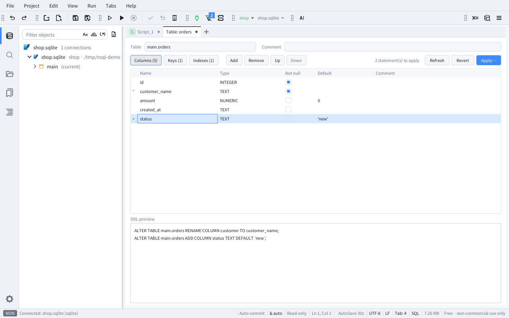

# 테이블 편집기 — 테이블 구조를 그리드에서 바꾸기

[English](Table-Editor) | **한국어**

테이블 편집기는 테이블을 탭으로 열어 **컬럼 · 키/제약 · 인덱스**를 그리드에서 고치는 화면입니다. 고치는 동안 만들어질 DDL이 아래에 실시간으로 보입니다. **적용…**을 누르고 미리보기 창에서 스크립트를 확인하기 전에는 서버로 아무것도 보내지 않습니다.

Oracle · PostgreSQL · SQL Server · MySQL/MariaDB · SQLite에서 동작합니다. 그 밖의 데이터베이스에서는 상태줄에 "테이블 편집기가 이 데이터베이스를 지원하지 않습니다"가 나옵니다.

*테이블 편집기 — 새 컬럼은 `+`, 바뀐 컬럼은 `*` 표식 · DDL 미리보기는 고칠 때마다 따라옵니다*

## 여는 법

| 방법 | 어떻게 |
|---|---|
| 있는 테이블 | 탐색기에서 테이블 우클릭 ▸ **구조 편집…** |
| 새 테이블 | 탐색기에서 **Tables** 폴더 우클릭 ▸ **새 테이블…** |
| 명령 팔레트 | "구조 편집"(`obj.edit_structure` · 기본 키 없음 — 자주 쓰면 키맵에서 지정) |

테이블마다 **테이블: 이름** 제목의 탭이 열립니다(새 테이블 = **새 테이블**). 아직 적용하지 않은 변경이 있으면 탭에 점이 붙습니다.

### 라이선스가 없을 때

테이블 편집기는 라이선스 기능입니다. 라이선스가 없어도 쓸 수 있습니다(무료 · 비상업): Nexa SQL을 시작한 뒤 처음 열 때 탭에 안내 — "테이블 편집기 - 라이선스 기능" — 가 **확인** · **라이선스…** 버튼과 함께 나옵니다. **확인**은 3초 뒤에 켜지고, 누르기 전에는 편집을 받지 않습니다. 안내는 실행마다 한 번만 나옵니다. **라이선스…**는 라이선스 창을 열며, 영리 목적이면 거기서 라이선스를 요청합니다.

## 화면

- **위** — 테이블 이름과 테이블 코멘트.
- **섹션 버튼** — **컬럼** · **키·제약** · **인덱스** · **기록**, 그리고 **추가** · **삭제** · **위로** · **아래로**.
- **오른쪽** — "적용할 문장 N개"(또는 "변경 없음")와 **새로 고침** · **되돌리기** · **적용…**.
- **그리드** — 컬럼 / 제약 / 인덱스 한 줄씩. 줄 앞 표식 = 새 줄 `+` · 바뀐 줄 `*`.
- **경고 줄** — 적용할 수 없는 변경(아래 *제약* 참고).
- **DDL 미리보기** — 적용이 실행할 문장. 고칠 때마다 갱신됩니다. 읽기 전용이며 우클릭으로 복사합니다.

| 섹션 | 칸 |
|---|---|
| 컬럼 | 이름 · 타입 · NOT NULL(체크) · 기본값 · 코멘트 |
| 키·제약 | 이름 · 종류(Primary / Unique / Foreign / Check) · 컬럼 · 참조 / 식 |
| 인덱스 | 이름 · 유니크(체크) · 컬럼 |

## 편집

- 선택한 칸을 다시 클릭하거나, 더블클릭하거나, **Enter**를 누르거나, 바로 글자를 치면 편집이 시작됩니다. **Tab** = 다음 칸 · **Esc** = 취소.
- **타입 목록** — 컬럼 섹션의 **타입** 칸을 편집하는 동안 그 데이터베이스에서 자주 쓰는 타입 목록이 칸 아래(아래에 자리가 없으면 위)에 열립니다. 친 글로 시작하는 타입만 남습니다. **↑ / ↓** 뒤 **Enter** 또는 클릭 = 그 타입을 넣고 편집을 끝냄 · **Esc** = 목록만 닫음. 목록에 없는 타입은 그대로 직접 쳐도 됩니다.
- 체크 칸은 클릭하면 뒤집힙니다. **새** 제약은 종류 칸을 클릭할 때마다 Primary → Unique → Foreign → Check로 돕니다.
- **추가**는 맨 끝에 새 줄을 넣습니다. **Delete**(또는 **삭제**)는 선택한 줄을 지웁니다.
- **되돌리기**는 편집을 모두 버리고 서버에서 읽은 상태로 돌아갑니다. **새로 고침**은 구조를 다시 읽습니다.
- **실행 취소 / 다시 실행** — **Ctrl+Z**는 변경을 하나씩 되돌립니다: 확정한 칸 · 추가하거나 지운 줄 · 뒤집은 체크 · 옮긴 줄 · **되돌리기** 버튼. **Ctrl+Y**(또는 **Ctrl+Shift+Z**)는 되돌린 것을 다시 합니다(macOS = **Cmd+Z** / **Cmd+Shift+Z**). 평소의 `edit.undo` / `edit.redo` 키이며 200단계까지 기억합니다. 칸을 편집하는 동안에는 같은 키가 그 칸 안의 입력을 되돌립니다. 서버에서 구조를 다시 읽으면(새로 고침 · 적용 뒤) 단계는 비워집니다.
- **적용하지 않은 변경이 있는 탭 닫기** — 처음 닫으면 탭이 남고 상태줄에 "적용하지 않은 테이블 변경이 있습니다 - 버리려면 탭을 한 번 더 닫으세요"가 나옵니다. 몇 초 안(`editor.close_confirm_ms` · 기본 3초)에 한 번 더 닫으면 편집을 버리고 닫힙니다. 서버에는 아무것도 가지 않았습니다.
- 새 이름은 데이터베이스의 규칙대로 접힙니다 — 따옴표 없는 이름은 Oracle에서 대문자, PostgreSQL에서 소문자가 됩니다. 입력한 그대로 두려면 `"…"`로 감쌉니다.
- 키·인덱스의 컬럼 칸에는 여러 컬럼을 쉼표로 나눠 적습니다.

## 적용

1. **적용…**을 누릅니다. Nexa SQL이 서버에서 테이블을 한 번 더 읽고 위험 검사(NOT NULL 추가 같은 변경에 대한 행 수 확인)를 돌립니다.
2. 연 뒤에 서버에서 테이블이 바뀌었으면 **아무것도 적용하지 않습니다** — 새로 고친 뒤 다시 편집하세요.
3. 미리보기 창이 스크립트를 머리 주석과 함께 보여 줍니다: 문장 수 · 운영 접속이면 `PRODUCTION` 줄 · `DANGER` / `WARNING` 줄 · 0이 아닌 검사 결과. 이 창에서 스크립트를 고칠 수 있습니다(아래 *미리보기에서 스크립트 고치기*).
4. 그 창의 **적용**을 누릅니다. 문장은 그 서버의 세션에서 **하나씩** 실행됩니다. 먼저 테이블을 백업합니다([탐색기와 필터](Explorers-and-Filters-ko) — 객체 백업).
5. 문장 하나가 실패하면 **그 자리에서 멈춥니다**: "문장 m개 중 n개 적용 뒤 중단". 앞 문장은 적용된 채로 남고(DDL은 자동으로 되돌리지 않습니다), 적용되지 않은 편집은 탭에 그대로 남아 고쳐서 다시 적용할 수 있습니다.
6. 모두 성공하면 구조를 다시 읽고 탭이 깨끗한 상태가 됩니다.

운영 접속에서는 평소의 운영 가드(확인 · 백업)가 그대로 적용됩니다. `tbledit.prod`를 **금지(읽기 전용)**로 두면 운영 접속의 테이블은 보기만 할 수 있습니다.

### 미리보기에서 스크립트 고치기

미리보기 창은 편집할 수 있습니다. 스크립트를 고치면 **적용**은 생성된 문장이 아니라 **창에 보이는 글**을 실행합니다.

- 글을 문장으로 나눠(SQL Server는 `GO` 줄 단위 배치로) 하나씩 실행합니다. 백업과 "첫 오류에서 멈춤"은 같습니다. 주석뿐인 조각은 건너뜁니다.
- 고친 스크립트는 다시 검사하지 않습니다. 편집기에서 실행한 것처럼, 적은 그대로 실행합니다.
- 실행 뒤 구조를 다시 읽습니다. 스크립트가 처리하지 않은 그리드의 편집은 문장이 모두 성공해도 **탭에 그대로 남습니다** — 다시 적용하기 전에 DDL 미리보기를 확인하세요.
- 스크립트가 서버에 더한 것(컬럼 · 키 · 인덱스)은 테이블의 일부로 그리드에 나타납니다.

## 기록

적용은 끝났든 멈췄든 모두 기록됩니다. **기록** 섹션에 이 탭에서 한 적용이 새 것부터 나옵니다.

| 칸 | 내용 |
|---|---|
| 시각 | 적용한 시각 |
| 결과 | "문장 m개 중 n개 적용" 또는 "m개 중 n개 뒤 중단" |
| 스크립트 파일 | 보관한 스크립트 |

줄을 더블클릭하거나 **Enter**를 누르면 그 스크립트가 편집기 탭으로 열립니다.

보낸 문장은 그 테이블의 객체 백업 옆, 설정 폴더의 `backups/objects` 폴더에 `<프로필>_<스키마>.<테이블>_TABLE.<시각>_applied.sql`로 보관됩니다. 머리 주석에 몇 개가 적용됐는지 적혀 있습니다. 멈춘 적용이면 `STOPPED` 줄이 더 있고, 파일의 마지막 문장이 실패한 문장입니다.

탭을 닫으면 목록은 사라지고 파일은 남습니다.

## 제약

- **테이블 재생성은 하지 않습니다.** 테이블을 지우고 다시 만들어야 하는 변경은 적용하지 않고 경고 줄에 적습니다.
  - 컬럼 자리 옮기기: 문장으로 되는 것은 MySQL/MariaDB뿐입니다.
  - SQLite: 컬럼의 타입 · NOT NULL · 기본값 · 제약 변경은 막힙니다(컬럼 추가 · 이름 바꾸기는 됩니다). SQLite에는 코멘트가 없습니다.
- **서버에서 읽은 외래 키와 CHECK**는 이름 바꾸기와 삭제만 됩니다 — 내용을 바꾸려면 지우고 새로 추가하세요. 새 외래 키와 CHECK는 자유롭게 적습니다.
- 기본 키나 유니크 제약을 받치기만 하는 인덱스는 인덱스가 아니라 키·제약 섹션에 나옵니다.
- 이 버전에 없는 것: 뷰 · 시퀀스 · 파티션 · 저장 옵션.

## 설정

| 키 | 기본 | 뜻 |
|---|---|---|
| `tbledit.prod` | 허용 | **허용** = 운영 접속도 운영 가드(확인 · 백업)와 함께 편집 · **금지(읽기 전용)** = 운영 접속에서는 구조 편집을 끔 |
