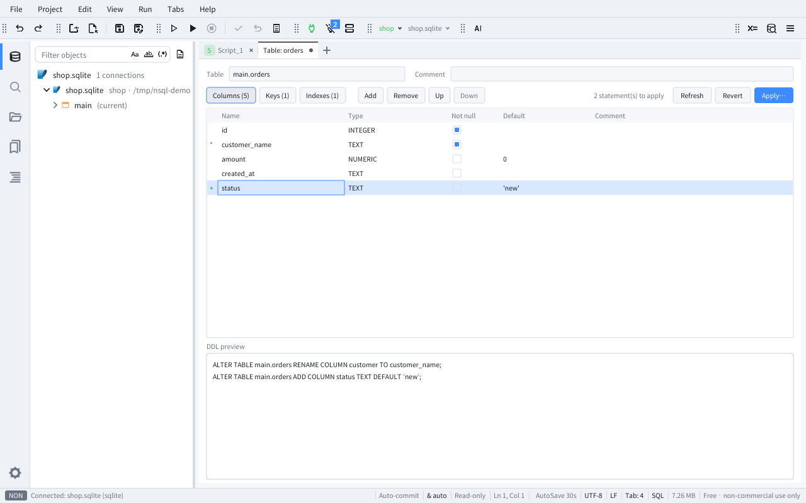

# Table editor — change a table's structure in a grid

**English** | [한국어](Table-Editor-ko)

The table editor opens a table as a tab where you edit its **columns, keys/constraints and indexes** in a grid. While you edit, the generated DDL is shown live at the bottom. Nothing is sent to the server until you press **Apply…** and confirm the script in the preview window.

Works with Oracle · PostgreSQL · SQL Server · MySQL/MariaDB · SQLite. For other databases the status bar says "The table editor does not support this database".

*Table editor — the new column is marked `+`, the changed one `*`; the DDL preview follows every edit*

## Opening it

| Way | How |
|---|---|
| An existing table | Explorer: right-click a table ▸ **Edit Structure…** |
| A new table | Explorer: right-click the **Tables** folder ▸ **New Table…** |
| Command Palette | "Edit Structure" (`obj.edit_structure` · no default key — bind one in the keymap if you use it often) |

Each table opens in its own tab titled **Table: name** (a new one = **New table**). The tab shows a dot while it has changes that are not applied yet.

### Without a license

The table editor is a licensed feature. Without a license it still works (free for non-commercial use): the first time you open it after starting Nexa SQL, the tab shows a notice — "Table editor - licensed feature" — with **OK** and **License…**. **OK** becomes available after 3 seconds; until you press it the editor does not accept edits. The notice is shown once per run. **License…** opens the License window, where you can request a license for commercial use.

## The screen

- **Top** — table name and table comment.
- **Section buttons** — **Columns** · **Keys** · **Indexes**, then **Add** · **Remove** · **Up** · **Down**.
- **Right side** — "N statement(s) to apply" (or "No changes") and **Refresh** · **Revert** · **Apply…**.
- **Grid** — one row per column / constraint / index. The marker in front of a row is `+` for a new row and `*` for a changed one.
- **Warning line** — changes that cannot be applied (see *Limits*).
- **DDL preview** — the statements that Apply would run, updated on every edit. Read-only; right-click to copy.

| Section | Cells |
|---|---|
| Columns | Name · Type · Not null (check) · Default · Comment |
| Keys | Name · Kind (Primary / Unique / Foreign / Check) · Columns · References / expression |
| Indexes | Name · Unique (check) · Columns |

## Editing

- Click a selected cell again, double-click it, press **Enter**, or just start typing to edit. **Tab** moves to the next cell, **Esc** cancels.
- **Type list** — while you edit a **Type** cell in the Columns section, a list of that database's common types opens under the cell (above it when there is no room below). It narrows to the types that start with what you typed. **↑ / ↓** then **Enter**, or a click, puts the type in and finishes the edit; **Esc** closes only the list. You can still type any other type by hand.
- Click a check cell to flip it. For a **new** constraint, clicking Kind cycles Primary → Unique → Foreign → Check.
- **Add** puts a new row at the end. **Delete** (or **Remove**) removes the selected row.
- **Revert** drops all edits and goes back to what was read from the server. **Refresh** reads the structure again.
- **Closing a tab with unapplied changes** — the first close keeps the tab and the status bar says "Unapplied table changes - close the tab again to discard them". Close it again within a few seconds (`editor.close_confirm_ms`, 3 seconds by default) to discard the edits. Nothing was sent to the server.
- New names follow the database's own folding — unquoted names become upper case on Oracle and lower case on PostgreSQL. Wrap a name in `"…"` to keep it exactly as typed.
- Type several columns as a comma-separated list in the Columns cell of a key or an index.

## Applying

1. Press **Apply…**. Nexa SQL reads the table from the server once more and runs the risk checks (row counts for changes such as adding NOT NULL).
2. If the table was changed on the server after you opened it, **nothing is applied** — press Refresh and edit again.
3. The preview window shows the script with a header: the number of statements, a `PRODUCTION` line for production connections, `DANGER` / `WARNING` lines and any check result that is not zero.
4. Press **Apply** in that window. The statements run **one at a time** on that server's session. The table is backed up first (see [Explorers and filters](Explorers-and-Filters) — object backup).
5. If a statement fails, the run **stops there**: "Stopped after n of m statement(s)". The statements before it stay applied (DDL is not rolled back automatically), and the edits that were not applied stay in the tab so you can fix them and apply again.
6. After a successful run the structure is read again and the tab is clean.

On a production connection the usual production guards apply (confirmation and backup). Set `tbledit.prod` to **Deny (read-only)** to open tables on production connections for viewing only.

## Limits

- **No table re-creation.** A change that would need the table to be dropped and re-created is never applied — it is listed on the warning line instead.
  - Moving a column to another position: only MySQL/MariaDB can do it with a statement.
  - SQLite: changing a column's type, NOT NULL, default or constraints is blocked (adding and renaming columns works). SQLite has no comments.
- **Foreign keys and checks read from the server** can be renamed or removed, not edited in place — remove and add a new one instead. New foreign keys and checks are free.
- An index that only backs a primary key or a unique constraint is listed under Keys, not under Indexes.
- Not in this version: views · sequences · partitions · storage options · undo of a single cell (use **Revert**).

## Setting

| Key | Default | Meaning |
|---|---|---|
| `tbledit.prod` | Allow | **Allow** = edit production connections with the production guards (confirmation, backup) · **Deny (read-only)** = structure editing is turned off on production connections |
