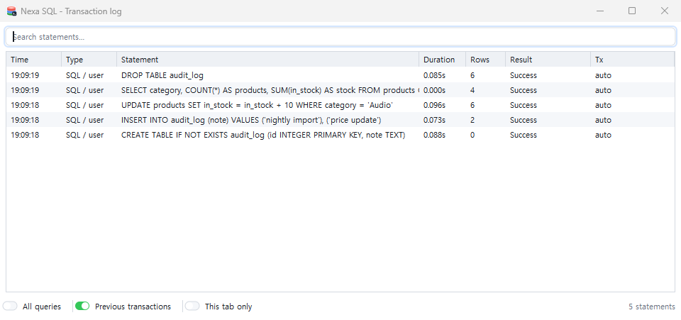

# Transaction log

**English** | [한국어](Transaction-Log-ko)

Open it with **View ▸ Transaction Log** (or the Transaction log button on the toolbar). Each statement you run is added as a line, and each line carries the duration · row count · result · **transaction outcome** (committed · rolled back · pending · auto). Rolled-back statements are shown dimmed with a strikethrough.

*Transaction log window — statement · time taken · row count · result · transaction*

## Down to the bind variables — three layers

For statements from grid editing or with `:name` binds, the "Statement" column of the table alone does not tell you which row they touched. **Click a row** to open the details below the table.

| Layer | What |
|---|---|
| ① Statement as sent (bind form) | Exactly what was sent to the server (bind form · `WHERE "ID" = :P2`) |
| ② Bind variables | A table of name · type · value (OUT variables are marked `(OUT)`) |
| ③ Statement with values substituted | The statement with the values from ② put into the `:name` places of ① (`WHERE "ID" = 'A001'`) |

③ is **a statement built by the app for reading**. The server received the bind form in ①. `:name` inside strings · comments · quoted identifiers and PostgreSQL `::` casts are not replaced, and OUT variables and names not in the list stay as `:name`.

- Clicking the same row again or clicking an empty area closes the details.
- Wheel over the details = scrolls only the details.
- Right-click a row: **Copy statement** · **Open in new editor tab** · **Copy statement with values** · **Open statement with values in new tab**.

For a statement without binds, ② shows "(no bind variables)" and ③ is the same as ①.

## Filtering

- Search box = partial match on the statement.
- **All queries** (off = user statements only · on = including explorer and helper queries) · **Previous transactions** (closed transactions too) · **This tab only**.
- With two or more sessions, a "Session" column appears at the right end.
