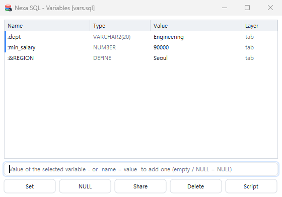

# Variables

**English** | [한국어](Variables-ko)

Runnable examples = `examples/variables/` in the repository (**common.sql** = the whole common language · runs without a server on SQLite · oracle/mssql/pg/sqlite.sql = per dialect · the README has a section ↔ dialect table). Full design = docs/63 (§12 summary of the concepts).

There are two main kinds (+ system, built-in and environment variables).

| Kind | Syntax | Where it is computed |
|---|---|---|
| **Bind variables** | `VARIABLE v NUMBER` · `EXEC :v := value` · `EXEC :v := expression` · `:v` inside a statement | A literal assignment on the client (0 round trips) · an expression on the server · the value is passed as a real bind |
| **Substitution variables** | `DEFINE v = text` · `&v` · `&&v` · `${v[:format]}` · `${env:NAME}` | The client replaces them as text before sending the statement |

## Variables inside variables — when are they expanded

```
DEFINE v1 = 2
DEFINE v2 = &v1 + 5
DEFINE v1 = 5
SELECT &v2 FROM dual;    -- at assignment: 2 + 5 · at use: 5 + 5
```

Setting **Script & variables ▸ Expand variables inside variables** (`vars.expand_at`):

| Value | Meaning |
|---|---|
| `assign` (default · At assignment) | Replaced at `DEFINE` time (same as SQL*Plus · psql · sqlcmd). Changing `v1` later leaves `v2` as it is. |
| `use` (At use (recursive)) | Keeps the original text and expands it recursively **every time it is used** (depth 16 · a circular reference is an error). The `DEFINE` list and the Variables window show `original → current value`. Bind expressions (`EXEC :v2 := :v1 + 5`) are also **recomputed automatically** before a statement that uses `:v2` once `:v1` has changed (1 server round trip · 0 if nothing changed). |

## Variables window (View ▸ Variables)



*Variables window — name · type · value · layer (tab / shared / global)*


*A run using a variable declared with `VAR` as a bind (`:min_salary`)*

Bind variables (tab layer · connection-shared layer) and substitution variables (`&name` · type `DEFINE`) are shown in one table. A value you change applies to the next run. Variables whose name contains a keyword from `vars.secret_names` (default `PASS,PWD,SECRET,TOKEN` · comma-separated · case-insensitive) and variables read with `ACCEPT … HIDE` are treated as secrets and masked as `******` (Variables window · `DEFINE` list · `PRINT` · log). Secret rows in the Variables window have a 👁 button at the right end of the value column: the real value is shown **only while you hold it down**, and it never goes to the log or to saved files (`vars.reveal_secret` · on by default).

**When a value is stale (10-24)** — with expansion *at use* (`vars.expand_at=use`), a variable defined by an expression, such as `:B := :A + 10`, is dimmed in the value column after `:A` changes and shows as `60 ⟳ := :A + 10` (the server is not asked again). If the Variables window is open, they are recomputed together when a run finishes (setting **Script & variables ▸ Recompute stale variables after a run (Variables window open)** `vars.refresh_on_run` · on by default · not after a run that ended with an error). You can also do it yourself with the window's **[↻ Recompute]** button.

## Common uses

- `${v:q}` = wrap as an SQL string literal · `${v:id}` = quote as an identifier · `${env:PATH}` = OS environment variable.
- `SET DEFINE OFF` = treat `&` as plain text.
- **Why `'R&D'` goes through as-is, without an input prompt, in SQL Server · PostgreSQL · MySQL · SQLite tabs** (10-10): in those DBMSs `&` is a common character in strings and in bitwise operations (`a & b`). So in non-Oracle tabs only names you **defined** with `DEFINE v = …` · `:setvar v …` are replaced as `&v`, and an undefined `&x` is left alone. Oracle tabs ask for undefined names, like SQL*Plus (to keep `&name` inside string literals as text, turn off the setting `script.define_in_strings` · on by default). To be asked in every DBMS, put `SET DEFINE ON` on the first line of the script or change the setting `script.define = on` ([Settings](Settings.md)).
- Script arguments `&1 &2 …` = `nsql run file.sql arg1 arg2`.

> **The same variable in another procedure** (10-08): if you pass a variable that was created without a declaration (for example `:RET` created by `EXEC SP_TEST1(:RET, 'SSS')`) to an OUT position of another procedure (`EXEC SP_TEST2(:RET, 'SSS')` · REF CURSOR OUT), it automatically takes that procedure's argument type. If you do not want its type to change, declare it with a type, such as `VAR RET NUMBER`.

> **Cursor result tab names** (10-08): REF CURSOR variables (`:R1` · `:R2` · a procedure's OUT cursors) and multiple result sets from one statement open as numbered tabs **Result 1 · Result 2 …**. Running again in the same tab reuses the same numbers. To see the variable name (`R1`) as the tab name, set `grid.result_tab_title` to `table`.

## Removing variables (10-07)

| Command | What it removes |
|---|---|
| `VAR name DROP` | That variable in this tab |
| `VAR name DROP GLOBAL` | That variable in this tab and in global |
| `VAR CLEAR` | All variables in this tab (global ones stay) |
| `VAR CLEAR GLOBAL` | This tab + all global variables |
| `VAR CLEAR ALL` | This tab + connection-shared + all global variables |

If the same name exists both in the tab and in global, **the tab value is used**; remove the tab value and the global value is used again. **A value goes where the variable lives**: after `VAR A GLOBAL`, `EXEC :A := 10` (or `SELECT … INTO :A`) sets the global A to 10. To use a different value only in this tab, first declare it in this tab with `VAR A` (or `VAR A NUMBER`) — after that `:A := 5` goes only into this tab and the global stays 10. `VAR A DROP` brings back the global 10.

- Declare with a value: `VAR A NUMBER = 10 GLOBAL` · `VAR A GLOBAL = 10` · connection-shared `VAR x VARCHAR2(30) SHARE`.
- `SHOW VARIABLES` shows every layer for the same name and marks the row in use with `Active` `*`. In the Variables window, hidden rows are dimmed.
- A variable created without a type changes type with its value (number → text, etc.). Declaring it with a type fixes the type.
- A wrong type (`VARCHAR2(50) GLOBAAL`, etc.) is an error and the variable is not created.

## Global variables in the CLI (10-07)

`nsql run` (CLI) does not use the global variable file (`vars/global.sql`) by default — so that batch scripts are not affected by values you used in the GUI. To let the CLI carry global variables too, turn on the setting `vars.cli_global` (`nsql config set vars.cli_global on`).

## Built-in variables — like `${workspaceFolder}` (setting `vars.intrinsic` · on by default)

Values the app knows are available in scripts and in path settings (`log.file` · `oracle.client_dir` · `oracle.tns_admin`) with the same names and syntax as VS Code. Lookup order = **`DEFINE` variable → built-in variable → text as it is**; for `${env:NAME}` it is **built-in alias (`NSQL_*`) → OS environment variable**.

| Name | Value | Alias (also via `${env:…}`) |
|---|---|---|
| `workspaceFolder` · `workspaceFolderBasename` · `workspaceFile` · `workspaceName` | Project file folder · its name · the project file · the project name (none without a project) | `NSQL_PROJECT_DIR` · `NSQL_PROJECT_FILE` · `NSQL_PROJECT_NAME` |
| `workspaceFolder:name` | A registered folder (by its last folder name) | — |
| `file` · `fileDirname` · `fileBasename` · `fileBasenameNoExtension` · `fileExtname` · `relativeFile` · `relativeFileDirname` · `fileWorkspaceFolder` | The active tab's file (for an unsaved tab `(unsaved tab)`, translated to the UI language · CLI = the script file) | `NSQL_FILE` · `NSQL_FILE_DIR` · `NSQL_FILE_NAME` |
| `lineNumber` · `columnNumber` | The caret (1-based) | — |
| `userHome` · `nsqlHome` · `cwd` · `execPath` · `pathSeparator` (=`/`) · `os` | Home · app settings folder · current folder · executable · OS separator · `windows`/`macos`/`linux` | `NSQL_USER_HOME` · `NSQL_HOME` · `NSQL_CWD` · `NSQL_EXEC` · `NSQL_OS` |
| `profile` · `dialect` | Name of the active connection profile · dialect | `NSQL_PROFILE` · `NSQL_DIALECT` |
| `config:key` | A setting value (e.g. `${config:db.fetch_size}`) | — |

Format suffixes work too: `${fileBasename:q}` = `'a.sql'`. Unknown names and missing context are left as text (no prompt). The file family (`${file…}` · `relativeFile…` · `NSQL_FILE*`), however, is not left as text in an unsaved tab but becomes `(unsaved tab)` (translated in the Korean UI). The CLI (`nsql run`) has no project, so there is no `${workspaceFolder}`, and `${file}` is the script path.

```
SPOOL ${workspaceFolder}/out/${fileBasenameNoExtension}.log
SELECT '${profile}' AS who, '${env:NSQL_PROJECT_DIR}' AS here FROM dual;
```
